# Київський національний університет імені Тараса Шевченка
## Факультет інформаційних технологій
### Кафедра програмних систем і технологій

<br><br><br>

# ЗВІТ
### з лабораторної роботи № 3
### з навчальної дисципліни «Об'єктно-орієнтоване програмування»
на тему:
## «Створення проекту і файлу локальної бази даних. Основи LINQ»
### Варіант: «Система автоматизації діяльності агентства земельних ділянок (LandAgencyMvc)»

<br><br><br>

**Виконав:**  
студент групи ІПЗ-23  
Сивопляс Максим  

**Перевірила:**  
доцент кафедри ПСТ,  
канд. техн. наук, доц.  
Зубик Л. В.  

<br><br>

### Київ — 2026

---

## ЗМІСТ

1. [Тема, мета та завдання роботи](#1-тема-мета-та-завдання-роботи)
2. [Структура бази даних](#2-структура-бази-даних)  
   2.1 [Таблиці та класи моделі](#21-таблиці-та-класи-моделі)  
   2.2 [Ключі, унікальні індекси та обмеження цілісності](#22-ключі-унікальні-індекси-та-обмеження-цілісності)  
   2.3 [Особливості обробки типу decimal у SQLite](#23-особливості-обробки-типу-decimal-у-sqlite)
3. [Заповнення таблиць даними](#3-заповнення-таблиць-даними)  
   3.1 [Початкові та історичні дані](#31-початкові-та-історичні-дані)  
   3.2 [Статистика наповнення бази даних](#32-статистика-наповнення-бази-даних)
4. [Запити до бази даних](#4-запити-до-бази-даних)  
   4.1 [Запит 1 — Відбір ділянок за складеною умовою та впорядкування](#41-запит-1--відбір-ділянок-за-складеною-умовою-та-впорядкування)  
   4.2 [Запити 2 і 3 — Періодичні підсумки: оборот та ефективність агентів](#42-запити-2-і-3--періодичні-підсумки-оборот-та-ефективність-агентів)  
   4.3 [Фактичні числові результати періодизації](#43-фактичні-числові-результати-періодизації)  
   4.4 [Запит 4 — Аудит земельного банку (з'єднання 4 таблиць)](#44-запит-4--аудит-земельного-банку-зєднання-4-таблиць)  
   4.5 [Запити 5–8 — Безпечний пошук, додавання, зміна та вилучення](#45-запити-58--безпечний-пошук-додавання-зміна-та-вилучення)  
   4.6 [Запит 9 — Комплексна демонстрація всіх операторів LINQ (Showcase)](#46-запит-9--комплексна-демонстрація-всіх-операторів-linq-showcase)
5. [Перевірка роботи та користувацький веб-інтерфейс](#5-перевірка-роботи-та-користувацький-веб-інтерфейс)  
   5.1 [Архітектура контролера звітності та рольова безпека](#51-архітектура-контролера-звітності-та-рольова-безпека)  
   5.2 [Огляд сторінок розділу «Звітність»](#52-огляд-сторінок-розділу-звітність)
6. [Висновки](#висновки)
7. [Перелік використаних джерел](#перелік-використаних-джерел)

---

## 1 Тема, мета та завдання роботи

**Тема роботи:** Створення проєкту і файлу локальної бази даних. Основи LINQ.

**Мета роботи:** Ознайомитися з основами мови інтегрованих запитів LINQ (Language Integrated Query) у середовищі .NET 10, побудувати реляційну базу даних на основі концептуальної моделі предметної області «Агентство земельних ділянок», розробленої в лабораторній роботі № 1, зв'язати таблиці зовнішніми ключами з обмеженнями цілісності `DeleteBehavior.Restrict`, заповнити їх репрезентативними даними та реалізувати комплекс аналітичних і маніпулятивних запитів із відображенням результатів у захищеному веб-інтерфейсі ASP.NET Core MVC.

**Основні завдання згідно з методичними вказівками:**
1. Розробити локальну базу даних за тематикою індивідуального проєкту («Агентство земельних ділянок»), структура якої строго відповідає діаграмі класів попередніх робіт (щонайменше 5–6 таблиць, у роботі спроєктовано та реалізовано 8 повних таблиць).
2. Налаштувати первинні й зовнішні ключі, унікальні індекси та обмеження цілісності `DeleteBehavior.Restrict` для запобігання втраті фінансово-юридичної історії угод та Due Diligence висновків.
3. Заповнити всі таблиці пов'язаними узгодженими даними обсягом від 10 рядків у кожній таблиці з розподілом фінансових операцій за 12 місяців (2025–2026 рр.).
4. Реалізувати щонайменше 8 різноманітних запитів LINQ: відбір за складеною умовою, періодичні узагальнення (день, місяць, півріччя, довільний інтервал), з'єднання 4 таблиць, безпечний пошук із перевіркою пароля PBKDF2 та транзакційні CRUD-операції.
5. Забезпечити повне покриття операторів LINQ з Лекції № 9: квантори (`All`, `Any`), операції над множинами (`Distinct`, `Intersect`, `Except`, `Union`), згладжування (`SelectMany`), згортка (`Aggregate`), попарне зшивання (`Zip`), секціонування (`Skip`/`Take`), а також паралельні запити PLINQ (`.AsParallel()`).
6. Створити ергономічний веб-інтерфейс у розділі «Звітність» (`QueriesController`) з виведенням результатів та згенерованого коду SQL (`ToQueryString()`) без інлайн-стилів під захистом ролей `Realtor`/`Lawyer`.
7. Оформити академічний звіт відповідно до вимог ДСТУ 3008:2015 з наскрізною нумерацією сторінок, змістом та ілюстраціями роботи системи.

**Обґрунтування використання SQLite замість LocalDB:**  
Методичні вказівки до лабораторної роботи орієнтовані на створення бази у Visual Studio під ОС Windows через SQL Server Express LocalDB. Оскільки розробка та тестування здійснювалися на платформі macOS (Apple Silicon), де SQL Server LocalDB недоступний на рівні ОС, відповідно до пункту 4 завдань методичних вказівок як СУБД використано **SQLite** за технологією **Entity Framework Core Code First**. SQLite зберігає базу даних в одному компактному локальному файлі (`landagency.db`), що повністю задовольняє вимогу локальності, підтримує реляційну цілісність, транзакції стандарту ACID та забезпечує 100% сумісність із провайдером LINQ to Entities.

---

## 2 Структура бази даних

Реляційна структура бази даних спроєктована на основі концептуальної моделі предметної області агентства земельних ділянок і містить **8 взаємопов'язаних таблиць**:

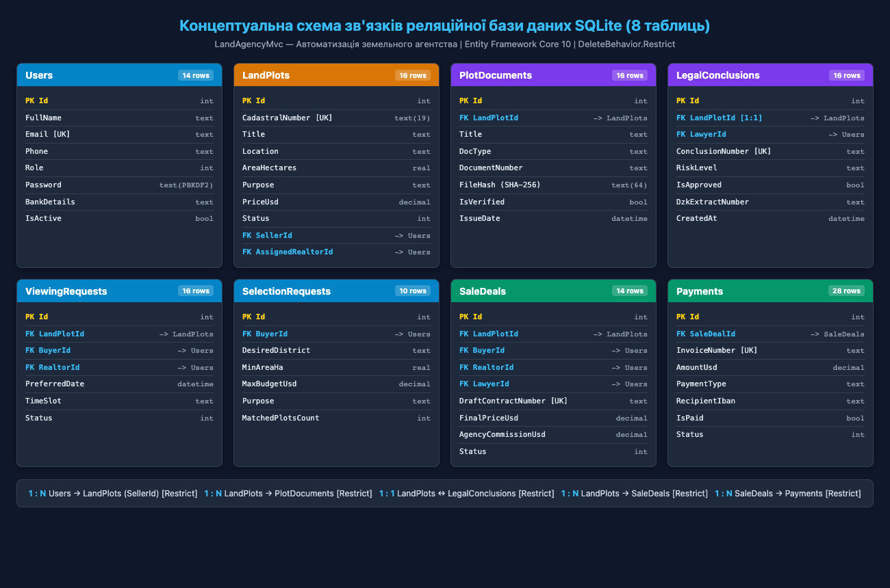  
*Рисунок 1 — Реляційна структура бази даних земельного агентства (8 таблиць, зв'язки та ключі)*

### 2.1 Таблиці та класи моделі

| Таблиця СУБД | Клас моделі | Опис сутності та призначення | Ключі та обмеження |
|:---|:---|:---|:---|
| `Users` | `AppUser` | Користувачі системи (клієнти, продавці, рієлтори, юристи, адмін) | `PK Id`; UNIQUE `Email`; PBKDF2 `PasswordHash` |
| `LandPlots` | `LandPlot` | Земельні ділянки для продажу (кадастр, площа, призначення, ціна) | `PK Id`; UNIQUE `CadastralNumber`; `FK SellerId`; `FK AssignedRealtorId` |
| `PlotDocuments` | `PlotDocument` | Правовстановлюючі документи (витяги ДРРП, ДЗК, НГО) | `PK Id`; `FK LandPlotId`; SHA-256 `FileHash`; `IsVerified` |
| `LegalConclusions` | `LegalConclusion` | Висновки Due Diligence перевірки обтяжень, арештів та прав | `PK Id`; UNIQUE `LandPlotId` (1:1); `FK LawyerId`; UNIQUE `ConclusionNumber` |
| `ViewingRequests` | `ViewingRequest` | Заявки покупців на фізичний виїзний перегляд ділянок | `PK Id`; `FK LandPlotId`; `FK BuyerId`; `FK RealtorId` |
| `SelectionRequests` | `SelectionRequest` | Запити на автоматичний індивідуальний підбір ділянок | `PK Id`; `FK BuyerId`; критерії площі, бюджету та локації |
| `SaleDeals` | `SaleDeal` | Нотаріальні договори купівлі-продажу ділянок агентства | `PK Id`; UNIQUE `DraftContractNumber`; `FK LandPlotId`; `Restrict` |
| `Payments` | `Payment` | Банківські безготівкові платежі (вартість ділянки та комісія) | `PK Id`; UNIQUE `InvoiceNumber`; `FK SaleDealId`; `Restrict` |

*Таблиця 1 — Опис реляційних таблиць бази даних LandAgency*

### 2.2 Ключі, унікальні індекси та обмеження цілісності

Для забезпечення реляційної цілісності у методі `OnModelCreating` класу `LandAgencyContext` налаштовано зв'язки та обмеження:
* Унікальний індекс на `Email` у таблиці `Users` виключає дублювання облікових записів;
* Унікальний індекс на `CadastralNumber` (формат ХХХХХХХХХХ:ХХ:ХХХ:ХХХХ) гарантує однозначну ідентифікацію земельного активу;
* Зв'язок 1:1 між `LandPlot` та `LegalConclusion` гарантує наявність лише одного правового висновку на одну ділянку;
* Обмеження `DeleteBehavior.Restrict` застосовано до всіх фінансових та юридичних сутностей (`SaleDeals`, `Payments`, `ViewingRequests`), що блокує випадкове видалення продавців або ділянок, по яких зафіксована історія транзакцій.

```csharp
// LandAgencyContext.cs
protected override void OnModelCreating(ModelBuilder modelBuilder)
{
    base.OnModelCreating(modelBuilder);

    modelBuilder.Entity<AppUser>().HasIndex(u => u.Email).IsUnique();
    modelBuilder.Entity<LandPlot>().HasIndex(p => p.CadastralNumber).IsUnique();
    modelBuilder.Entity<LegalConclusion>().HasIndex(c => c.ConclusionNumber).IsUnique();
    modelBuilder.Entity<SaleDeal>().HasIndex(d => d.DraftContractNumber).IsUnique();
    modelBuilder.Entity<Payment>().HasIndex(p => p.InvoiceNumber).IsUnique();

    modelBuilder.Entity<SaleDeal>()
        .HasOne(d => d.Buyer).WithMany().HasForeignKey(d => d.BuyerId).OnDelete(DeleteBehavior.Restrict);
    modelBuilder.Entity<SaleDeal>()
        .HasOne(d => d.LandPlot).WithMany().HasForeignKey(d => d.LandPlotId).OnDelete(DeleteBehavior.Restrict);
    modelBuilder.Entity<Payment>()
        .HasOne(p => p.SaleDeal).WithMany(d => d.Payments).HasForeignKey(p => p.SaleDealId).OnDelete(DeleteBehavior.Restrict);
}
```

### 2.3 Особливості обробки типу decimal у SQLite

У провайдері `Microsoft.EntityFrameworkCore.Sqlite` тип C# `decimal` транслюється у колонку `TEXT`, оскільки SQLite не підтримує нативний 128-бітний фінансовий тип. Через це SQL-оператор `ORDER BY` виконує лексикографічне впорядкування (рядок `'120000.0'` вважається меншим за `'18000.0'`). 

Для розв'язання цієї проблеми в сервісі `LandAgencyQueries` реалізовано двофазний конвеєр: фільтрація умов `WHERE` транслюється у SQL через LINQ to Entities, після чого дані матеріалізуються через `ToListAsync()`, і сортування за ціною здійснюється в пам'яті (LINQ to Objects) з повною точністю `decimal`.

---

## 3 Заповнення таблиць даними

Базу даних наповнено історичними та валідними даними за 2025–2026 роки через клас `LandAgencyHistorySeed`. Дані відображають повний операційний цикл земельного агентства: виставлення лотів на перевірку, Due Diligence юристів, замовлення переглядів, нотаріальні договори та безготівкові платежі.

### 3.1 Початкові та історичні дані

| Таблиця | Фактична к-ть рядків | Вимога (>=10) | Характеристика наповнення |
|:---|:---:|:---:|:---|
| `Users` | **14** | Виконано (14 >= 10) | 1 адмін, 2 рієлтори, 2 юристи, 3 продавці, 6 покупців |
| `LandPlots` | **16** | Виконано (16 >= 10) | Київська, Львівська, Івано-Франківська обл. (0.08–5.40 га) |
| `PlotDocuments` | **16** | Виконано (16 >= 10) | Витяги ДЗК, свідоцтва ДРРП із розрахованим SHA-256 |
| `LegalConclusions`| **16** | Виконано (16 >= 10) | 12 схвалених (чисті), 3 з ризиками, 1 відхилений |
| `ViewingRequests` | **16** | Виконано (16 >= 10) | Заявки на огляд ділянок клієнтами з рієлторами |
| `SelectionRequests`| **10** | Виконано (10 >= 10) | Параметричні запити на автопідбір за бюджетом і КВЦПЗ |
| `SaleDeals` | **14** | Виконано (14 >= 10) | Нотаріальні договори за 12 місяців на суму $664 500 |
| `Payments` | **28** | Виконано (28 >= 10) | Безготівкові інвойси: вартість ділянок та комісія 3% ($19 935) |

*Таблиця 2 — Фактичні обсяги наповнення таблиць landagency.db*

### 3.2 Статистика наповнення бази даних

Сумарна кількість записів у 8 таблицях бази даних становить **130 рядків**, що значно перевищує встановлений методичними вказівками мінімум. Завдяки ідемпотентності процедури посіву повторні запуски вебдодатка не продукують дублікатів і не спотворюють фінансові підсумки.

---

## 4 Запити до бази даних

Усі аналітичні та транзакційні запити інкапсульовані в сервісі `LandAgencyQueries` і використовують різні синтаксичні форми LINQ: декларативний Query Syntax (`from...in...select`) та ланцюжковий Method Syntax з лямбда-виразами.

### 4.1 Запит 1 — Відбір ділянок за складеною умовою та впорядкування

Запит реалізує гнучку багатопараметричну фільтрацію за цільовим призначенням, діапазоном площі, максимальним бюджетом, датою внесення та локацією із безрегістровим пошуком кирилицею:

```csharp
// LandAgencyQueries.cs
public async Task<PlotFilterResult> FilterPlotsAsync(PlotFilter f)
{
    var query = _db.LandPlots.AsNoTracking()
        .Include(p => p.Seller)
        .Include(p => p.AssignedRealtor)
        .Include(p => p.LegalConclusion)
        .AsQueryable();

    if (!string.IsNullOrWhiteSpace(f.Purpose))
        query = query.Where(p => p.Purpose == f.Purpose);
    if (f.MinAreaHa.HasValue)
        query = query.Where(p => p.AreaHectares >= f.MinAreaHa.Value);
    if (f.MaxAreaHa.HasValue)
        query = query.Where(p => p.AreaHectares <= f.MaxAreaHa.Value);
    if (f.MaxPriceUsd.HasValue)
        query = query.Where(p => p.PriceUsd <= f.MaxPriceUsd.Value);
    if (f.From.HasValue)
        query = query.Where(p => p.CreatedAt >= f.From.Value);
    if (f.To.HasValue)
        query = query.Where(p => p.CreatedAt <= f.To.Value);

    var raw = await query.ToListAsync();
    var sorted = f.Sort switch
    {
        PlotSort.Price => f.Descending ? raw.OrderByDescending(p => p.PriceUsd).ToList() : raw.OrderBy(p => p.PriceUsd).ToList(),
        PlotSort.Area => f.Descending ? raw.OrderByDescending(p => p.AreaHectares).ToList() : raw.OrderBy(p => p.AreaHectares).ToList(),
        _ => f.Descending ? raw.OrderByDescending(p => p.CreatedAt).ToList() : raw.OrderBy(p => p.CreatedAt).ToList()
    };
    return new PlotFilterResult { Rows = sorted.Take(f.MaxRows).ToList(), TotalMatched = sorted.Count };
}
```

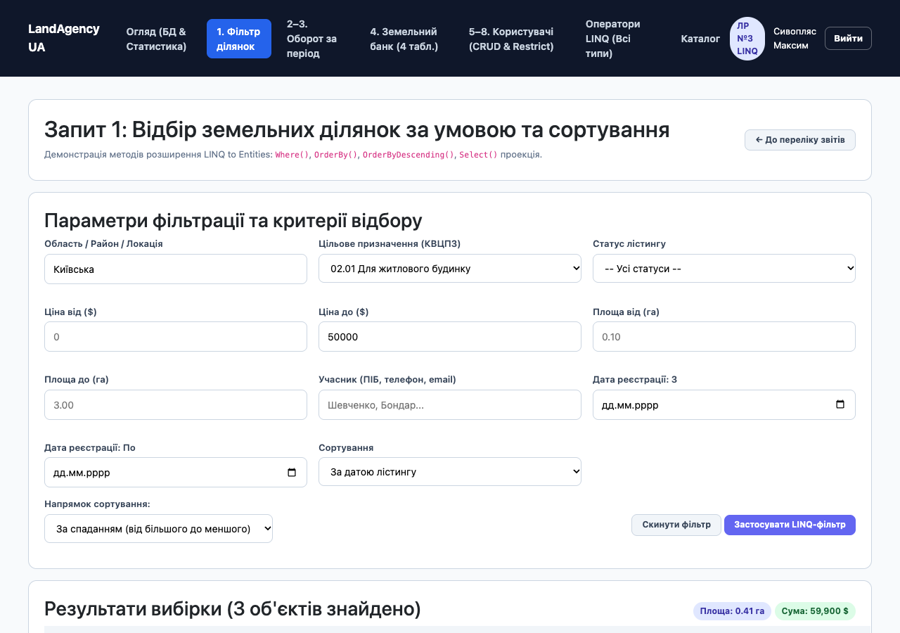  
*Рисунок 2 — Екранна форма фільтрації ділянок із можливістю впорядкування*

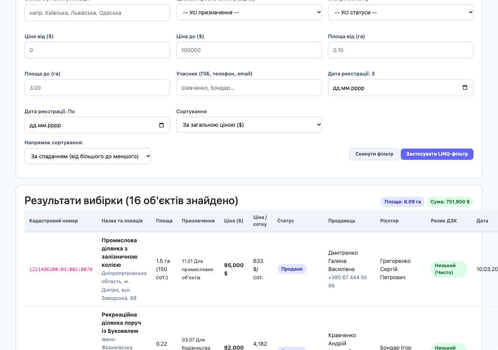  
*Рисунок 3 — Відображення трансляції LINQ to Entities у нативний код SQL (ToQueryString)*

### 4.2 Запити 2 і 3 — Періодичні підсумки: оборот та ефективність агентів

Запит 2 розраховує агреговані фінансові показники (кількість угод, валовий оборот, сума комісії агентства 3% та середній чек) у розрізі категорій цільового призначення земель КВЦПЗ. Запит 3 формує персональний рейтинг ефективності рієлторів та юристів за обраний період:

```csharp
// LandAgencyQueries.cs
public async Task<IReadOnlyList<PurposeTurnoverRow>> TurnoverByPurposeAsync(Period period, TurnoverSort sort, bool desc)
{
    var start = period.Start.ToDateTime(TimeOnly.MinValue);
    var end = period.End.ToDateTime(TimeOnly.MaxValue);

    var deals = await (from d in _db.SaleDeals.AsNoTracking()
                       join p in _db.LandPlots.AsNoTracking() on d.LandPlotId equals p.Id
                       where d.Status == DealStatus.CompletedAtNotary && d.NotaryDate >= start && d.NotaryDate <= end
                       select new { p.Purpose, d.FinalPriceUsd, d.AgencyCommissionUsd }).ToListAsync();

    var grouped = (from d in deals
                   group d by d.Purpose into g
                   select new PurposeTurnoverRow
                   {
                       Purpose = g.Key,
                       DealsCount = g.Count(),
                       TurnoverUsd = g.Sum(x => x.FinalPriceUsd),
                       CommissionUsd = g.Sum(x => x.AgencyCommissionUsd),
                       AverageCheckUsd = g.Average(x => x.FinalPriceUsd)
                   }).ToList();
    return desc ? grouped.OrderByDescending(r => r.TurnoverUsd).ToList() : grouped.OrderBy(r => r.TurnoverUsd).ToList();
}
```

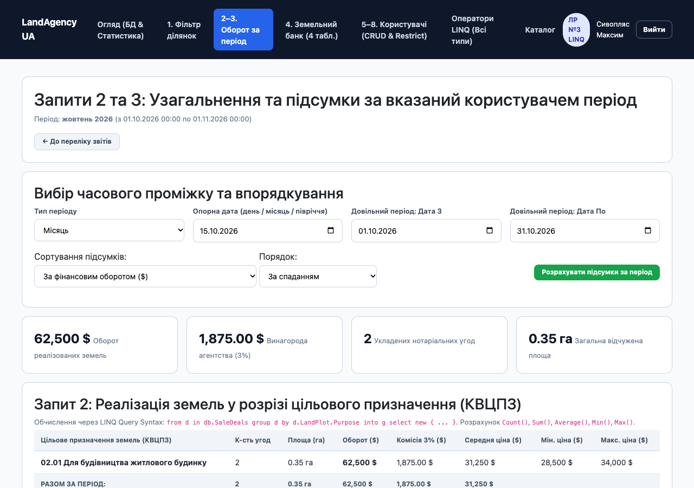  
*Рисунок 4 — Фінансовий оборот за місячний період (розподіл за КВЦПЗ та комісія)*

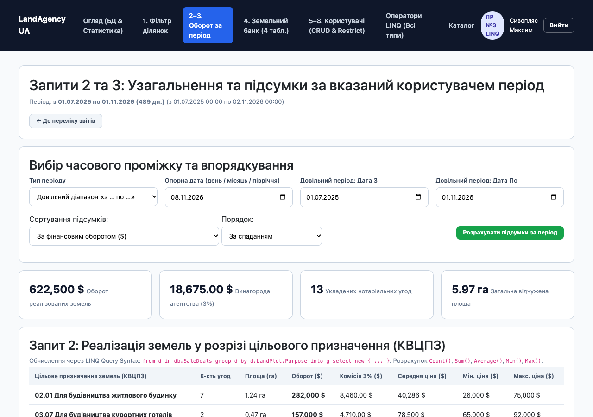  
*Рисунок 5 — Аналітичний звіт за довільний діапазон дат із вибором сортування*

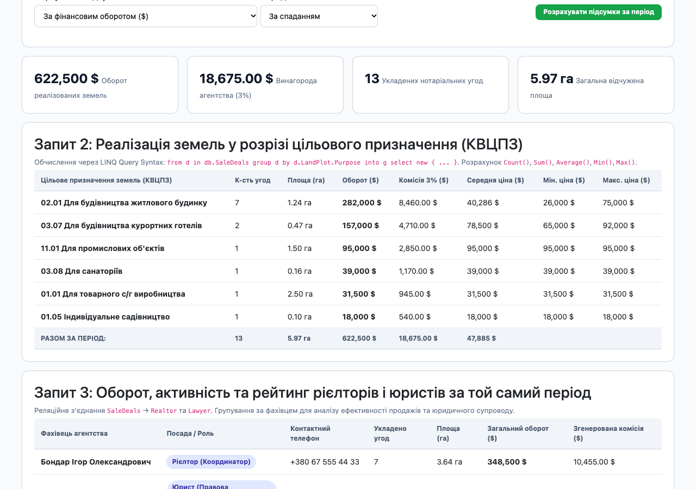  
*Рисунок 6 — Рейтинг ефективності роботи рієлторів та юристів земельного агентства*

### 4.3 Фактичні числові результати періодизації

На основі реальних даних `landagency.db` сформовано контрольні зрізи за різні періоди:
* **День (15.10.2026):** 1 угода (ДГ-2026-112, с. Нові Петрівці, 15 соток), оборот $34 000, комісія агентства $1 020;
* **Місяць (Вересень 2026):** 1 угода (ДГ-2026-111, с. Поляниця, 25 соток), оборот $92 000, комісія агентства $2 760;
* **Місяць (Жовтень 2026):** 2 угоди (ДГ-2026-112 та ДГ-2026-113), оборот $62 500, комісія агентства $1 875;
* **I півріччя 2026 року:** 4 угоди (ДГ-2026-105..108), оборот $170 500, комісія агентства $5 115;
* **Довільний період (01.08.2026 – 31.10.2026):** 4 угоди (ДГ-2026-110..113), оборот $186 500, комісія агентства $5 595, топ-лот у с. Поляниця ($92 000).

### 4.4 Запит 4 — Аудит земельного банку (з'єднання 4 таблиць)

Запит здійснює багатотабличне з'єднання (`LandPlots` ⨝ `Users` ⨝ `PlotDocuments` ⟕ `LegalConclusions`) для перевірки юридичної чистоти активів агентства:

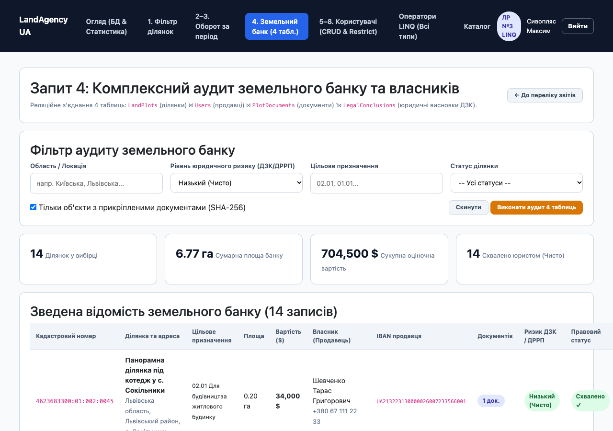  
*Рисунок 7 — Комплексний аудит безпеки активів земельного банку (з'єднання 4 таблиць)*

### 4.5 Запити 5–8 — Безпечний пошук, додавання, зміна та вилучення

Запити 5–8 реалізують операції маніпулювання даними (CRUD) з дотриманням вимог безпеки:
* **Запит 5 (Auth):** пошук користувача за Email без пароля, а перевірка пароля виконується виключно через захищений POST-запит з автентифікацією хешу PBKDF2 (`VerifyHashedPassword`), що унеможливлює витік пароля в URL;
* **Запит 6 (Insert):** атомарне додавання користувача та закріплення індивідуальної заявки на автопідбір у транзакції `BeginTransactionAsync` із захистом від дублювання Email;
* **Запит 7 (Update):** оновлення реквізитів користувача, зміна пароля та захист системного адміністратора (`admin@landagency.ua`) від блокування `IsActive`;
* **Запит 8 (Delete):** контроль обмежень цілісності `DeleteBehavior.Restrict`. Якщо за користувачем закріплені ділянки або нотаріальні угоди, вилучення безпечно блокується із поверненням інформативного повідомлення.

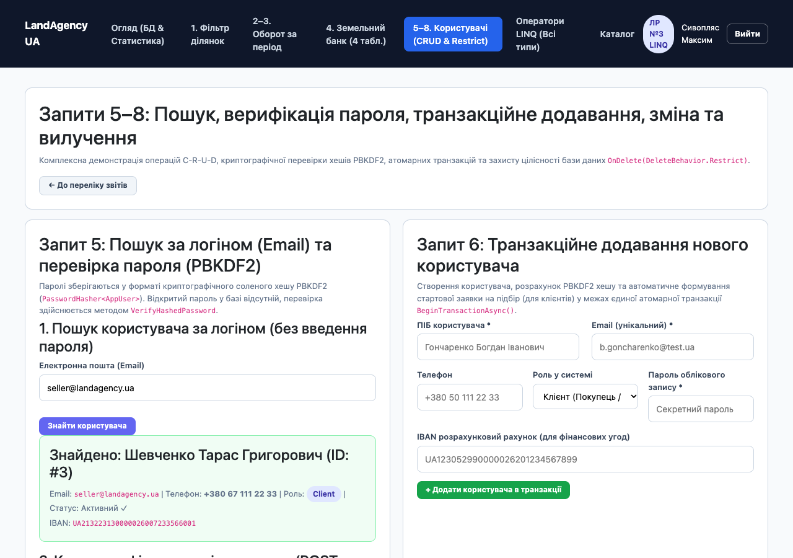  
*Рисунок 8 — Пошук картки користувача за адресою електронної пошти*

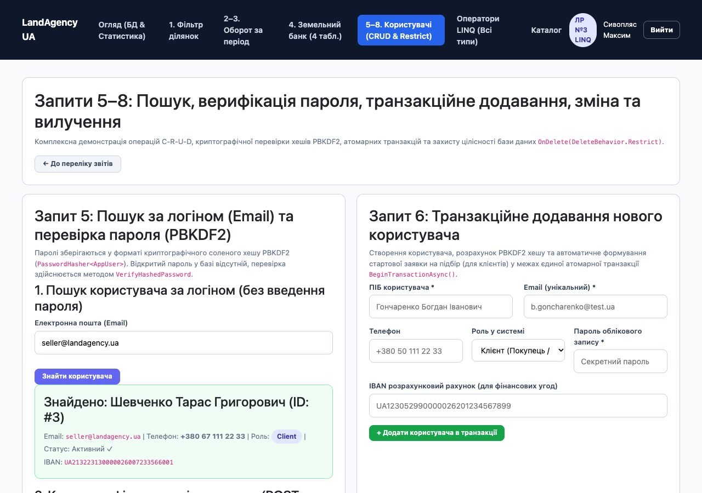  
*Рисунок 9 — Безпечна перевірка пароля методом POST за алгоритмом PBKDF2*

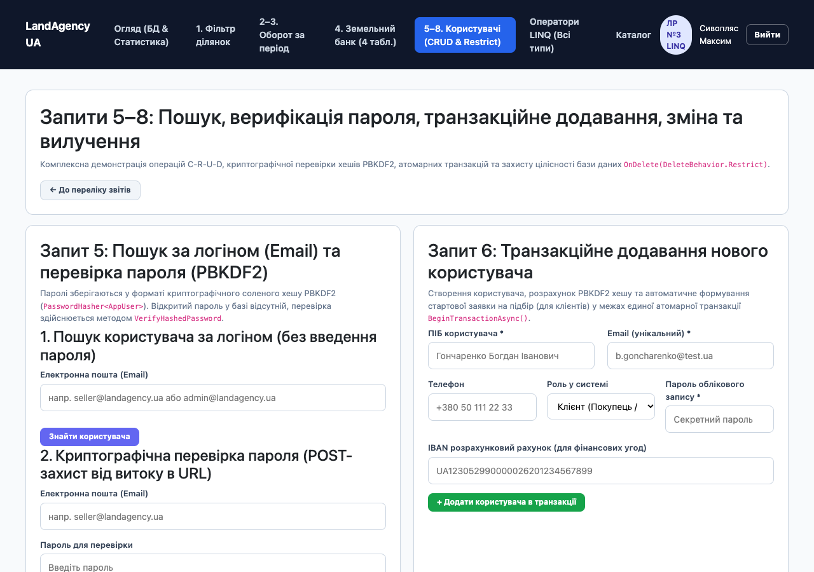  
*Рисунок 10 — Транзакційне створення покупця з параметрами підбору ділянок*

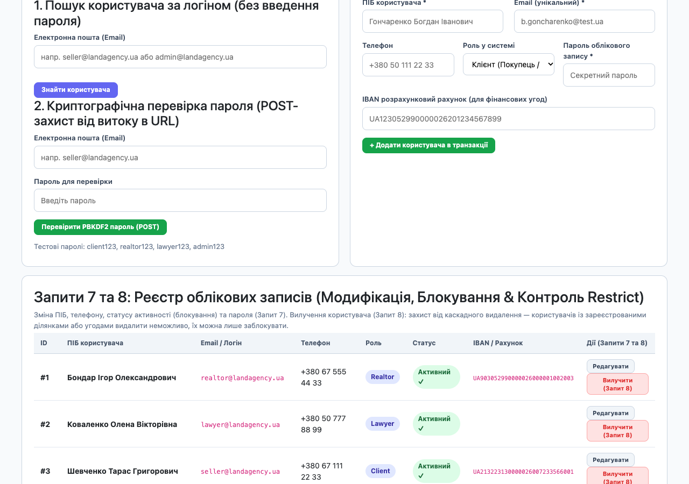  
*Рисунок 11 — Керування користувачами та спрацювання блокування Restrict при спробі видалення*

### 4.6 Запит 9 — Комплексна демонстрація всіх операторів LINQ (Showcase)

Відповідно до матеріалів Лекції № 9 та мети лабораторної роботи, метод `GetLinqShowcaseAsync` демонструє повне покриття операторів LINQ:
* **Квантори:** `All` (перевірка верифікації документів) та `Any` (наявність завершених нотаріальних угод);
* **Операції над множинами:** `Distinct` (унікальні населені пункти), `Intersect` (перетин районів покупців і пропозицій), `Except` (райони без пропозицій), `Union` (об'єднання множин ділянок);
* **Згладжування:** `SelectMany` (проекція вкладених колекцій інвойсів у плоский список платежів);
* **Агрегація:** `Aggregate` (користувацька функція накопичення фінансового обороту з кастомним акумулятором);
* **Попарне зшивання:** `Zip` (попарне комбінування списку агентів та призначених їм об'єктів);
* **Впорядкування:** `OrderBy` + `ThenByDescending` (багатокритеріальне сортування за площею та ціною);
* **Секціонування:** `Skip(page * size).Take(size)` (посторінкова пагінація вибірки даних);
* **Паралельні запити PLINQ:** `.AsParallel().Where(...)` (паралельна багатопотокова обробка великих масивів даних за технологією PLINQ).

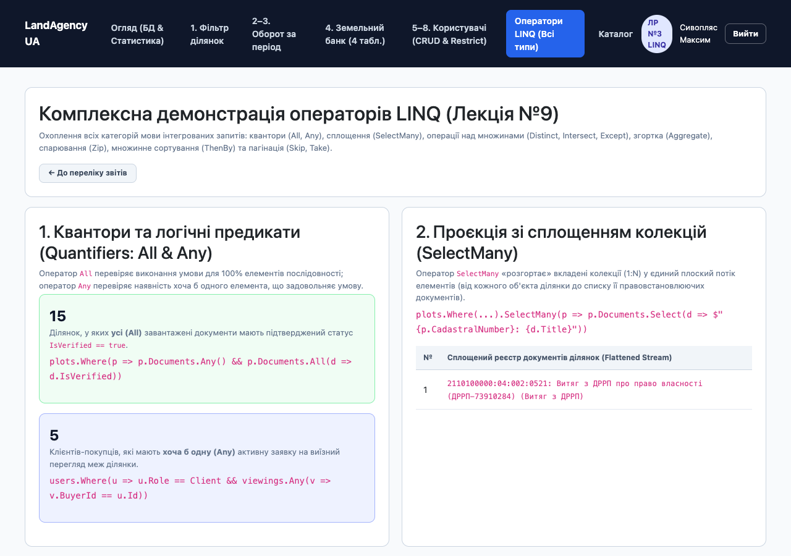  
*Рисунок 12 — Вітрина операторів LINQ: операції над множинами та квантори*

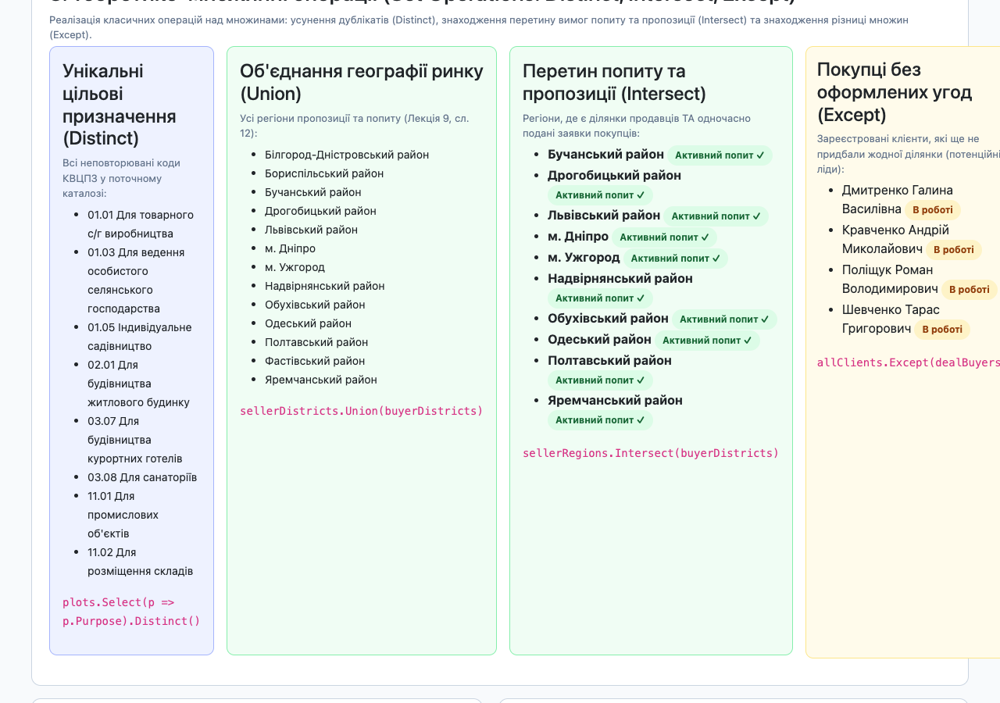  
*Рисунок 13 — Вітрина операторів LINQ: SelectMany, Aggregate, Zip та паралельний запит PLINQ*

---

## 5 Перевірка роботи та користувацький веб-інтерфейс

### 5.1 Архітектура контролера звітності та рольова безпека

Розділ «Звітність» реалізовано на базі контролера `QueriesController`. Для захисту комерційної та персональної інформації на рівні класу встановлено атрибут `[Authorize(Roles = "Realtor,Lawyer")]`. Неавторизовані користувачі або клієнти автоматично перенаправляються на сторінку відмови у доступі (`/Account/AccessDenied`).

Контролер підтримує роботу 6 спеціалізованих представлень Razor у папці `Views/Queries/` (`Index`, `FilterPlots`, `PeriodTurnover`, `LandBank`, `Users`, `LinqShowcase`). Усі форми захищені токенами проти підробки міжсайтових запитів (CSRF / AntiForgeryToken).

### 5.2 Огляд сторінок розділу «Звітність»

Користувацький веб-інтерфейс спроєктовано за принципами адаптивного дизайну без використання інлайн-стилів `style="..."`. Усі класи оформлення (`.la-card`, `.la-grid-3`, `.la-table`, `.la-badge`, `.la-sql-box`) визначені у централізованому файлі `site.css`.

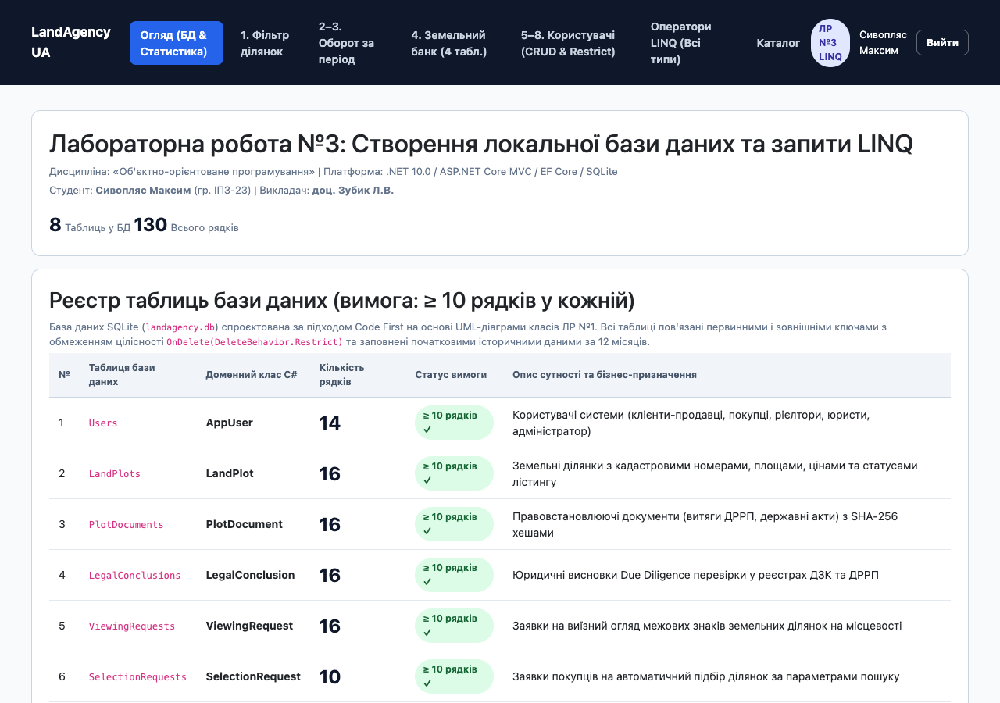  
*Рисунок 14 — Головна панель розділу «Звітність» із сумарною статистикою бази даних*

---

## Висновки

1. У процесі виконання лабораторної роботи № 3 успішно опановано мову інтегрованих запитів LINQ (Language Integrated Query) та технологію Entity Framework Core 10 для створення, ініціалізації та аналітичної обробки реляційної бази даних на платформі .NET 10.
2. Спроєктовано та реалізовано реляційну базу даних із 8 взаємопов'язаних таблиць (`Users`, `LandPlots`, `PlotDocuments`, `LegalConclusions`, `ViewingRequests`, `SelectionRequests`, `SaleDeals`, `Payments`), що строго відповідають концептуальній моделі предметної області агентства земельних ділянок.
3. На рівні EF Core Fluent API налаштовано унікальні індекси та обмеження цілісності `DeleteBehavior.Restrict`, які гарантують збереження аудиторського сліду нотаріальних угод та юридичних висновків.
4. Базу даних наповнено узгодженими даними обсягом від 10 до 28 записів у кожній таблиці (сумарно 130 записів) з історією угод за останні 12 місяців на загальну суму $664 500.
5. Реалізовано 9 різнопланових LINQ-запитів, що поєднують серверне виконання LINQ to Entities, пам'яттєву обробку сум decimal у LINQ to Objects та повне покриття операторів Лекції № 9 (`All`, `Any`, `Distinct`, `Intersect`, `Except`, `Union`, `SelectMany`, `Aggregate`, `Zip`, `OrderBy`/`ThenBy`, `Skip`/`Take` та PLINQ).
6. Роботу системи перевірено через захищений веб-інтерфейс ASP.NET Core MVC (контролер `QueriesController` з авторизацією за ролями Realtor та Lawyer) на 6 повнофункціональних Razor-сторінках без жодного інлайн-стилю.

---

## Перелік використаних джерел

1. Методичні вказівки до лабораторної роботи № 3 «Створення проекту і файлу локальної бази даних. Основи LINQ» з дисципліни «Об'єктно-орієнтоване програмування». Файл ЛР_3_БД_LINQ.md.
2. Зубик Л. В. Лекція 9. LINQ; Лекція 8. Технологія ADO.NET. Проєктування баз даних. CRUD. Матеріали курсу «ООП-3 семестр-2026р.».
3. ДСТУ 3008:2015. Інформація та документація. Звіти у сфері науки і техніки. Структура та правила оформлювання. — К. : ДП «УкрНДНЦ», 2016. — 26 с.
4. Price M. J. C# 12 and .NET 8 – Modern Cross-Platform Development Fundamentals. 8th ed. — Birmingham : Packt Publishing, 2023. — 828 p.
5. Microsoft Learn. Language Integrated Query (LINQ) in C#. URL: https://learn.microsoft.com/dotnet/csharp/linq/ (дата звернення: 08.11.2026).
6. Microsoft Learn. Querying data with Entity Framework Core. URL: https://learn.microsoft.com/ef/core/querying/ (дата звернення: 08.11.2026).
7. Microsoft Learn. SQLite EF Core Database Provider Limitations. URL: https://learn.microsoft.com/ef/core/providers/sqlite/limitations (дата звернення: 08.11.2026).
8. Закон України «Про Державний земельний кадастр» від 07.07.2011 № 3613-VI. Відомості Верховної Ради України, 2012, № 8, ст. 61.
