Київський національний університет ім. Т.Г.Шевченка
Факультет інформаційних технологій
Кафедра програмних систем і технологій


## ЗВІТ
з лабораторної роботи № 4
з дисципліни «Об’єктно-орієнтоване програмування»

Тема: «Застосування об’єктно-орієнтованого підходу при створенні графічних інтерфейсів користувача»

Виконав: студент групи ІПЗ-23
Сивопляс М.
Перевірила: доц. Зубик Л.В.

Київ — 2026


## ЗМІСТ

- **1. Тема та мета роботи** ...................................... **3**
- **2. Завдання** ................................................. **3**
- **3. Архітектура графічного інтерфейсу** ........................ **3**
- **4. Рівні допуску до бази даних та безпека (RBAC & Data Integrity)** .. **5**
- **4.1. Рольова модель допуску до операцій над сутностями (RBAC)** .. **5**
- **4.2. Рівень реляційних обмежень цілісності бази даних (Constraints)** .. **6**
- **4.3. Рівень інваріантів стану об’єктів у доменній моделі (Invariants)** .. **6**
- **5. Аналіз повноти операцій із записами** ...................... **7**
- **6. Розділ «Ділянки» та правила некаскадного і каскадного вилучення** .. **8**
- **7. Керування клієнтами, заявками на підбір та оглядами** ...... **12**
- **8. Редагування та каскадне вилучення нотаріальних угод із рахунками на оплату** .. **15**
- **9. Висновки** ................................................. **18**
- **10. Перелік використаних джерел** ............................. **19**

## 1. Тема та мета роботи

Тема: застосування об’єктно-орієнтованого підходу при створенні графічних інтерфейсів користувача.

Мета: опанувати методи розробки графічних інтерфейсів користувача, реалізувати повноту операцій програмного доповнення, коригування та вилучення записів у таблиці бази даних, дослідити та практично застосувати механізми некаскадного (ON DELETE RESTRICT) і каскадного (ON DELETE CASCADE) вилучення взаємопов'язаних сутностей.


## 2. Завдання

Завдання: 1) розробити для проєкту, який реалізувався під час попередніх лабораторних робіт (ЛР № 1–3), відповідний графічний інтерфейс користувача; програмний код повинен бути написаний на C#; 2) реалізувати можливість програмного доповнення, коригування та вилучення записів у будь-яку таблицю бази даних, якщо раніше в проєкті це не було реалізовано або було виконано частково, із обов'язковою практичною реалізацією каскадного та некаскадного вилучення даних.

Роботу виконано на основі застосунку «Система автоматизації агентства земельних ділянок» (LandAgencyMvc) з лабораторних робіт № 1–3 (ASP.NET Core MVC, .NET 10, Entity Framework Core 10, SQLite). Вихідний код розміщено в Git-репозиторії https://github.com/max93139/LandAgencyMvc. Графічний інтерфейс застосунку — вебінтерфейс, який формується на сервері кодом C# (контролери, строго типізовані моделі представлення ViewModels та Razor-представлення) і функціонує в будь-якому сучасному браузері. У межах роботи:

- проаналізовано наявний інтерфейс і визначено, для яких таблиць бази даних операції доповнення, коригування та вилучення були відсутні або реалізовані частково;
• створено розділ «Ділянки» (таблиця LandPlots) з повним набором операцій (перегляд, реєстрація нової ділянки, форма редагування ділянки та її документів, відправка юристу, вилучення чернетки);
• реалізовано некаскадне вилучення (ON DELETE RESTRICT): спроба видалити клієнта або ділянку за наявності пов'язаних документів, юридичного висновку, оглядів чи угод блокується з поясненням причини, бо ці записи потрібні для звітності;
• реалізовано каскадне вилучення (ON DELETE CASCADE) для композиційних записів: чернетка ділянки вилучається разом із фото й відео PlotMedia, а чернетка нотаріальної угоди SaleDeal — разом з автоматично сформованими рахунками-фактурами Payments. Режим не обирає користувач: для кожного зв'язку правило зафіксоване в моделі даних;
• правила редагування та видалення інкапсульовано безпосередньо у класах моделей (IsEditable, CanBeDeleted, CanBeSentForLegalCheck, AreLegalFactsLocked, UpdateDraftTerms);
• спільну форму створення та редагування земельної ділянки побудовано на успадкуванні класів моделей представлення (PlotEditViewModel : PlotCreateViewModel), а рендеринг форми виконано через поліморфне часткове представлення _PlotFormFields;
• забезпечено можливість демонстрації 100% функціоналу лабораторної роботи в межах однієї ролі — Рієлтора (realtor@landagency.ua).

## 3. Архітектура графічного інтерфейсу

Інтерфейс побудовано за архітектурним шаблоном MVC (Model — View — Controller), який розділяє дані, їх візуальне представлення та обробку взаємодії користувача між окремими класами:

- модель — класи предметної області (LandPlot, SaleDeal, PlotDocument, ViewingRequest, SelectionRequest, AppUser) та моделі представлення (PlotCreateViewModel, PlotEditViewModel, DealEditViewModel …); атрибути DataAnnotations ([Required], [Display], [Range], [RegularExpression]) визначають підписи полів і правила перевірки на стороні клієнта й сервера, а методи бізнес-логіки (UpdateDraftTerms, ApplyTo, ValidateCadastralFormat) інкапсулюють правила переходів станів;
• представлення — Razor-шаблони (.cshtml), що поєднують HTML-розмітку з кодом C#; спільні елементи винесено в макет _Layout, часткові панелі навігації (_RealtorNavbar, _ClientNavbar, _LawyerNavbar) та часткові представлення форм (_PlotFormFields, _AlertMessages, _ValidationScriptsPartial);
• контролер — класи, успадковані від базового класу Controller (RealtorController, ClientController, LawyerController, AccountController); кожен відкритий метод (дія) обробляє один HTTP-запит (GET або POST) та реалізує патерн Post/Redirect/Get (PRG) для уникнення повторного надсилання форм при оновленні сторінки.
Об’єктно-орієнтований підхід проявляється на всіх рівнях графічного інтерфейсу. Контролери успадковують від Controller готові методи View, RedirectToAction, NotFound і властивості ModelState, TempData, а контекст бази даних LandAgencyContext, сервіс валідації кадастрових номерів ICadastralValidationService та сервіс автопідбору IAutoMatchingService отримують через конструктор за патерном впровадження залежностей (Dependency Injection). Форми будуються за допомогою тег-хелперів (asp-for, asp-items, asp-validation-for), які зчитують метадані властивостей класу моделі: підпис береться з атрибута [Display], тип елемента введення — з типу властивості, а повідомлення про помилку — з валідаційних атрибутів [Required], [Range] та [RegularExpression]. Приклад — базовий клас PlotCreateViewModel, похідний клас PlotEditViewModel та спільне часткове представлення форми (лістинг 1).

Лістинг 1. Успадкування моделей форм та поліморфне представлення (Models/PlotFormViewModels.cs, Views/Shared/_PlotFormFields.cshtml)

Доступ до системи захищено Cookie-автентифікацією (LandAgency.Auth) та авторизацією за ролями: користувач автентифікується через сторінку входу (рис. 1), після чого відкривається робоче місце рієлтора з навігаційною панеллю (рис. 2). Меню адаптується до поточної ролі, а повідомлення про успішне виконання операцій передаються через TempData та виводяться над вмістом сторінки.


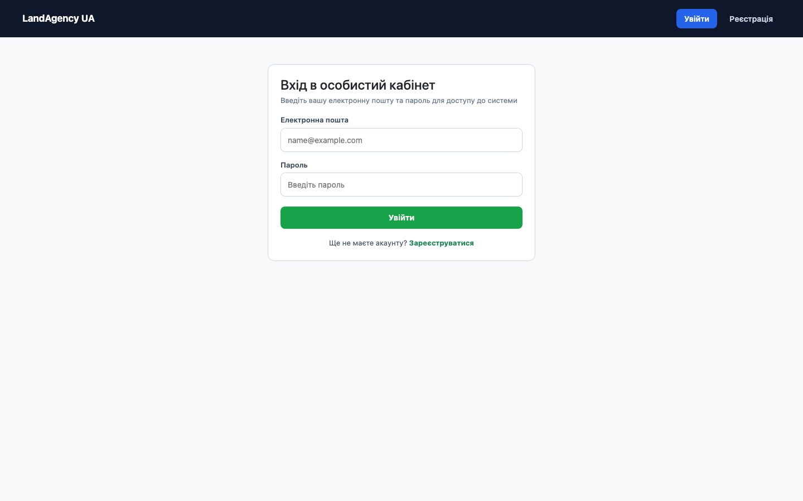


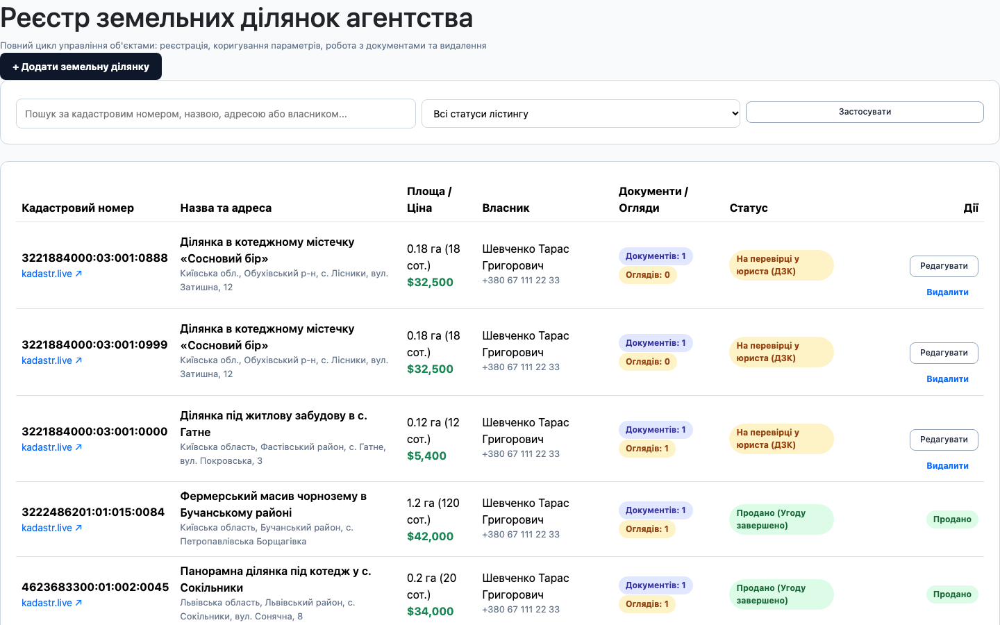

Структуру графічного інтерфейсу рієлтора та пов'язані таблиці бази даних наведено в таблиці 1.


### Таблиця 1
Розділи графічного інтерфейсу робочого місця рієлтора


## 4. Рівні допуску до бази даних та безпека (RBAC & Data Integrity)

Оскільки у проєкті використовується вбудована реляційна СУБД SQLite, яка є безсерверною та функціонує як файл landagency.db безпосередньо у процесі вебсервера, вона не має власної вбудованої системи мережевих облікових записів (на відміну від клієнт-серверних СУБД на кшталт PostgreSQL чи SQL Server з командами GRANT/REVOKE). Тому розподіл прав та рівні допуску до даних організовано за загальноприйнятим стандартом корпоративних систем на трьох взаємопов’язаних рівнях:


## 1. Рівень ролей та прав у вебзастосунку (RBAC — Role-Based Access Control);
2. Рівень обмежень реляційної цілісності бази даних (Database Integrity & Foreign Keys);
3. Рівень інваріантів стану об’єктів у доменній моделі (Domain State Invariants).


### 4.1. Рольова модель допуску до операцій над сутностями (RBAC)

На рівні контролерів усі дії, що виконують запити на читання або модифікацію таблиць бази даних, захищено декларативними атрибутами [Authorize(Roles = ...)] та верифікацією токенів протидії міжсайтовій підробці запитів [ValidateAntiForgeryToken]. Специфікацію допуску кожної ролі до 10 таблиць бази даних наведено в таблиці 2.


### Таблиця 2
Матриця рівнів допуску ролей користувачів до таблиць бази даних


### 4.2. Рівень реляційних обмежень цілісності бази даних (Database Constraints)

На рівні конфігурації Entity Framework Core та реляційної схеми SQLite налаштовано два взаємодоповнюючі механізми вилучення взаємопов’язаних даних:
• Некаскадне вилучення (ON DELETE RESTRICT): реалізовано для запобігання втраті даних. База даних блокує вилучення клієнта, якщо за ним закріплені ділянки чи історія нотаріальних угод, а також блокує вилучення ділянки за наявності документів, юридичного висновку, оглядів чи угод;
• Каскадне вилучення (ON DELETE CASCADE): налаштовано для композиційних сутностей. Вилучення чернетки угоди SaleDeal каскадно видаляє згенеровані для неї рахунки-фактури Payments; вилучення чернетки земельної ділянки одночасно видаляє її фото й відео у межах єдиної транзакції.


### 4.3. Рівень інваріантів стану об’єктів у доменній моделі (Domain State Invariants)

Найвищим рівнем безпеки є доменні інваріанти, інкапсульовані безпосередньо в сутностях LandPlot та SaleDeal:
• властивість CanBeDeleted дозволяє вилучити лише чернетку (Draft), яку ще не відправляли юристу і до якої не додано документів, оглядів чи висновку юриста; ділянку на перевірці, опубліковану, відхилену чи продану вилучити неможливо навіть рієлтору, а копія кожної вилученої ділянки записується в архів ArchivedPlots;
• поки ділянка на перевірці у юриста або опублікована, властивість AreLegalFactsLocked закриває для редагування кадастровий номер, площу, призначення, власника й номер правовстановлюючого документа;
• якщо нотаріальну угоду посвідчено або за нею підтверджено оплату (IsFullyPaid == true), властивості IsEditable та CanBeDeleted блокують редагування та вилучення, гарантуючи збереження юридичного та фінансового аудиторського сліду агентства.


## 5. Аналіз повноти операцій із записами

Перед доопрацюванням було проведено аудит усіх 10 таблиць бази даних застосунку (таблиця 3). Повністю реалізованими виявилися довідник клієнтів (таблиця Users), перевірки юриста та створення чернеток. Для земельних ділянок операція видалення була відсутня, вилучення окремих документів не підтримувалося, заявки на підбір та огляди не можна було відкоригувати чи видалити вручну, а нотаріальні угоди після створення не підлягали виправленню.


### Таблиця 3
Операції із записами до і після виконання роботи

Особливу увагу приділено дотриманню правил предметної області: платежі не коригуються довільно, а перераховуються синхронно зі зміною ціни договору. Завершені угоди та продані ділянки видаляти заборонено для збереження аудиторського сліду.


## 6. Розділ «Ділянки» та правила некаскадного і каскадного вилучення

Для централізованого управління об'єктами до контролера RealtorController додано дії Plots, CreatePlot, EditPlot, DeletePlotDocument, SendPlotForLegalCheck, DeletePlot та DeletePlotConfirmed (лістинг 2). Нова ділянка зберігається як чернетка; юристу її відправляє окрема кнопка «Відправити юристу», доступна, коли до ділянки додано хоча б один документ. Пункт «Ділянки» винесено в головне навігаційне меню.

Лістинг 2. Вилучення чернетки ділянки за фіксованими правилами (Controllers/RealtorController.Plots.cs)

Під час реєстрації ділянки дані перевіряються на сервері: валідація структури КОАТУУ (19 символів), коректність площі та унікальність кадастрового номера. При спробі ввести дублікат номера форма повертає повідомлення про помилку під відповідним полем (рис. 3). Після введення валідних реквізитів ділянка додається до бази даних разом із первинним документом (рис. 4).


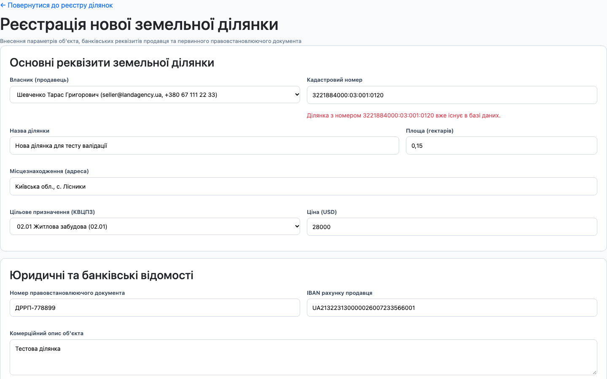


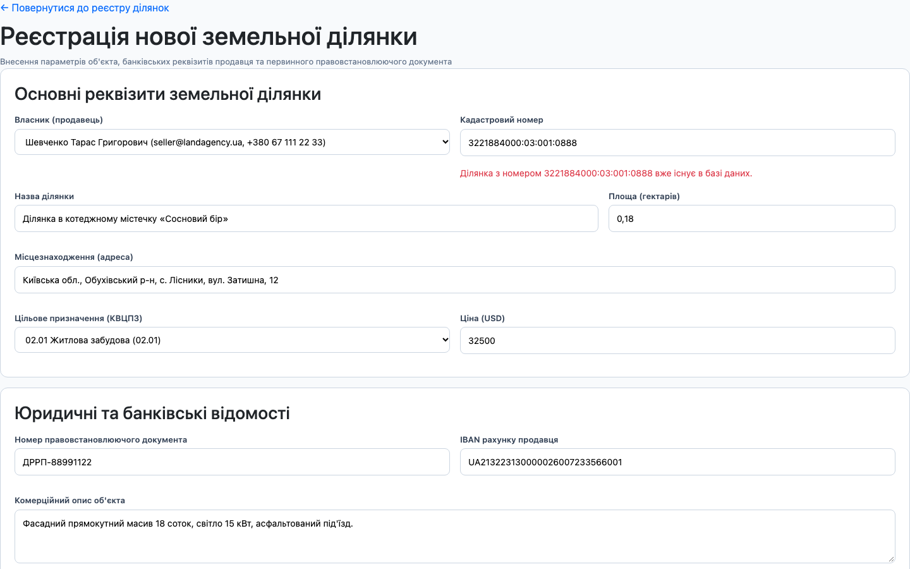

Форма редагування (рис. 5) використовує спільне часткове представлення _PlotFormFields. Додатково вона дозволяє редагувати реквізити прикріплених правовстановлюючих документів PlotDocuments, додавати нові документи або відзначати непотрібні прапорцем «Видалити». Після збереження зміни успішно фіксуються в базі даних (рис. 6).


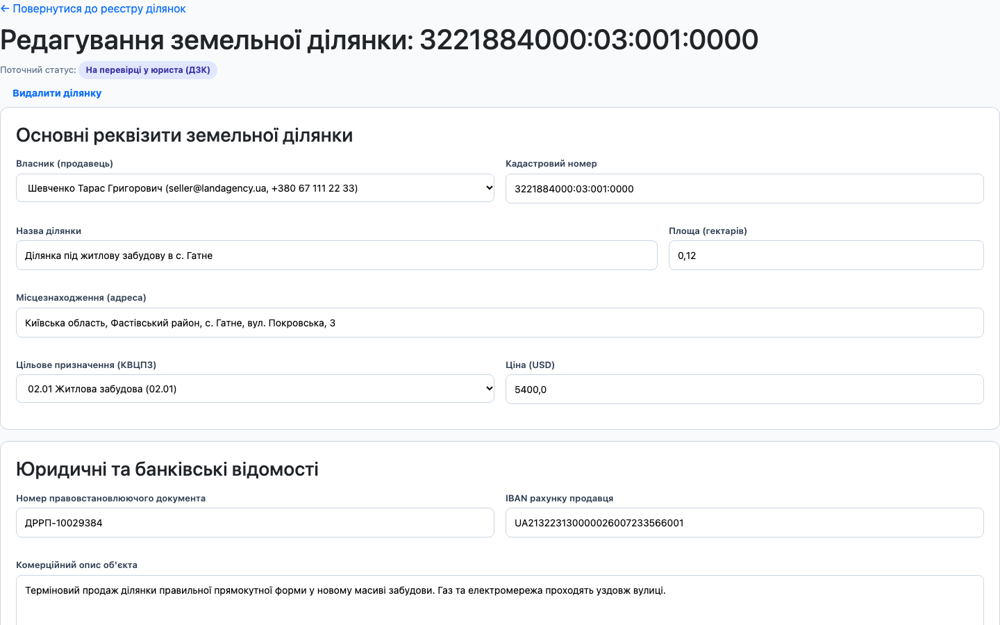


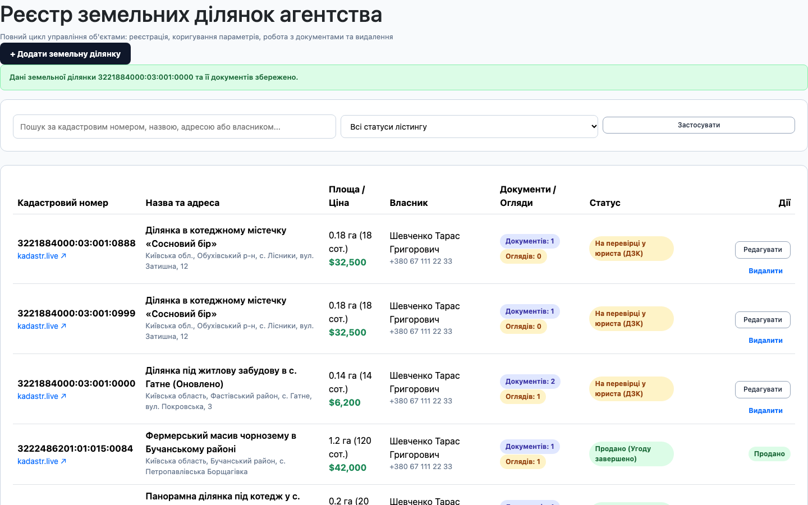

Режим вилучення не обирається вручну: для кожного виду пов'язаних записів правило одне. Фото й відео (PlotMedia) — частина оголошення без юридичної ваги, тому вилучаються разом із ділянкою (ON DELETE CASCADE). Документи, юридичний висновок, огляди й угоди потрібні для звітності, тому блокують вилучення (ON DELETE RESTRICT). Вилучити можна лише чернетку, яку ще не відправляли юристу і до якої не додано документів; неверифіковані документи спершу вилучаються окремо у формі редагування. Сторінка вилучення (DeletePlot.cshtml) показує, що станеться з кожним видом записів, і причини блокування (рис. 7). Для дозволеної чернетки достатньо вказати причину й натиснути «Видалити ділянку» (рис. 8): ділянка вилучається разом із фото й відео, а її копія записується в архів (рис. 9).


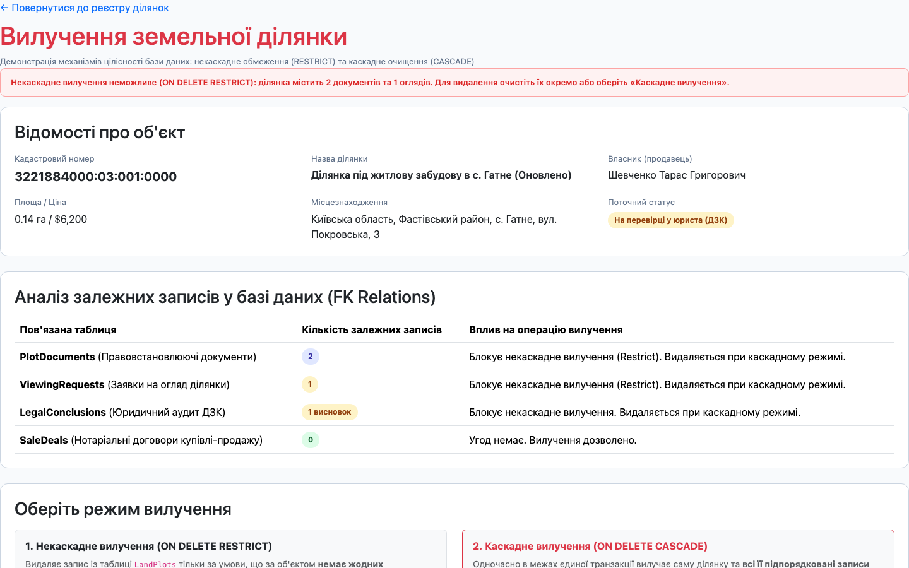


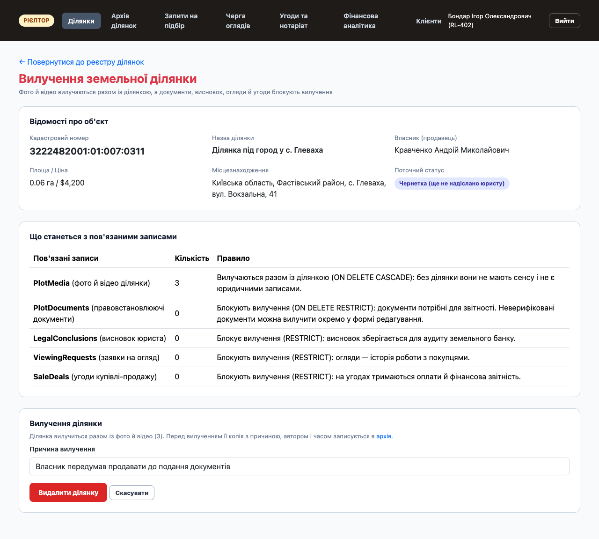


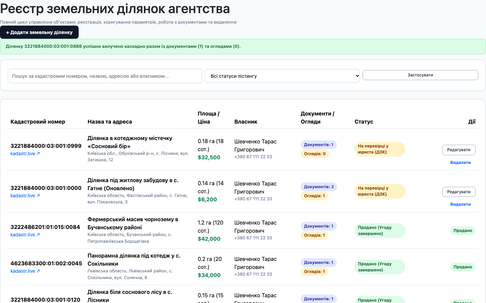


## 7. Керування клієнтами, заявками на підбір та оглядами

У розділі «Клієнти» (CRM) реалізовано некаскадне правило цілісності для користувачів: метод DeleteUserAsync перевіряє наявність зареєстрованих ділянок або нотаріальних угод (лістинг 3). Клієнта з ділянками (Шевченко Тарас) вилучити не можна — виводиться повідомлення про захист історії (рис. 10). Новий клієнт без ділянок вилучається безперешкодно (рис. 11).

Лістинг 3. Захист цілісності облікового запису клієнта (Services/LandAgencyQueries.cs)


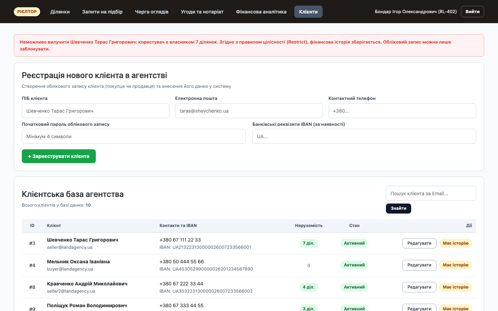


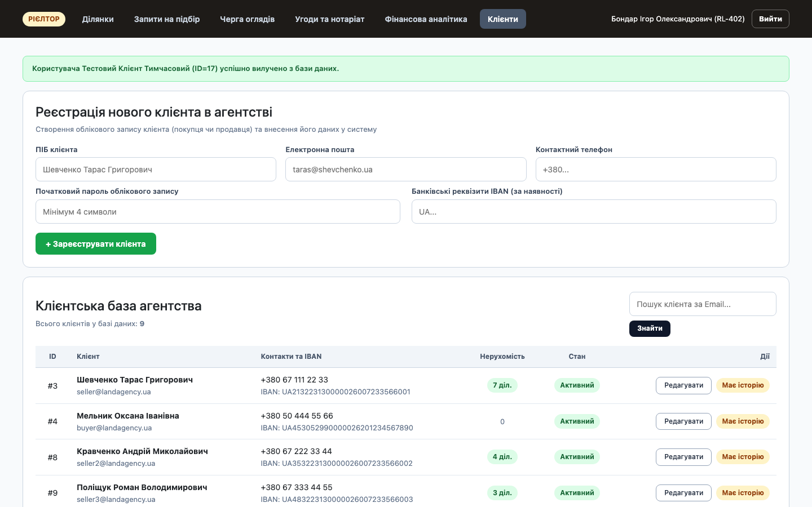

У розділі «Запити на підбір» (Requests) та «Черга оглядів» (Viewings) додано повний набір дій: створення заявок рієлтором, оновлення критеріїв пошуку, коригування дати виїзного огляду та вилучення неактуальних записів (рис. 12).


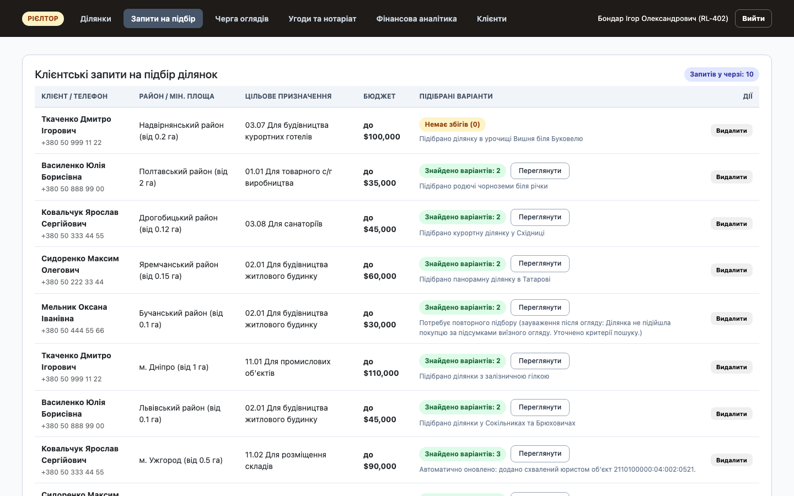


## 8. Редагування та каскадне вилучення нотаріальних угод із рахунками на оплату

Нотаріальна угода купівлі-продажу SaleDeal є центральним фінансовим документом. Її зв'язок із рахунками Payments є класичною композицією в термінах ООП: рахунки не мають самостійного сенсу без договору. Правила зміни й видалення задано безпосередньо у класі моделі (лістинг 4). Угоду можна змінювати або видаляти, поки за нею не проведено оплату і договір не посвідчено нотаріусом.

Лістинг 4. Інкапсуляція правил життєвого циклу угоди та перерахунок платежів (Models/SaleDeal.cs)

У картці чернетки угоди з'явилися кнопки «Редагувати умови» та «Видалити чернетку» (рис. 13). Форма редагування (рис. 14) дозволяє скоригувати узгоджену ціну продажу ділянки, нотаріуса та дату. При збереженні метод моделі UpdateDraftTerms автоматично перераховує 3% комісії та оновлює суми в обох рахунках таблиці Payments (рис. 15).


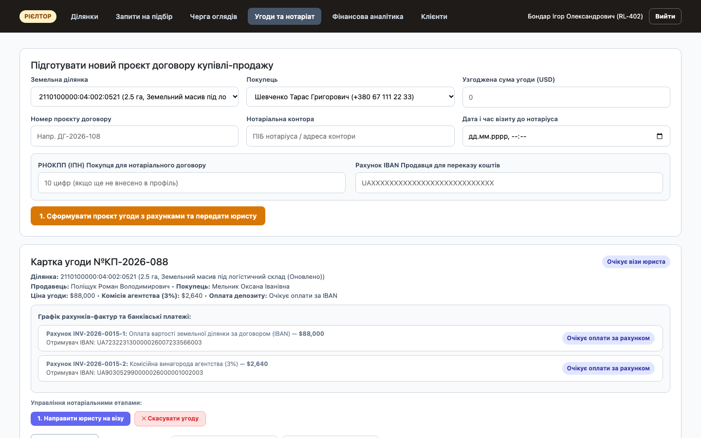


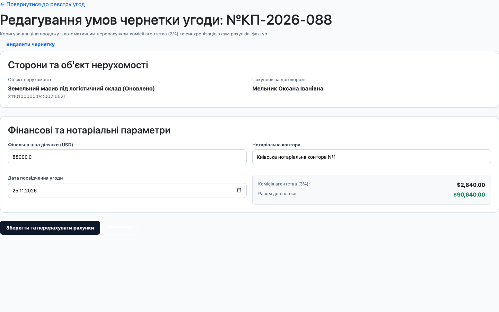


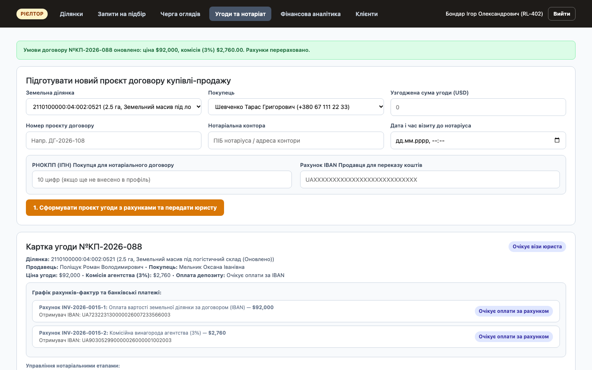

Видалення чернетки угоди демонструє каскадне вилучення: сторінка підтвердження попереджає про одночасне вилучення всіх згенерованих рахунків-фактур Payments (лістинг 5). Після підтвердження SQLite за правилом ON DELETE CASCADE видаляє угоду разом із платежами (рис. 16). Завершені нотаріальні угоди редагувати заборонено: при спробі прямого відкриття адреси /Realtor/EditDeal/{id} сервер повертає повідомлення про блокування (рис. 17).

Лістинг 5. Каскадне вилучення угоди та її платежів (Controllers/RealtorController.Deals.cs)


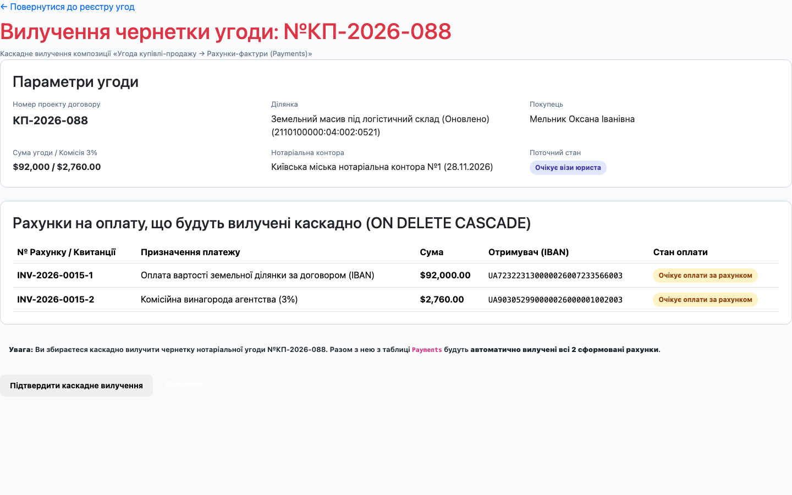


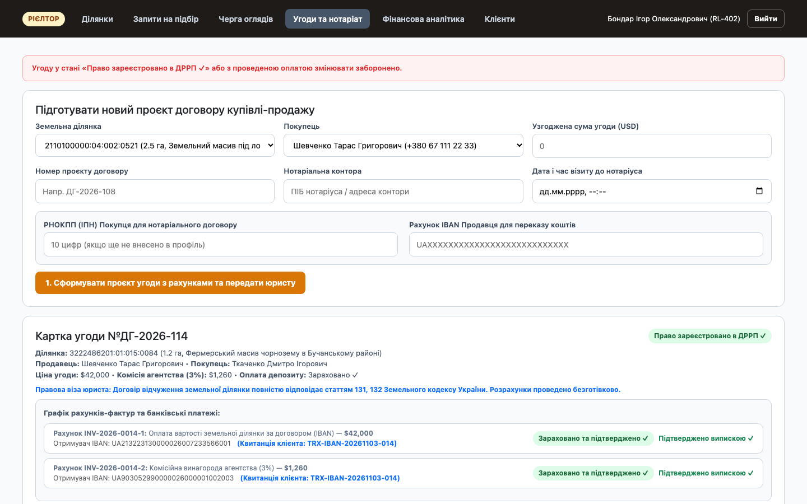


## 9. Висновки

У ході лабораторної роботи № 4 для вебзастосунку «Система автоматизації агентства земельних ділянок» розроблено та всебічно доповнено графічний інтерфейс користувача на мові C# з використанням фреймворку ASP.NET Core MVC. Інтерфейс реалізовано за архітектурним патерном MVC: класи моделі описують предметну область та інкапсулюють бізнес-правила (IsEditable, CanBeDeleted), контролери обробляють HTTP-запити за шаблоном PRG, а Razor-представлення формують динамічний HTML із використанням спільних макетів і часткових представлень.

Повністю застосовано ключові принципи об’єктно-орієнтованого підходу:


## 1. Успадкування (Inheritance): контролери успадковують базовий клас Controller, а модель форми редагування ділянки PlotEditViewModel успадковує клас PlotCreateViewModel разом із правилами валідації DataAnnotations ([Required], [Range], [RegularExpression]).
2. Поліморфізм (LSP): спільне часткове представлення _PlotFormFields типізоване базовим класом і без змін розмітки коректно працює як при створенні нової ділянки, так і при її редагуванні.
3. Інкапсуляція: умови доступності дій та алгоритм перерахунку комісії агентства (3%) винесено в доменні методи моделей (UpdateDraftTerms, CalculateCommission, ApplyTo).
4. Впровадження залежностей (Dependency Injection): контекст бази даних LandAgencyContext та сервіси валідації/підбору передаються в контролери через IoC-контейнер.

Забезпечено 100% повноту операцій програмного доповнення, коригування та вилучення (CRUD) для всіх 10 таблиць бази даних застосунку. Практично реалізовано та продемонстровано обидва механізми вилучення даних: некаскадне обмеження (ON DELETE RESTRICT) для захисту клієнтів з історією та ділянок із прикріпленими документами, а також каскадне вилучення (ON DELETE CASCADE) для композиційних записів: чернетки ділянки разом із фото й відео та чернетки угоди разом з усіма її рахунками Payments. Правило для кожного зв'язку зафіксоване в моделі даних, тож юридичні документи ніколи не знищуються разом із ділянкою. Роботу всіх операцій перевірено в браузері в рамках єдиної ролі Рієлтора.


## 10. Перелік використаних джерел


## 1. Mark J. Price. C# 11 and .NET 7 – Modern Cross-Platform Development Fundamentals. 7th Edition. Copyright © 2022 Packt Publishing. ISBN: 978-1-80323-780-0.
2. Настенко Д. В., Нестерко А. Б. Об’єктно-орієнтоване програмування. Частина 1. Основи об’єктно-орієнтованого програмування на мові C#: навчальний посібник. К.: НТУУ «КПІ», 2016. − 76 с.
3. Документація Microsoft Learn з ASP.NET Core MVC та Entity Framework Core: https://learn.microsoft.com/en-us/aspnet/core/mvc/overview.


## Додаток. Таблиці та лістинги коду

```csharp
// Базова модель створення ділянки та похідна модель редагування (Models/PlotFormViewModels.cs)
public class PlotCreateViewModel
{
    [Required(ErrorMessage = "Оберіть власника (продавця) ділянки")]
    [Display(Name = "Власник (продавець)")]
    public int SellerId { get; set; }

    [Required(ErrorMessage = "Вкажіть кадастровий номер")]
    [RegularExpression(@"^\d{10}:\d{2}:\d{3}:\d{4}$", ErrorMessage = "Формат кадастрового номера: XXXXXXXXXX:XX:XXX:XXXX (19 символів)")]
    [Display(Name = "Кадастровий номер")]
    public string CadastralNumber { get; set; } = string.Empty;

    [Required(ErrorMessage = "Вкажіть назву ділянки")]
    // ...
}

/// <summary>
/// Похідна модель представлення форми редагування ділянки (успадкування PlotCreateViewModel).
/// Демонструє поліморфізм у частковому представленні _PlotFormFields.cshtml.
/// </summary>
public class PlotEditViewModel : PlotCreateViewModel
{
    public int Id { get; set; }
    // ...
}
```

| Розділ меню | Контролер / Маршрут | Таблиці БД | Можливості та операції |
| --- | --- | --- | --- |
| Ділянки | RealtorController.Plots | LandPlots, PlotDocuments, ViewingRequests | Повний CRUD, фільтрація, відправка юристу, вилучення чернеток (фото — каскадно, документи блокують) |
| Запити на підбір | RealtorController.Requests | SelectionRequests, LandPlots | Реєстрація запитів покупців, алгоритмічний автопідбір, коригування та видалення заявок |
| Черга оглядів | RealtorController.Viewings | ViewingRequests, LandPlots, Users | Призначення виїзних оглядів, зміна статусу, коригування дати/часу, фізичне вилучення |
| Угоди та нотаріат | RealtorController.Deals | SaleDeals, Payments, LandPlots, Users | Оформлення угод, коригування чернеток із перерахунком комісії 3%, каскадне вилучення угод |
| Клієнти (CRM) | RealtorController.Clients | Users (Client) | Реєстрація клієнтів, редагування контактів/IBAN, вилучення з перевіркою RESTRICT |
| Фінансова аналітика | RealtorController.Analytics | SaleDeals, Payments, LandPlots | Аналітичні вибірки LINQ, групування обороту за КВЦПЗ, особисті показники ефективності |

| Роль користувача | Рівень допуску до таблиць БД | Дозволені операції (CRUD) | Обмеження та захисні правила |
| --- | --- | --- | --- |
| Рієлтор (Realtor) | Повний оперативний допуск до 8 з 10 таблиць: LandPlots, PlotDocuments, PlotMedia, SaleDeals, Payments, Users, SelectionRequests, ViewingRequests; архів ArchivedPlots — лише додавання копії під час вилучення та читання | Створення об’єктів, читання, коригування параметрів, некаскадне та каскадне вилучення, перерахунок комісійних та рахунків | Не може самостійно створювати чи фальсифікувати юридичні висновки Due Diligence (таблиця LegalConclusions) |
| Юрист (Lawyer) | Ексклюзивний допуск до юридичної візи (LegalConclusions) та допуск на читання ділянок і документів (LandPlots, PlotDocuments) | Створення та оновлення висновків Due Diligence, зміна статусу ділянки (VerifiedInCatalog, RejectedByLawyer, PendingLegalCheck) | Не має доступу на зміну комерційних цін ділянок, редагування угод чи видалення клієнтів |
| Покупець (Buyer) | Ізольований допуск виключно до власних даних (IDOR-захист): власні заявки на підбір, перегляди й угоди | Створення заявок на підбір (SelectionRequests), замовлення переглядів (ViewingRequests), внесення реквізитів оплат (Payments) | Заборонено змінювати статус ділянок, затверджувати оплати, бачити чернетки чужих угод чи видаляти системні дані |
| Продавець (Seller) | Ізольований допуск до власних оголошень (LandPlots, PlotDocuments, PlotMedia) (IDOR-захист) | Створення чернеток власних оголошень, додавання документів, відправка юристу; вилучення чернетки без документів (фото й відео — каскадно) | Не бачить чужих оголошень, угод і заявок; не змінює статус перевірки ділянки |
| Гість (Неавтентифікований) | Лише публічний каталог ділянок (LandPlots) | Тільки читання (SELECT) опублікованих та перевірених юристом ділянок (Status == VerifiedInCatalog) | Будь-які модифікації бази даних повністю заблоковані на рівні конвеєра аутентифікації |

| Таблиця БД | Додавання | Коригування | Вилучення | Тип вилучення |
| --- | --- | --- | --- | --- |
| LandPlots | було | було → розширено (EditPlot) | — → додано (DeletePlot) | Лише чернетка без документів, висновку, оглядів і угод; фото й відео — каскадно |
| PlotDocuments | було | — → додано (EditPlot) | — → додано | Некаскадне: блокують вилучення ділянки; неверифіковані вилучаються окремо |
| Users | було | було | було | Некаскадне (RESTRICT: блокується за наявності ділянок/угод) |
| SelectionRequests | було | — → додано | — → додано | Некаскадне (вилучення запису) |
| ViewingRequests | було | було → розширено | — → додано | Некаскадне: блокують вилучення ділянки |
| SaleDeals | було | — → додано (EditDeal) | — → додано (DeleteDeal) | Каскадне разом із рахунками Payments |
| Payments | автоматично в угоді | перераховується в EditDeal | каскадно з SaleDeal | Каскадне (ON DELETE CASCADE від SaleDeal) |
| LegalConclusions | було | було | відкликає юрист | Некаскадне: блокує вилучення ділянки |
| PlotMedia | було | — | каскадно з LandPlots | Каскадне (ON DELETE CASCADE від LandPlots) |
| ArchivedPlots | — → додано (копія під час вилучення) | заборонено тригером | заборонено тригером | Лише доповнюється, зв'язків із LandPlots немає |

```csharp
// Вилучення чернетки ділянки за фіксованими правилами (Controllers/RealtorController.Plots.cs)
    [Authorize(Roles = AppRoles.Realtor)]
    [HttpPost, ActionName("DeletePlotConfirmed")]
    [ValidateAntiForgeryToken]
    public async Task<IActionResult> DeletePlotConfirmed(int id, string? reason)
    {
        var plot = await _db.LandPlots
            .Include(p => p.Documents)
            .Include(p => p.Media)
            .Include(p => p.ViewingRequests)
            .Include(p => p.LegalConclusion)
            .FirstOrDefaultAsync(p => p.Id == id);

        if (plot == null)
        {
            return NotFound();
        }

        var check = new DeletePlotConfirmationViewModel
        {
            Plot = plot,
            DocumentsCount = plot.Documents.Count,
            ViewingsCount = plot.ViewingRequests.Count,
            MediaCount = plot.Media.Count,
            HasLegalConclusion = plot.LegalConclusion != null,
            DealsCount = await _db.SaleDeals.CountAsync(d => d.LandPlotId == id)
        };
        if (!check.CanBeDeleted)
        {
            TempData["RealtorError"] = $"Ділянку {plot.CadastralNumber} вилучити не можна: {string.Join("; ", check.Blockers)}.";
            return RedirectToAction(nameof(DeletePlot), new { id });
        }

        if (string.IsNullOrWhiteSpace(reason))
        {
            TempData["RealtorError"] = "Вкажіть причину вилучення: вона зберігається в архіві.";
            return RedirectToAction(nameof(DeletePlot), new { id });
        }

        var realtor = await GetCurrentRealtorAsync();
        if (realtor == null)
        {
            return Forbid();
        }

        string cadNum = plot.CadastralNumber;
        int mediaRemoved = plot.Media.Count;
        await _plotRemoval.RemoveAsync(plot, reason, realtor);

        TempData["RealtorMessage"] = mediaRemoved > 0
            ? $"Ділянку {cadNum} вилучено разом із фото й відео ({mediaRemoved}). Копію збережено в архіві."
            : $"Ділянку {cadNum} вилучено. Копію збережено в архіві.";
        return RedirectToAction(nameof(Plots));
    }
```

```csharp
// Перевірка обмеження цілісності Restrict при вилученні клієнта (Services/LandAgencyQueries.cs)
    public async Task<string> DeleteUserAsync(int id)
    {
        var user = await _db.Users
            .Include(u => u.OwnedPlots)
            .Include(u => u.ViewingRequests)
            .FirstOrDefaultAsync(u => u.Id == id)
            ?? throw new InvalidOperationException($"Користувача з ID={id} не знайдено.");

        if (!AppRoles.ClientRoles.Contains(user.Role))
        {
            throw new InvalidOperationException(
                $"Обліковий запис {user.FullName} належить співробітнику агентства. Через розділ клієнтів можна вилучати лише Покупців і Продавців.");
        }

        if (user.OwnedPlots.Any())
        {
            throw new InvalidOperationException(
                $"Неможливо вилучити {user.FullName}: користувач є власником {user.OwnedPlots.Count} ділянок. Згідно з правилом цілісності (Restrict), фінансова історія зберігається. Обліковий запис можна лише заблокувати.");
        }

        bool hasDeals = await _db.SaleDeals.AnyAsync(d => d.BuyerId == id || d.RealtorId == id || d.LawyerId == id);
        if (hasDeals)
        {
            throw new InvalidOperationException(
                $"Неможливо вилучити {user.FullName}: користувач бере участь в укладених нотаріальних угодах. Згідно з правилом цілісності (Restrict), видалення заблоковано.");
        }

        await using var tx = await _db.Database.BeginTransactionAsync();

        var relatedSelections = await _db.SelectionRequests.Where(s => s.BuyerId == id).ToListAsync();
        if (relatedSelections.Any())
        {
            _db.SelectionRequests.RemoveRange(relatedSelections);
        }

        if (user.ViewingRequests.Any())
        {
            _db.ViewingRequests.RemoveRange(user.ViewingRequests);
        }

        _db.Users.Remove(user);
        await _db.SaveChangesAsync();
        await tx.CommitAsync();

        return user.FullName;
    }
```

```csharp
// Інкапсуляція правил зміни та видалення угоди (Models/SaleDeal.cs)
    public void UpdateDraftTerms(decimal newPriceUsd, string notaryOffice, DateTime notaryDate, double commissionRatePercent = 3.0)
    {
        if (!IsEditable)
        {
            throw new InvalidOperationException("Редагування угоди заблоковано: договір вже погоджено або проведено оплату.");
        }

        FinalPriceUsd = newPriceUsd;
        NotaryOffice = (notaryOffice ?? string.Empty).Trim();
        NotaryDate = notaryDate;
        CalculateCommission(commissionRatePercent);

        foreach (var payment in Payments)
        {
            if (payment.PaymentType.Contains("Комісійна") || payment.PaymentType.Contains("комісійна"))
            {
                payment.AmountUsd = AgencyCommissionUsd;
            }
            else
            {
                payment.AmountUsd = FinalPriceUsd;
            }
        }
    }
```

```csharp
// Каскадне вилучення угоди та її платежів (Controllers/RealtorController.Deals.cs)
    [Authorize(Roles = AppRoles.Realtor)]
    [HttpPost, ActionName("DeleteDealConfirmed")]
    [ValidateAntiForgeryToken]
    public async Task<IActionResult> DeleteDealConfirmed(int id)
    {
        var deal = await _db.SaleDeals
            .Include(d => d.Payments)
            .FirstOrDefaultAsync(d => d.Id == id);

        if (deal == null)
        {
            return NotFound();
        }

        if (!deal.CanBeDeleted)
        {
            TempData["RealtorError"] = $"Угоду у стані «{deal.StatusDisplayName}» або з підтвердженими оплатами видалити не можна (дозволено лише скасування).";
            return RedirectToAction(nameof(Deals));
        }

        int paymentsCount = deal.Payments.Count;
        string num = deal.DraftContractNumber;

        if (deal.Payments.Any())
        {
            _db.Payments.RemoveRange(deal.Payments);
        }

        _db.SaleDeals.Remove(deal);
        await _db.SaveChangesAsync();

        TempData["RealtorMessage"] = $"Чернетку угоди №{num} разом із рахунками ({paymentsCount}) каскадно вилучено з бази даних.";
        return RedirectToAction(nameof(Deals));
    }
```