## 1 Тема, мета та завдання роботи

**Тема роботи:** CRUD, ACID, повнота функціоналу.

**Мета роботи:** забезпечити повноту функціоналу розроблюваного проєкту «Система автоматизації агентства земельних ділянок» (LandAgencyMvc): перевірити, що всі прецеденти з діаграми ЛР № 1 реалізовано, що з усіма даними можна виконувати операції створення, читання, оновлення й вилучення (CRUD), що кожна операція з базою даних відповідає властивостям ACID, і що ролі користувачів збігаються з ролями на діаграмі прецедентів.

**Завдання згідно з методичними вказівками:**

- переглянути проєкт і перевірити функціонал на повноту відносно ЛР № 1–4, за потреби доопрацювати його;
- перевірити можливість CRUD-операцій для всіх даних проєкту;
- перевірити відповідність усіх операцій з базою даних властивостям ACID (Atomicity, Consistency, Isolation, Durability);
- перевірити, чи реалізовано ролі.

**Результат у стислому вигляді.** Діаграма прецедентів ЛР № 1 містить 21 прецедент (з урахуванням зв'язків include та extend) і чотири актори-людини: Покупець, Продавець, Рієлтор, Юрист. Аудит показав, що повністю збігалися з діаграмою лише 8 прецедентів. Решту доопрацьовано: розділено роль «Клієнт» на Покупця й Продавця, прибрано відсутню на діаграмі роль Admin, додано службовий вхід, перенесення дати огляду, підписання договору покупцем, реєстрацію переходу права юристом, фото, відео, координати та умови продажу. CRUD доповнено для продавця, покупця й юриста. Властивості ACID забезпечено транзакціями, обмеженнями бази даних, токенами версій і режимом повної синхронізації запису. Усі 21 прецедент пройдено наскрізним сценарієм від імені всіх чотирьох ролей.

## 2 Повнота функціоналу відносно діаграми прецедентів

### 2.1 Методика перевірки

Для кожного овала діаграми прецедентів (рисунок 2 звіту ЛР № 1) визначено актора, дію контролера, сторінку інтерфейсу та клас моделі, що її реалізують. Нумерацію прецедентів введено зверху вниз і зліва направо: UC-01 «Подати запит на підбір ділянки» … UC-21 «Зареєструвати перехід права власності в ДЗК». У документації кожної відповідної дії є рядок із номером прецеденту, тому будь-який прецедент знаходиться пошуком, наприклад, `UC-05` у проєкті. Карту «прецедент → дія → вид → модель» генерує скрипт `tools/use_case_map.py`, який сам знаходить актуальні номери рядків, і результат поміщено у файл `PROJECT_GUIDE.md`.

### 2.2 Виявлені розбіжності та їх усунення

**Таблиця 1 — Стан реалізації прецедентів до та після роботи**

| № | Прецедент | Актор | До роботи | Після роботи |
|---|---|---|---|---|
| UC-01, UC-02 | Запит на підбір; автоматичний підбір | Покупець | реалізовано | без змін |
| UC-03 | Замовити виїзний огляд | Покупець | реалізовано | без змін |
| UC-04 | Перенести дату огляду | Покупець | відсутній (лише скасування) | `RescheduleViewingByClient` |
| UC-05 | Підписати договір у нотаріуса | Покупець | дію виконував рієлтор | `SignContractAtNotary`, лише після підтвердженої оплати |
| UC-06 | Оплата через банк | Покупець | реалізовано | без змін |
| UC-07 | Реєстрація та авторизація клієнта | Покупець, Продавець | одна роль «Клієнт» | вибір ролі Покупець чи Продавець |
| UC-08, UC-09 | Зареєструвати ділянку; перевірка в ДЗК | Продавець | перевірка лише формату | попередній запит до ДЗК/ДРРП видно продавцю |
| UC-10 | Встановити ціну та умови продажу | Продавець | лише ціна | ціна та умови продажу (`UpdatePlotTerms`, `EditOwnPlot`) |
| UC-11 | Завантажити правовстановлюючі документи | Продавець | реалізовано | без змін |
| UC-12 | Опис із фото, відео та координатами | Рієлтор | лише текстовий опис | координати, фото, відео (таблиця `PlotMedia`) |
| UC-13 | Організувати виїзд та показ | Рієлтор | реалізовано | без змін |
| UC-14, UC-15 | Пакет документів; розрахунок комісії | Рієлтор | реалізовано | без змін |
| UC-16 | Службова авторизація | Рієлтор, Юрист | одна сторінка входу | той самий єдиний вхід `Login`, робоче місце визначає роль облікового запису |
| UC-17, UC-18 | Перевірка обмежень; витяг із ДЗК | Юрист | реалізовано | без змін |
| UC-19, UC-20 | Юридичний звіт; акт про ризики | Юрист | реалізовано | додано відкликання висновку |
| UC-21 | Реєстрація переходу права власності | Юрист | дію виконував рієлтор | `RegisterOwnershipTransfer` |

Зовнішні актори діаграми (ДЗК, Банківська система, Сервіс підбору) у проєкті емулюються: `DzkRegistrySimulator`, введення IBAN із підтвердженням платежу рієлтором і `AutoMatchingService`. Це відповідає рівню лабораторної роботи й прямо зазначено у звіті.

## 3 Ролі користувачів

### 3.1 Відповідність ролей діаграмі

На діаграмі класів та діаграмі прецедентів Користувач має чотири спеціалізації: Покупець, Продавець, Рієлтор, Юрист. У проєкті було три ролі (`Client`, `Realtor`, `Lawyer`) і формальна згадка ролі `Admin`, якої не існувало в переліченні `UserRole`, хоча вона використовувалася у понад десяти місцях. Тепер перелічення збігається з діаграмою, а `Admin` вилучено повністю:

Лістинг 1 — Ролі користувачів (Models/Enums.cs)

```csharp
public enum UserRole
{
    Buyer = 0,
    Realtor = 1,
    Lawyer = 2,
    Seller = 3
}
```

Числові значення збережено сумісними з даними бази: значення 0–2 не змінилися, продавці отримали значення 3. Імена ролей для атрибутів `[Authorize]` зібрано у класі `AppRoles` замість рядкових літералів на кшталт `"Realtor,Admin"`.

### 3.2 Рольова модель допуску

**Таблиця 2 — Матриця доступу ролей до функціональних розділів**

| Розділ | Покупець | Продавець | Рієлтор | Юрист |
|---|---|---|---|---|
| Каталог ділянок, запити на підбір | так | ні | ні | ні |
| Огляди: замовити, перенести, скасувати | так | ні | керує | ні |
| Виставлення ділянок, ціна й умови, документи | ні | так | редагує | ні |
| Фото, відео, координати | перегляд | перегляд | так | ні |
| Угоди й оплати | оплата, підпис | перегляд | готує, підтверджує оплату | віза, реєстрація права |
| Юридичні висновки й земельний банк | ні | ні | ні | так |
| Клієнтська база (CRM) та аналітика | ні | ні | так | ні |

Обмеження діють на сервері атрибутами `[Authorize(Roles = AppRoles.Buyer)]` та подібними; приховування кнопок у видах є лише зручністю. Вхід для всіх ролей єдиний: пароль перевіряється однаково, а роль облікового запису визначає, яке робоче місце відкриється. Неавторизований перехід на сторінку рієлтора чи юриста веде на цей самий вхід і після автентифікації повертає на потрібну сторінку.

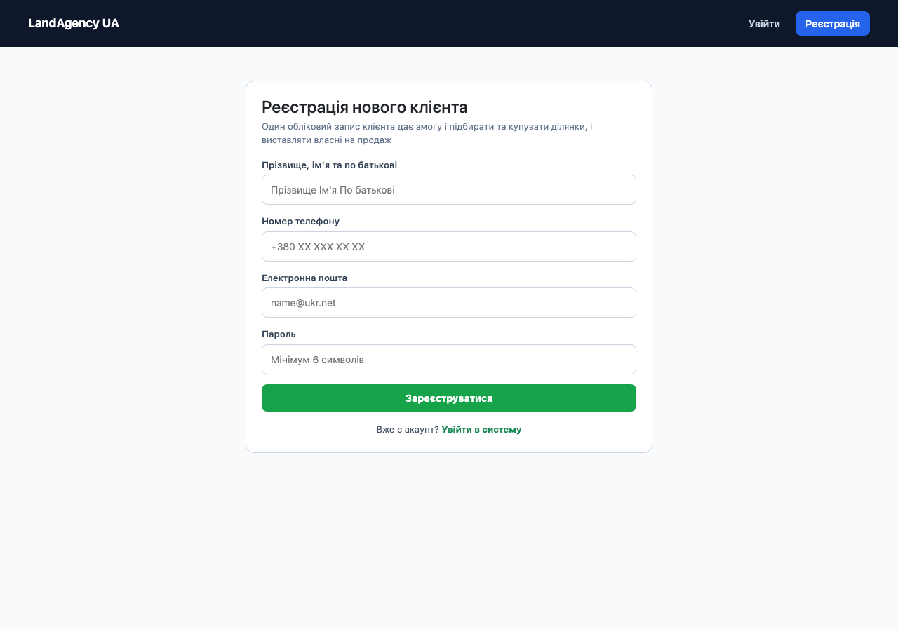

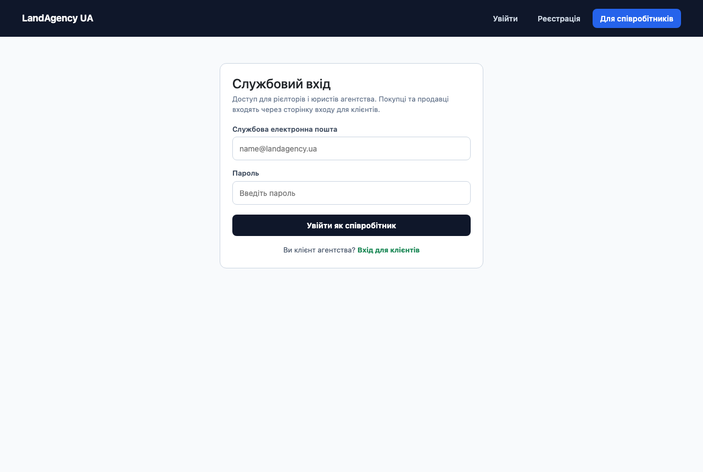

## 4 CRUD для всіх даних проєкту

### 4.1 Матриця операцій

База даних містить дев'ять таблиць. Для кожної визначено відповідальні ролі й дії контролерів, що виконують операції створення, читання, оновлення та вилучення.

**Таблиця 3 — Матриця CRUD за таблицями та ролями**

| Таблиця | Create | Read | Update | Delete |
|---|---|---|---|---|
| Users | Покупець/Продавець: реєстрація; рієлтор: CRM | рієлтор: CRM; клієнт: кабінет | клієнт: профіль; рієлтор: CRM | рієлтор: лише клієнтів |
| LandPlots | Продавець, рієлтор | усі ролі за правами | Продавець: ціна, умови, оголошення; рієлтор: комерційні поля (юридичні факти закриті після перевірки); юрист: статус | Продавець і рієлтор: лише ділянки без юридичного висновку |
| PlotDocuments | Продавець | картка ділянки | рієлтор (неверифіковані); юрист (верифікація) | рієлтор (неверифіковані) |
| PlotMedia | Рієлтор | картка ділянки | вилучити й додати знову | рієлтор |
| LegalConclusions | Юрист | юрист | Юрист: повторне подання | Юрист: відкликання |
| ViewingRequests | Покупець, рієлтор | покупець, рієлтор | Покупець: перенесення; рієлтор: допустимі переходи статусу та дата | рієлтор: нові, скасовані, відхилені |
| SelectionRequests | Покупець, рієлтор | покупець, рієлтор | Покупець, рієлтор | Покупець, рієлтор |
| SaleDeals | Рієлтор; покупець (заявка) | рієлтор, юрист, покупець | рієлтор: умови; юрист: віза, реєстрація; покупець: підпис | рієлтор: чернетку |
| Payments | система разом з угодою | покупець, рієлтор | покупець: подання; рієлтор: підтвердження чи відхилення лише поданого платежу | разом з угодою |

Платежі не редагуються довільно, і це свідоме рішення: сума виводиться з ціни угоди, а статус змінюється лише через подання й підтвердження, тому прямого редагування в інтерфейсі немає. Облікові записи співробітників створює агенція (початкові дані), тому CRUD акаунтів у застосунку виконується для клієнтів. Через CRM тепер не можна вилучити рієлтора чи юриста: раніше така дія була можлива для співробітника без угод.

### 4.2 Доповнення, зроблені в ході роботи

- **Продавець** редагує власне оголошення (назва, адреса, ціна, IBAN, опис, умови продажу) та вилучає його. Кадастровий номер, площа й цільове призначення на формі лише показуються, бо це юридичні факти, які перевіряє юрист. Редагування й вилучення блокуються, якщо ділянку продано, підписано договір, за нею є будь-яка угода (навіть скасована) або активні заявки на огляд.
- **Покупець** змінює (з перерахунком підбору) та вилучає власні запити на підбір; чужі запити недоступні.
- **Юрист** відкликає юридичний висновок: ділянка повертається на повторну перевірку, документи втрачають позначку верифікації, активні огляди скасовуються, збіги із запитами перераховуються. Відкликання заборонене для проданої ділянки чи ділянки з активною угодою.

Вилучення ділянки не знищує історію: перед видаленням у ту саму транзакцію записується архівна копія в таблицю `ArchivedPlots` (кадастровий номер, власник, статус, кількість документів, обов'язкова причина, автор і час). Тригери бази забороняють змінювати й видаляти рядки архіву, а рієлтор переглядає його на сторінці «Архів ділянок». Це відповідає принципу збереження історії для звітності й аудиту.

Спільна логіка вилучення ділянки з усіма залежними записами винесена в `PlotRemovalService` і використовується продавцем та рієлтором. Під час перевірки знайдено й усунено дефект: після вилучення ділянки її ідентифікатор лишався у списках збігів запитів на підбір, тепер сервіс прибирає його.

Лістинг 2 — Вилучення ділянки з архівною копією та залежними записами (Services/PlotRemovalService.cs)

```csharp
    public async Task RemoveWithDependentsAsync(LandPlot plot, string reason, AppUser removedBy)
    {
        if (string.IsNullOrWhiteSpace(reason))
        {
            throw new ArgumentException("Потрібно вказати причину вилучення ділянки.", nameof(reason));
        }

        var sellerName = await _db.Users
            .Where(u => u.Id == plot.SellerId)
            .Select(u => u.FullName)
            .FirstOrDefaultAsync() ?? string.Empty;

        _db.ArchivedPlots.Add(new ArchivedPlot
        {
            OriginalPlotId = plot.Id,
            CadastralNumber = plot.CadastralNumber,
            Title = plot.Title,
            Location = plot.Location,
            AreaHectares = plot.AreaHectares,
            PriceUsd = plot.PriceUsd,
            SellerName = sellerName,
            StatusAtRemoval = plot.Status,
            DocumentsCount = plot.Documents.Count,
            ViewingsCount = plot.ViewingRequests.Count,
            MediaCount = plot.Media.Count,
            Reason = reason.Trim(),
            RemovedByName = removedBy.FullName,
            RemovedByRole = removedBy.Role,
            RemovedAtUtc = DateTime.UtcNow
        });

        _db.PlotDocuments.RemoveRange(plot.Documents);
        _db.ViewingRequests.RemoveRange(plot.ViewingRequests);
        if (plot.LegalConclusion != null)
        {
            _db.LegalConclusions.Remove(plot.LegalConclusion);
        }

        var matchedRequests = await _db.SelectionRequests.Where(r => r.MatchedPlotIds != string.Empty).ToListAsync();
        foreach (var request in matchedRequests)
        {
            request.RemoveMatch(plot.Id);
        }

        var mediaFiles = plot.Media.ToList();
        _db.LandPlots.Remove(plot);
        await _db.SaveChangesAsync();

        mediaFiles.ForEach(_mediaStorage.DeleteFile);
    }
```

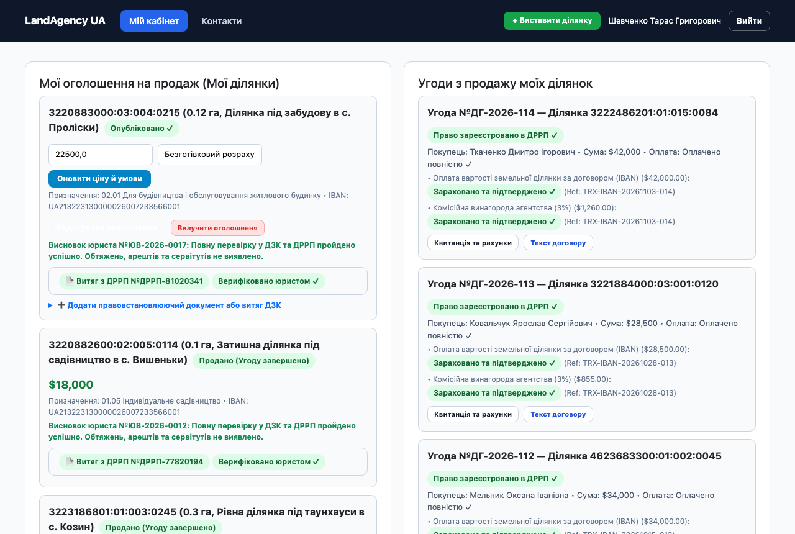

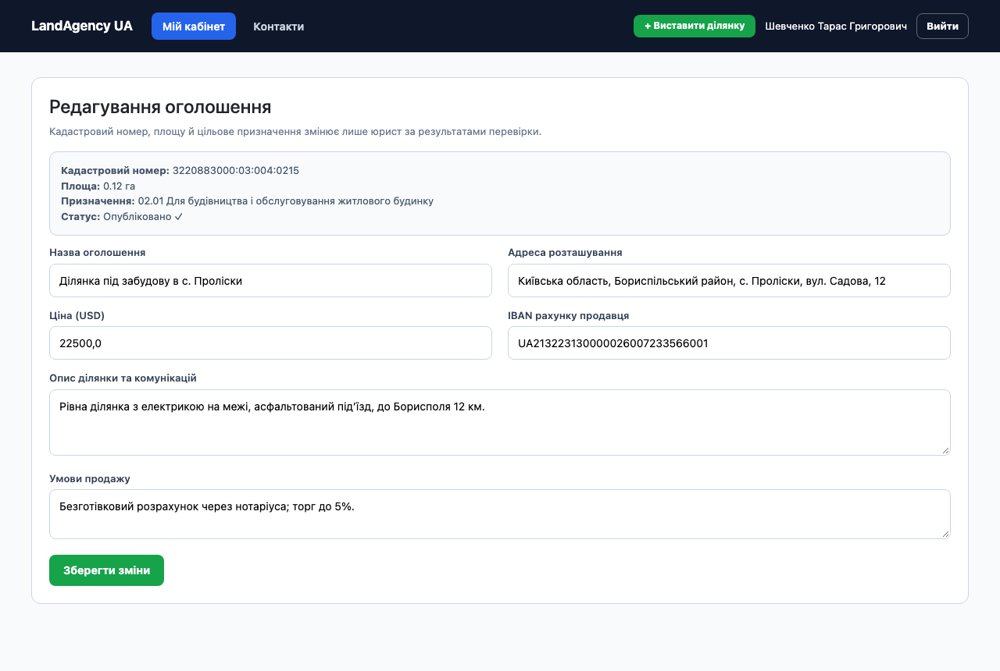

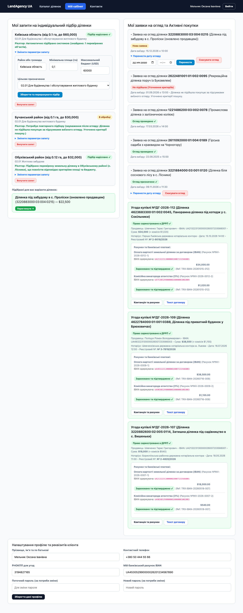

### 4.3 Нові дані ділянки: умови продажу, координати, фото та відео

Прецеденти UC-10 та UC-12 вимагали полів, яких не було в моделі. До `LandPlot` додано умови продажу (до 500 символів), широту й довготу, а нова таблиця `PlotMedia` зберігає фото та відео. Файли перевіряються за форматом і розміром (фото до 5 МБ, відео до 25 МБ), відео можна також вказати https-посиланням. Координати перевіряються в межах України. Рієлтор вносить координати й медіа, а покупець бачить їх на сторінці ділянки з посиланням на карту.

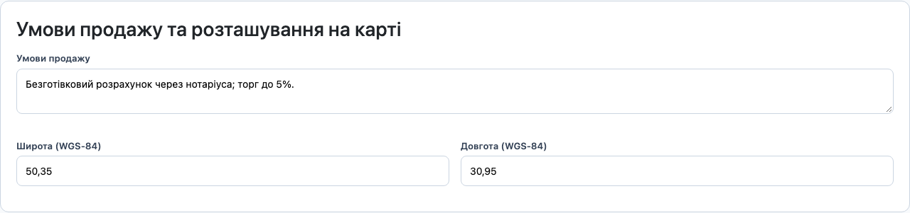

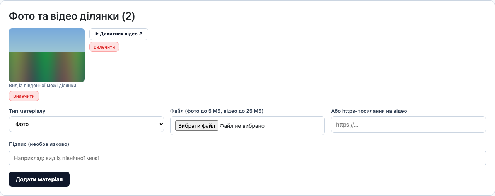

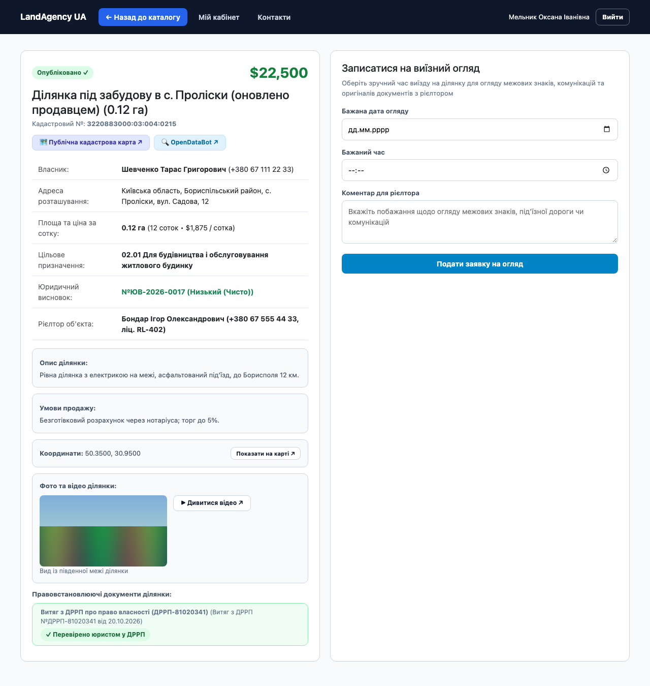

### 4.4 Правила логічності та збереження історії

Методичні вказівки вимагають не лише наявності операцій, а й їх логічності: кожна роль виконує лише природні для неї дії, а відомості, на яких тримаються звітність і аудит, не знищуються. З цього погляду код перевірено повторно. Виявлені порушення усунено, а правила закладено в доменну модель і на сервер: приховування кнопок їх лише дублює (таблиця 4).

**Таблиця 4 — Правила логічності операцій**

| Операція | Раніше | Тепер | Причина |
|---|---|---|---|
| Зміна юридичних фактів перевіреної ділянки | рієлтор міг змінити кадастровий номер, площу, призначення, власника, номер документа | поля закриті; змінити їх можна, коли юрист відкликає висновок | ділянка не лишається «перевіреною» з іншими фактами |
| Верифіковані документи | рієлтор міг змінити чи вилучити; доданий ним документ верифікувався автоматично | не змінюються й не вилучаються; доданий документ не верифікований | верифікацію надає лише юрист |
| Вилучення ділянки | разом із юридичним висновком і актом про ризики | лише ділянка без висновку; решту спершу повертає на перевірку юрист | висновки потрібні для аудиту земельного банку |
| Підтвердження та відхилення платежу | з будь-якого статусу | лише платіж, поданий покупцем; підтверджений не скасовується | оборот у звітності не змінюється заднім числом |
| Вилучення огляду | будь-який | лише новий, скасований, відхилений покупцем | проведений огляд є підставою для угоди |
| Статус огляду | довільний, у тому числі назад | лише допустимі переходи; покупець не скасовує проведений | послідовність процесу |
| Платежі та акаунти співробітників | немає довільного керування | залишено без змін | фінансова історія недоторканна; адміністратора немає, співробітників створює агенція |

Особливо важливе рішення стосується платежів: сума виводиться з ціни угоди, статус змінюється лише через подання й підтвердження, а вилучаються платежі тільки разом із чернеткою угоди. Окреме створення, зміна чи вилучення рахунку вручну порушили б звітність і статистику, тому додавати їх було б помилкою, а не повнотою.

Перевірку виконано запитами від імені відповідних ролей, зокрема підробленими запитами в обхід інтерфейсу. У всіх перевірках правила спрацювали, а сторінка вилучення пояснює користувачеві, що робити (наприклад, звернутися до юриста для відкликання висновку).

## 5 Відповідність операцій властивостям ACID

База даних — SQLite; її транзакції надають основу, а кожну властивість додатково налаштовано та перевірено окремо.

### 5.1 Атомарність (Atomicity)

Раніше дії з кількома збереженнями виконувалися без транзакції: якщо другий крок завершувався помилкою, перший лишався в базі. Тепер створення угоди, реєстрація ділянки (продавцем і рієлтором), заявка на купівлю, запит на підбір, юридичний висновок і редагування ділянки виконуються в явній транзакції. Файлова система не входить у транзакцію бази, тому при невдалій реєстрації ділянки завантажений файл вилучається вручну.

Лістинг 3 — Створення угоди в транзакції (Controllers/RealtorController.Deals.cs)

```csharp
        _db.SaleDeals.Add(deal);
        await _db.SaveChangesAsync();

        _db.Payments.AddRange(deal.CreateDefaultPayments(
            plot.SellerBankIban ?? plot.Seller?.BankDetails,
            isPaid: false,
            agencyIban: currentUser?.BankDetails));
        await _db.SaveChangesAsync();
        await transaction.CommitAsync();
```

**Перевірка.** Щоб змусити другий крок завершитися помилкою, у базі підмінено номер рахунку так, що рахунок нової угоди порушив унікальність. Кількість угод до спроби дорівнювала 14, після спроби лишилась 14: угода не збереглася. Користувач бачить повідомлення «Усі зміни скасовано». Після усунення причини повторна спроба створила угоду з двома рахунками.

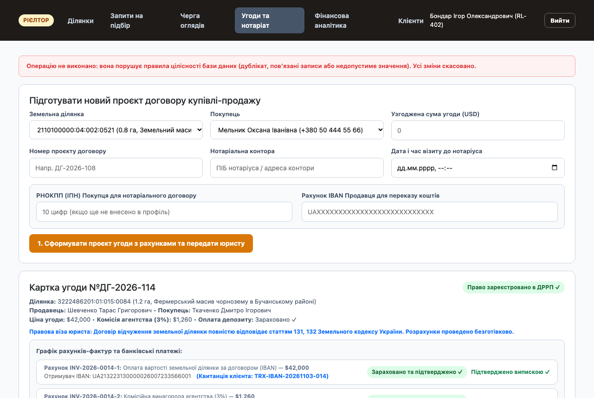

### 5.2 Узгодженість (Consistency)

Правила цілісності діють у самій базі, тому їх не можна обійти помилкою в коді. Налаштовано обмеження CHECK, частковий унікальний індекс «одна активна угода на ділянку» та зовнішні ключі `Restrict`/`Cascade`.

Лістинг 4 — Обмеження цілісності (Models/LandAgencyContext.cs)

```csharp
        modelBuilder.Entity<SaleDeal>()
            .HasIndex(d => d.LandPlotId)
            .IsUnique()
            .HasDatabaseName("UX_SaleDeals_LandPlotId_Active")
            .HasFilter($"\"Status\" <> {(int)DealStatus.Cancelled}");
```

**Таблиця 5 — Обмеження цілісності та результат перевірки порушень**

| Правило | Обмеження | Результат спроби порушити |
|---|---|---|
| Площа ділянки додатна | CK_LandPlots_Area | CHECK constraint failed |
| Ціна ділянки додатна | CK_LandPlots_Price | відхилено |
| Координати в межах України | CK_LandPlots_Latitude, CK_LandPlots_Longitude | CHECK constraint failed |
| Роль користувача 0–3 | CK_Users_Role | CHECK constraint failed |
| Суми угод і платежів | CK_SaleDeals_Price, CK_SaleDeals_Commission, CK_Payments_Amount | відхилено |
| Одна активна угода на ділянку | UX_SaleDeals_LandPlotId_Active | UNIQUE constraint failed |
| Цілісність посилань | зовнішні ключі | FOREIGN KEY constraint failed |

Під час перевірки знайдено ще один дефект: номер договору для другої угоди на ту саму ділянку після скасування першої збігався з попереднім і порушував унікальний індекс; тепер такий номер отримує числовий суфікс.

### 5.3 Ізоляція (Isolation)

SQLite виконує записи по одному, але між двома запитами користувачів лишається ризик втрачених оновлень: двоє відкрили форму, перший зберіг, другий затер чужі зміни. Щоб цього уникнути, ділянки й угоди мають маркер версії `Version`, який змінюється при кожному оновленні. Форма редагування передає версію, з якою її відкрито, і збереження зі застарілою версією відхиляється.

Лістинг 5 — Маркер версії та його оновлення (Models/LandAgencyContext.cs)

```csharp
    public void UseSubmittedVersion<T>(T entity, Guid submittedVersion) where T : class, IVersioned
    {
        if (submittedVersion != Guid.Empty)
        {
            Entry(entity).Property(e => e.Version).OriginalValue = submittedVersion;
        }
    }

    private void StampVersions()
    {
        foreach (var entry in ChangeTracker.Entries<IVersioned>().Where(e => e.State == EntityState.Modified))
        {
            entry.Entity.Version = Guid.NewGuid();
        }
    }
```

Фільтр `DatabaseExceptionFilter` перетворює конфлікт паралельного редагування й порушення цілісності на зрозуміле повідомлення та повертає користувача на попередню сторінку, замість сторінки помилки.

**Перевірка.** Відкрито форму редагування ділянки, після чого в базі змінено цей рядок (імітація роботи іншого користувача). Збереження зі старою версією відхилено: назва в базі лишилась чужою, а користувач бачить повідомлення про конфлікт. Збереження з поточною версією пройшло, і версія змінилася.

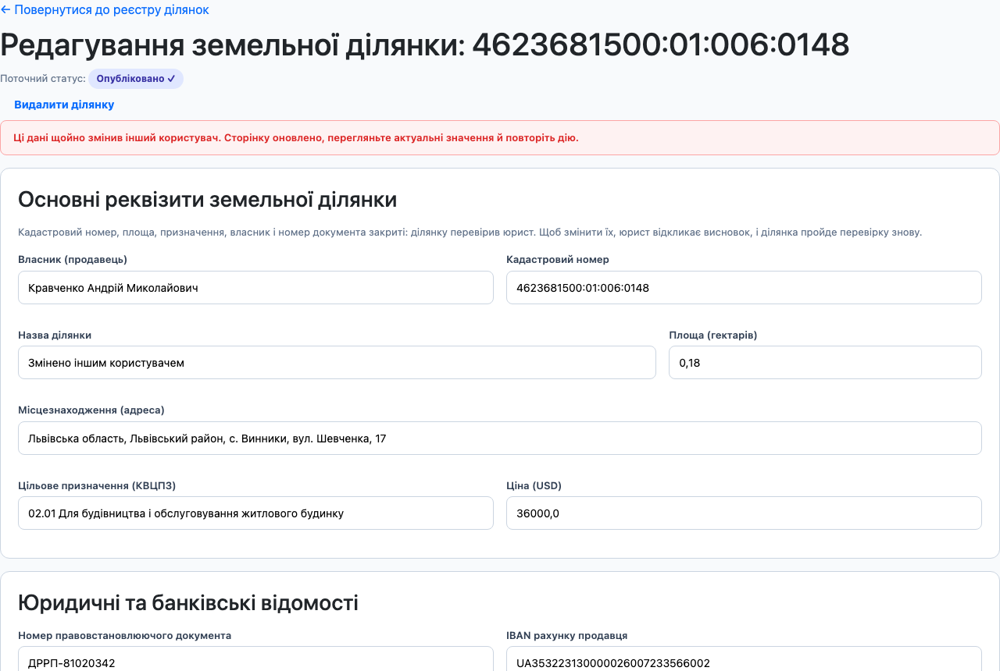

### 5.4 Довговічність (Durability)

У режимі WAL SQLite за замовчуванням використовує `synchronous = NORMAL`, який не гарантує збереження підтвердженої транзакції при втраті живлення. Перехоплювач з'єднань вмикає повну синхронізацію на кожному відкритому з'єднанні.

Лістинг 6 — Повна синхронізація запису (Data/SqliteDurabilityInterceptor.cs)

```csharp
    private const string FullSynchronous = "PRAGMA synchronous = FULL;";

    public override void ConnectionOpened(DbConnection connection, ConnectionEndEventData eventData)
    {
        Apply(connection);
    }
```

**Перевірка.** Тимчасова діагностика показала значення `synchronous = 2` (FULL) на всіх 168 відкритих з'єднаннях. Після підтвердженого запису застосунок зупинено командою `kill -9`, і після перезапуску записи (15 угод і змінена назва ділянки) були на місці.

**Таблиця 6 — Підсумок перевірки властивостей ACID**

| Властивість | Сценарій перевірки | Результат |
|---|---|---|
| Атомарність | збій на другому кроці створення угоди | 14 угод до та після; повторна спроба успішна |
| Узгодженість | вставка ділянки з площею 0, другої активної угоди, широти 80, ролі 9, висячого посилання | усі спроби відхилено базою |
| Ізоляція | збереження форми зі застарілою версією | відхилено з повідомленням; збереження з поточною версією пройшло |
| Довговічність | `kill -9` після запису; значення `synchronous` | дані збережено; FULL на всіх з'єднаннях |

## 6 Наскрізна перевірка повноти за діаграмою прецедентів

Усі 21 прецедент пройдено послідовним сценарієм на чистій базі від імені чотирьох ролей. Сценарій охоплює реєстрацію нових продавця й покупця, вхід усіх ролей, виставлення ділянки з документом, перевірку в ДЗК, схвалення й відхилення юристом (акт про ризики для номера з обтяженням), додавання координат, фото й відео, запит на підбір, огляд із перенесенням дати, створення угоди з автоматичною комісією, візу юриста, оплату, підписання покупцем і реєстрацію переходу права.

**Таблиця 7 — Протокол наскрізного сценарію**

| Прецеденти | Перевірка | Результат |
|---|---|---|
| UC-07, UC-16 | реєстрація продавця й покупця, вхід рієлтора й юриста єдиною сторінкою | виконано |
| UC-08, UC-09, UC-10, UC-11 | ділянка зареєстрована, видно попередній запит до ДЗК, ціну й умови змінено, додано документи | виконано |
| UC-17, UC-18, UC-19 | юрист бачить ділянку в черзі, витяг із ДЗК, висновок схвалено | виконано |
| UC-20 | номер із обтяженням відхилено, сформовано акт про ризики | виконано |
| UC-12 | координати, фото, відео збережено | виконано |
| UC-01, UC-02 | запит на підбір, нова ділянка потрапила до підбору | виконано |
| UC-03, UC-04, UC-13 | огляд замовлено, перенесено, підтверджено й проведено | виконано |
| UC-14, UC-15 | угоду створено з двома рахунками; комісія 3% від $30 000 дорівнює $900 | виконано |
| UC-06, UC-05 | без оплати підпис неможливий; після підтвердженої оплати договір підписано | виконано |
| UC-21 | без повної оплати право не реєструється; після неї угоду завершено, ділянку переведено в «Продано» | виконано |

Усього виконано 30 перевірок, усі успішні. Архів вилучених ділянок і єдиний вхід додано пізніше, тому їх перевірено окремо: вилучення без причини відхиляється, тригери бази блокують зміни архіву, кожна роль після входу потрапляє у свої розділи. Після сценарію `PRAGMA foreign_key_check` повертає порожній результат, а `PRAGMA integrity_check` дорівнює `ok`. Один результат на першому проході (перевірка повідомлення UC-09) виявився помилкою самого тесту: повідомлення, що показується одноразово, вже було показане на попередній сторінці; окрема перевірка підтвердила, що для чистого номера повертається «Низький (Чисто)», для номера з арештом «Високий (Виявлено обтяження)», а некоректний код області відхиляється до запиту.

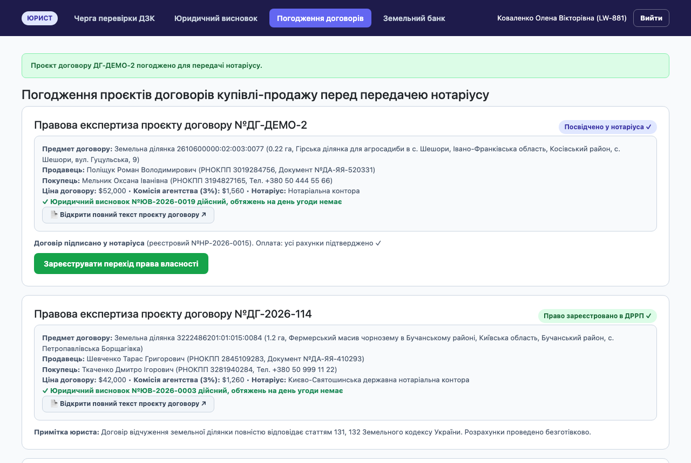

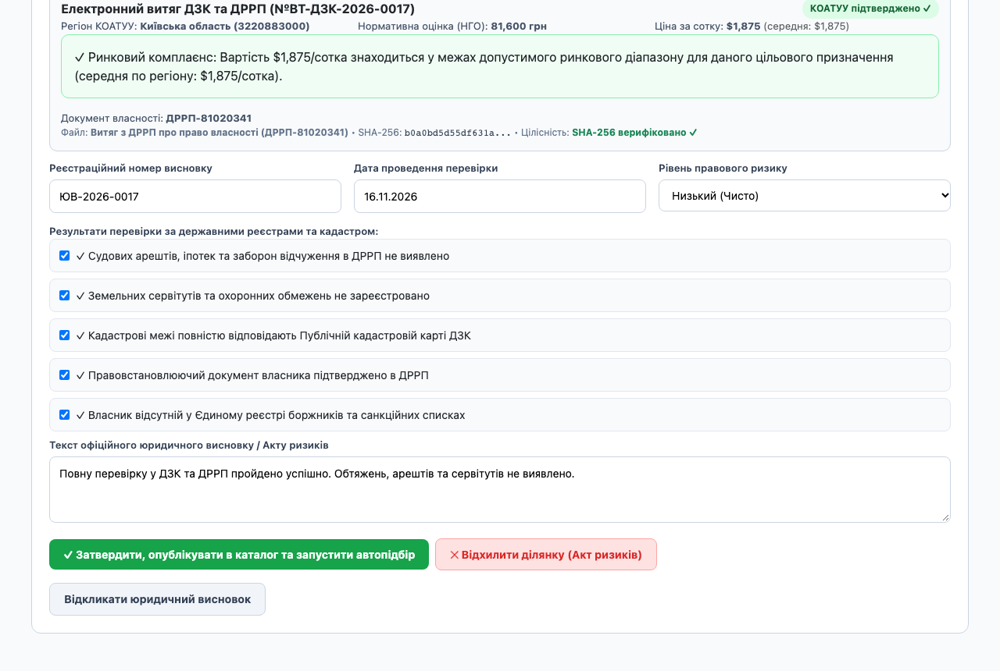

## 7 Структура та читабельність коду

Файли контролерів рієлтора (1464 рядки) і клієнта (1200 рядків) стали важкими для навігації. Їх розділено на `partial`-класи за темами; маршрути, види й поведінка не змінилися, а найбільший файл тепер має 489 рядків. Рієлтор має файли для запитів на підбір, оглядів, ділянок, угод, клієнтської бази й аналітики; клієнт має файли для каталогу, оглядів, угод, ділянок продавця й кабінету. Кабінет клієнта, який змішував блоки продавця й покупця в одному файлі на 330 рядків, розділено на два часткові подання.

Усі дії, що реалізують прецеденти, мають у документації рядок `UC-nn`, а допоміжні довідники генеруються: `PROJECT_GUIDE.md` містить карту прецедентів, матрицю CRUD, таблицю місць реалізації ACID, сценарій демонстрації та таблицю типових запитань на захисті з вказівками «де це в коді».

## 8 Дефекти, виявлені під час перевірки

Перевірка повноти виявила дефекти, не пов'язані з новими можливостями, які також усунено:

- сценарій початкового наповнення бази завершувався помилкою на чистій базі («індекс уже існує»), через що застосунок не запускався без старого файлу бази; тепер індекси створюються ідемпотентно, а сам сценарій регенеровано зі схеми EF;
- форму редагування ділянки рієлтором було неможливо зберегти в браузері зі скриптами: порожній рядок «додати документ» неявно вимагав заповнення, а поле ціни відхиляло значення на кшталт `36000.0` через атрибут `step`;
- через CRM можна було вилучити обліковий запис співробітника без угод;
- після вилучення ділянки ідентифікатор лишався в збігах запитів на підбір;
- другий договір на ту саму ділянку після скасування першого порушував унікальність номера;
- у сіді ділянка «на перевірці» вже мала юридичний висновок, що суперечить процесу; висновок вилучено, і ця ділянка слугує прикладом для відхилення юристом;
- логічні прогалини наведено в підрозділі 4.4: зміна юридичних фактів після перевірки, довільні переходи статусів платежу й огляду, вилучення верифікованих документів, проведених оглядів та ділянок із висновком.

## 9 Висновки

1. Діаграму прецедентів ЛР № 1 зіставлено з кодом: з 21 прецедента повністю збігалися 8, решту доопрацьовано, після чого всі 21 реалізовано та пройдено наскрізним сценарієм із 30 перевірок.
2. Ролі приведено у відповідність до діаграми: Покупець, Продавець, Рієлтор, Юрист. Відсутню на діаграмі роль Admin вилучено, вхід для всіх ролей єдиний, а архів вилучених ділянок зберігає історію вилучень.
3. CRUD забезпечено для всіх дев'яти таблиць; додано редагування й вилучення власних оголошень продавцем, власних запитів на підбір покупцем і відкликання висновку юристом з обмеженнями, що захищають фінансову й юридичну історію. Операції приведено у відповідність до логіки ролей: юридичні факти перевіреної ділянки, платежі, верифіковані документи й проведені огляди захищені правилами домену.
4. Властивості ACID забезпечено й перевірено: атомарність через явні транзакції, узгодженість через обмеження бази даних, ізоляцію через токен версії рядка, довговічність через повну синхронізацію запису.
5. Для кожної властивості виконано демонстрацію (відкат, порушення обмежень, конфлікт версій, зупинка застосунку командою `kill -9`), результати наведено в таблицях 6 і 7.
6. Код стало легше читати й пояснювати: контролери розділено за темами, кожну дію прив'язано до номера прецеденту, а карту «прецедент → код» генерує скрипт.

## 10 Перелік використаних джерел

1. Методичні вказівки до лабораторної роботи № 5 «CRUD, ACID, повнота функціоналу» з дисципліни «Об'єктно-орієнтоване програмування».
2. Mark J. Price. C# 11 and .NET 7 – Modern Cross-Platform Development Fundamentals. 7th Edition. Packt Publishing, 2022. ISBN: 978-1-80323-780-0.
3. Настенко Д. В., Нестерко А. Б. Об'єктно-орієнтоване програмування. Частина 1. Основи об'єктно-орієнтованого програмування на мові C#: навчальний посібник. К.: НТУУ «КПІ», 2016. 76 с.
4. Microsoft Learn. Entity Framework Core: Transactions, Concurrency Conflicts. URL: https://learn.microsoft.com/ef/core/saving/ .
5. SQLite Documentation. Atomic Commit in SQLite; PRAGMA synchronous. URL: https://www.sqlite.org/docs.html .
6. ДСТУ 3008:2015. Інформація та документація. Звіти у сфері науки і техніки. Структура та правила оформлювання. К.: ДП «УкрНДНЦ», 2016.
