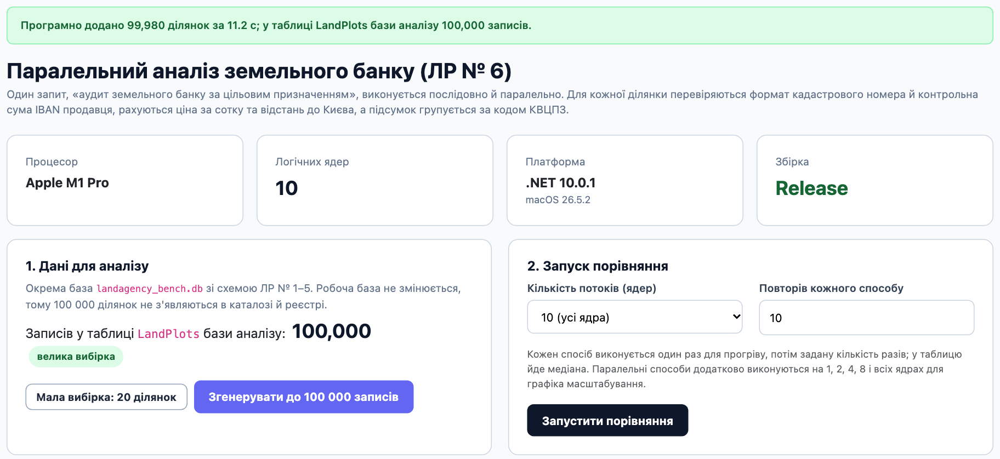
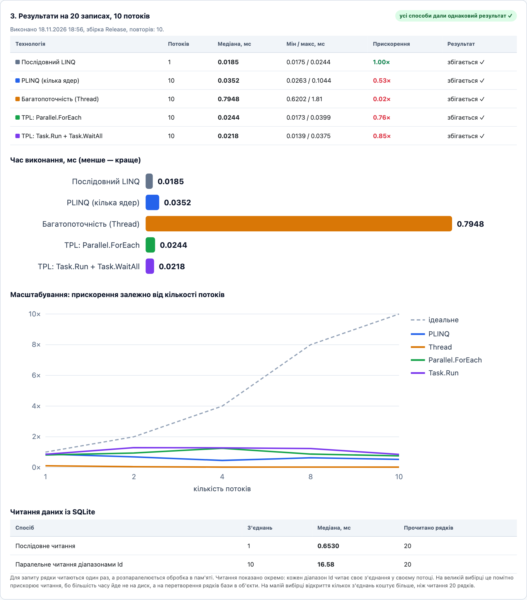
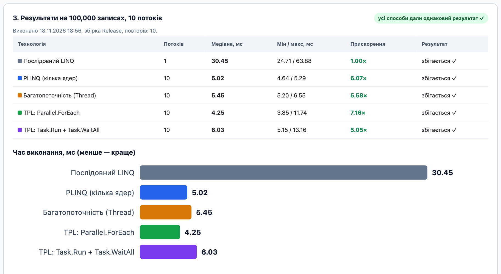
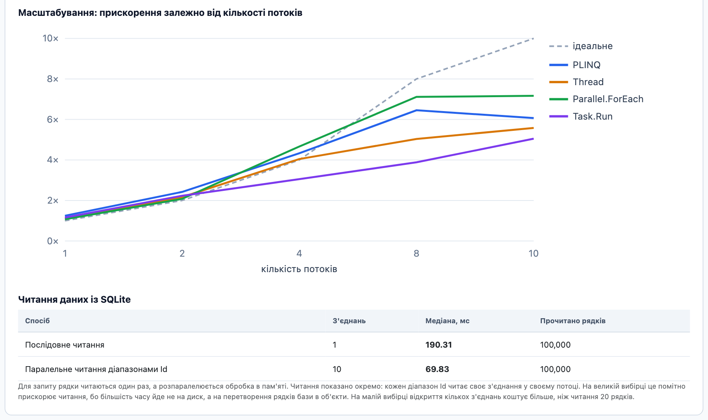
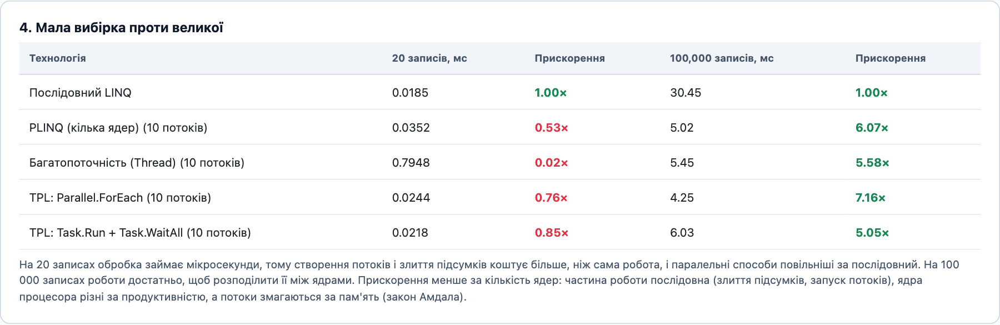
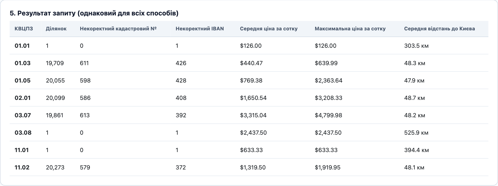

## 1 Тема, мета та завдання роботи

**Тема роботи:** паралельна обробка даних.

**Мета роботи:** опрацювати методи підвищення швидкодії застосунків на прикладі проєкту «Система автоматизації агентства земельних ділянок» (LandAgencyMvc): виконати один і той самий запит на вибірку даних послідовно й паралельно, порівняти час на малому (до 20 записів) і великому (близько 100 000 записів) обсязі даних і порівняти різні технології розпаралелювання.

**Завдання згідно з методичними вказівками:**

- виконати один довільний запит на вибірку даних спочатку послідовно, потім паралельно;
- порівняти час роботи запиту на незначних обсягах даних (до 20 записів у таблиці) при послідовному й паралельному виконанні;
- програмно доповнити одну з таблиць бази даних, розробленої на ЛР № 1–5, так, щоб кількість записів становила близько 100 000;
- порівняти час роботи послідовного й паралельного запитів на такому обсязі даних;
- розпаралелити той самий запит різними технологіями (на кількох ядрах із самостійно обраною кількістю ядер, багатопоточність, TPL), порівняти час виконання й оформити результати у вигляді таблиці.

**Результат у стислому вигляді.** У застосунок додано окрему сторінку рієлтора «Паралельний аналіз». На ній запит «аудит земельного банку за цільовим призначенням» виконується п'ятьма способами: послідовним LINQ, PLINQ на заданій кількості ядер, ручними потоками `Thread`, `Parallel.ForEach` і `Task.Run` з TPL. Таблицю `LandPlots` окремої бази аналізу програмно доповнено до 100 000 записів. На 20 записах усі паралельні способи повільніші за послідовний або не швидші за нього. На 100 000 записах найкращий результат дав `Parallel.ForEach`: прискорення в 7,16 раза на 10 потоках процесора Apple M1 Pro. Усі способи дали однаковий результат запиту.

## 2 Обраний запит

### 2.1 Що рахує запит

Для паралельної обробки обрано запит, у якому на кожен рядок припадає помітна обчислювальна робота: без неї розпаралелювання не має чого прискорювати. Запит «аудит земельного банку за цільовим призначенням» природний для агентства: перед публікацією й угодами важливо знати, скільки ділянок мають помилки в реквізитах, яка ціна за сотку й наскільки далеко ділянки від Києва. Для кожної ділянки таблиці `LandPlots` запит:

- перевіряє формат кадастрового номера (групи з 10, 2, 3 і 4 цифр через двокрапку);
- перевіряє контрольну суму IBAN продавця за модулем 97 (ISO 13616);
- рахує ціну за сотку;
- рахує відстань від центру ділянки до центру Києва за формулою гаверсинуса.

Результат групується за кодом КВЦПЗ: кількість ділянок, кількість некоректних кадастрових номерів і IBAN, середня й максимальна ціна за сотку, середня відстань до Києва (лістинг 1).

Лістинг 1 — Обробка однієї ділянки в запиті (Models/ParallelAnalysisModels.cs)

```csharp
public void Add(PlotAnalysisRow row)
{
    if (!_groups.TryGetValue(row.Purpose, out var stats))
    {
        stats = new PurposeGroupStats { PurposeCode = LandBankAudit.PurposeCode(row.Purpose) };
        _groups[row.Purpose] = stats;
    }

    stats.Count++;
    if (!LandPlot.IsValidCadastralFormat(row.CadastralNumber))
    {
        stats.InvalidCadastralCount++;
    }

    if (!LandBankAudit.IsValidUaIban(row.SellerBankIban))
    {
        stats.InvalidIbanCount++;
    }

    if (row.AreaHectares > 0)
    {
        decimal perSotka = Math.Round(row.PriceUsd / (decimal)(row.AreaHectares * 100.0), 2);
        stats.SumPricePerSotkaUsd += perSotka;
        if (perSotka > stats.MaxPricePerSotkaUsd)
        {
            stats.MaxPricePerSotkaUsd = perSotka;
        }
    }

    if (row.Latitude.HasValue && row.Longitude.HasValue)
    {
        stats.WithCoordinatesCount++;
        stats.SumDistanceMeters += LandBankAudit.DistanceToKyivMeters(row.Latitude.Value, row.Longitude.Value);
    }
}
```

### 2.2 Однаковий результат за будь-якого способу виконання

Кожен потік накопичує власний проміжний підсумок `LandBankAccumulator`, а наприкінці підсумки зливаються методом `Merge`. Спільних змінних під час обробки немає, тому блокування потрібне лише на етапі злиття. Суми цілочисельні (кількості, відстані в метрах) або типу `decimal` (ціни), тому результат не залежить від того, у якому порядку потоки обробили рядки. Це дає змогу перевіряти кожен паралельний спосіб: його результат порівнюється з послідовним групу за групою, і на сторінці видно позначку «збігається» для кожного способу.

Дві деталі реалізації впливають на масштабування:

- ключ словника груп — повне значення призначення, а код КВЦПЗ визначається лише раз на групу. Якби для кожної ділянки створювався новий рядок коду, потоки чекали б на збирач сміття;
- формат кадастрового номера перевіряється посимвольно, без регулярного виразу. Об'єкт `Regex` зберігає лише один готовий обробник, тому паралельні потоки змагалися б за нього й створювали нові. Після цієї заміни прискорення на 8 потоках зросло приблизно з 2 до 6–7 разів.

## 3 Дані для аналізу

Вимірювання виконуються на окремій базі `landagency_bench.db`, яка має ту саму схему, що й робоча база ЛР № 1–5. Так 100 000 згенерованих ділянок не потрапляють у каталог, реєстр рієлтора й автоматичний підбір, і демонстрація ЛР № 4–5 лишається незмінною.

- **Мала вибірка.** Кнопка «Мала вибірка: 20 ділянок» створює базу аналізу заново й копіює в таблицю `LandPlots` 20 ділянок із робочої бази.
- **Велика вибірка.** Кнопка «Згенерувати до 100 000 записів» програмно доповнює ту саму таблицю до 100 000 записів (лістинг 2). Генератор використовує фіксоване зерно `Random`, тому дані щоразу однакові. Кадастрові номери унікальні, коди КВЦПЗ і райони реальні, ціни залежать від призначення й площі. Приблизно 3% кадастрових номерів і 2% IBAN навмисно некоректні, щоб перевіркам запиту було що відсіювати. Записи додаються пачками по 5 000 в одній транзакції; 99 980 записів додаються приблизно за 11 с.

Лістинг 2 — Програмне доповнення таблиці LandPlots пачками в одній транзакції (Services/ParallelAnalysisService.cs)

```csharp
await using var transaction = await db.Database.BeginTransactionAsync();
for (int start = 0; start < toAdd; start += InsertBatchSize)
{
    int end = Math.Min(start + InsertBatchSize, toAdd);
    var batch = new List<LandPlot>(end - start);
    for (int i = start; i < end; i++)
    {
        batch.Add(GeneratePlot(i, sellerId, random, createdBase));
    }

    db.LandPlots.AddRange(batch);
    await db.SaveChangesAsync();
    db.ChangeTracker.Clear();
}

await transaction.CommitAsync();
```



## 4 Способи виконання запиту

Той самий запит виконується п'ятьма способами (таблиця 1). Кількість потоків для паралельних способів обирається на сторінці: 1, 2, 4, 8 або всі 10 логічних ядер.

**Таблиця 1 — Способи виконання запиту**

| Спосіб | Технологія | Як ділиться робота |
|---|---|---|
| Послідовний LINQ | один потік | цикл по всіх рядках |
| PLINQ | розпаралелювання на кількох ядрах, `AsParallel().WithDegreeOfParallelism(n)` | PLINQ сам ділить рядки між n ядрами, підсумки зливає `Aggregate` |
| Багатопоточність | ручні потоки `Thread` | масив ділиться на n рівних частин, кожну обробляє свій потік, `Join` чекає всіх |
| TPL: `Parallel.ForEach` | Task Parallel Library | `Partitioner` ділить масив на діапазони (по 4 на потік), вільний потік бере наступний діапазон |
| TPL: `Task.Run` | Task Parallel Library | n завдань пулу потоків на рівних частинах масиву, `Task.WaitAll` чекає всіх |

Лістинг 3 — Послідовне виконання і PLINQ на заданій кількості ядер (Services/ParallelAnalysisService.cs)

```csharp
public static List<PurposeGroupStats> RunSequential(PlotAnalysisRow[] rows)
{
    var accumulator = new LandBankAccumulator();
    foreach (var row in rows)
    {
        accumulator.Add(row);
    }

    return accumulator.ToResult();
}

public static List<PurposeGroupStats> RunPlinq(PlotAnalysisRow[] rows, int threads) =>
    rows.AsParallel()
        .WithDegreeOfParallelism(threads)
        .Aggregate(
            () => new LandBankAccumulator(),
            (accumulator, row) => { accumulator.Add(row); return accumulator; },
            (left, right) => { left.Merge(right); return left; },
            accumulator => accumulator.ToResult());
```

Лістинг 4 — Багатопоточність на ручних потоках Thread (Services/ParallelAnalysisService.cs)

```csharp
public static List<PurposeGroupStats> RunThreads(PlotAnalysisRow[] rows, int threads)
{
    var partials = new LandBankAccumulator[threads];
    var workers = new Thread[threads];
    int chunk = (rows.Length + threads - 1) / threads;

    for (int t = 0; t < threads; t++)
    {
        int index = t;
        int from = Math.Min(rows.Length, index * chunk);
        int to = Math.Min(rows.Length, from + chunk);
        workers[t] = new Thread(() =>
        {
            var accumulator = new LandBankAccumulator();
            for (int i = from; i < to; i++)
            {
                accumulator.Add(rows[i]);
            }

            partials[index] = accumulator;
        });
        workers[t].Start();
    }

    foreach (var worker in workers)
    {
        worker.Join();
    }

    return MergeAll(partials);
}
```

Лістинг 5 — TPL: Parallel.ForEach із локальним підсумком потоку (Services/ParallelAnalysisService.cs)

```csharp
public static List<PurposeGroupStats> RunParallelForEach(PlotAnalysisRow[] rows, int threads)
{
    var total = new LandBankAccumulator();
    var sync = new object();
    int rangeSize = Math.Max(1, rows.Length / (threads * 4));

    Parallel.ForEach(
        Partitioner.Create(0, rows.Length, rangeSize),
        new ParallelOptions { MaxDegreeOfParallelism = threads },
        () => new LandBankAccumulator(),
        (range, _, accumulator) =>
        {
            for (int i = range.Item1; i < range.Item2; i++)
            {
                accumulator.Add(rows[i]);
            }

            return accumulator;
        },
        accumulator =>
        {
            lock (sync)
            {
                total.Merge(accumulator);
            }
        });

    return total.ToResult();
}
```

Лістинг 6 — TPL: Task.Run на частинах масиву (Services/ParallelAnalysisService.cs)

```csharp
public static List<PurposeGroupStats> RunTasks(PlotAnalysisRow[] rows, int threads)
{
    int chunk = (rows.Length + threads - 1) / threads;
    var tasks = new Task<LandBankAccumulator>[threads];
    for (int t = 0; t < threads; t++)
    {
        int from = Math.Min(rows.Length, t * chunk);
        int to = Math.Min(rows.Length, from + chunk);
        tasks[t] = Task.Run(() =>
        {
            var accumulator = new LandBankAccumulator();
            for (int i = from; i < to; i++)
            {
                accumulator.Add(rows[i]);
            }

            return accumulator;
        });
    }

    Task.WaitAll(tasks);
    return MergeAll(tasks.Select(t => t.Result));
}
```

## 5 Методика вимірювань

Вимірювання виконано на ноутбуці з процесором Apple M1 Pro (10 логічних ядер: 8 продуктивних і 2 енергоефективні), macOS 26.5, .NET 10.0.1, у збірці Release (у збірці Debug вимкнено оптимізації компілятора). Сторінка показує ці характеристики, щоб результати можна було порівнювати.

- Рядки читаються з бази один раз, а розпаралелюється обробка в пам'яті. Читання з SQLite виміряно окремо (розділ 6.5).
- Перед вимірюваннями всі способи виконуються протягом 1,5 с для прогріву. JIT спершу компілює методи без оптимізацій і лише після кількох викликів замінює їх оптимізованими, тому без прогріву перший виміряний спосіб був би несправедливо повільним.
- Кожен спосіб виконується один раз окремо, потім 10 разів із вимірюванням через `Stopwatch` (лістинг 7). У таблицю потрапляє медіана, яка менше залежить від випадкових пауз системи, ніж середнє.
- Кожен прогін перевіряє, що результат збігається з послідовним.

Лістинг 7 — Вимірювання часу одного способу (Services/ParallelAnalysisService.cs)

```csharp
private static TechniqueTiming Measure(
    AnalysisTechnique technique, int threads, int repetitions, List<PurposeGroupStats> expected, Func<List<PurposeGroupStats>> run)
{
    var warmup = run();
    bool matches = SameResult(expected, warmup);

    var samples = new double[repetitions];
    var stopwatch = new Stopwatch();
    for (int r = 0; r < repetitions; r++)
    {
        stopwatch.Restart();
        var result = run();
        stopwatch.Stop();
        samples[r] = stopwatch.Elapsed.TotalMilliseconds;
        matches &= SameResult(expected, result);
    }

    Array.Sort(samples);
    double median = repetitions % 2 == 1
        ? samples[repetitions / 2]
        : (samples[repetitions / 2 - 1] + samples[repetitions / 2]) / 2;

    return new TechniqueTiming
    {
        Technique = technique,
        Threads = threads,
        MedianMs = Math.Round(median, 4),
        MinMs = Math.Round(samples[0], 4),
        MaxMs = Math.Round(samples[^1], 4),
        ResultMatches = matches
    };
}
```

## 6 Результати

### 6.1 Мала вибірка: 20 записів

**Таблиця 2 — Час виконання запиту на 20 записах, 10 потоків**

| Спосіб | Медіана, мс | Прискорення відносно послідовного |
|---|---|---|
| Послідовний LINQ | 0,0185 | 1,00 |
| PLINQ | 0,0352 | 0,53 |
| Багатопоточність (Thread) | 0,7948 | 0,02 |
| TPL: Parallel.ForEach | 0,0244 | 0,76 |
| TPL: Task.Run | 0,0218 | 0,85 |

На 20 записах уся робота займає близько 18 мікросекунд, тому розподіл між потоками коштує більше, ніж сама обробка. Найповільніші ручні потоки `Thread`: створення 10 нових потоків операційної системи займає майже мілісекунду, що в 40 разів довше за послідовне виконання. PLINQ, `Parallel.ForEach` і `Task.Run` беруть потоки з готового пулу, тому програють значно менше (рис. 2).



### 6.2 Велика вибірка: 100 000 записів

**Таблиця 3 — Час виконання запиту на 100 000 записах, 10 потоків**

| Спосіб | Медіана, мс | Мін / макс, мс | Прискорення відносно послідовного |
|---|---|---|---|
| Послідовний LINQ | 30,45 | 24,71 / 63,88 | 1,00 |
| PLINQ | 5,02 | 4,64 / 5,29 | 6,07 |
| Багатопоточність (Thread) | 5,45 | 5,20 / 6,55 | 5,58 |
| TPL: Parallel.ForEach | 4,25 | 3,85 / 11,74 | 7,16 |
| TPL: Task.Run | 6,03 | 5,15 / 13,16 | 5,05 |

На 100 000 записах роботи достатньо, щоб розподілити її між ядрами: усі паралельні способи швидші за послідовний у 5–7 разів (рис. 3). Найшвидший `Parallel.ForEach`: він ділить масив на дрібніші діапазони, і потік, що звільнився раніше, бере наступний. Ручні `Thread` і `Task.Run` ділять масив на рівні частини наперед, тому чекають найповільнішого потоку. Це помітно на M1 Pro, де два з десяти ядер енергоефективні й повільніші.



### 6.3 Масштабування залежно від кількості ядер

**Таблиця 4 — Медіана часу, мс, і прискорення на 100 000 записах залежно від кількості потоків**

| Потоків | PLINQ | Thread | Parallel.ForEach | Task.Run |
|---|---|---|---|---|
| 1 | 24,42 (1,25×) | 27,21 (1,12×) | 28,33 (1,07×) | 26,30 (1,16×) |
| 2 | 12,56 (2,42×) | 14,05 (2,17×) | 14,64 (2,08×) | 13,62 (2,24×) |
| 4 | 7,03 (4,33×) | 7,52 (4,05×) | 6,53 (4,67×) | 9,97 (3,05×) |
| 8 | 4,72 (6,45×) | 6,04 (5,04×) | 4,28 (7,12×) | 7,84 (3,88×) |
| 10 | 5,02 (6,07×) | 5,45 (5,58×) | 4,25 (7,16×) | 6,03 (5,05×) |

До 4 потоків прискорення майже ідеальне, тобто близьке до кількості потоків (рис. 4). Після 8 потоків воно майже не росте: додаткові два ядра енергоефективні, частина роботи лишається послідовною (запуск потоків і злиття підсумків), а потоки змагаються за пам'ять. Це відповідає закону Амдала. На одному потоці всі способи виконуються за 24–30 мс, як і послідовний; різниця між ними в межах похибки вимірювань (мінімальний час послідовного способу 24,71 мс).



### 6.4 Порівняння малої й великої вибірки

**Таблиця 5 — Прискорення на 10 потоках: 20 записів проти 100 000 записів**

| Спосіб | 20 записів | 100 000 записів |
|---|---|---|
| PLINQ | 0,53× | 6,07× |
| Багатопоточність (Thread) | 0,02× | 5,58× |
| TPL: Parallel.ForEach | 0,76× | 7,16× |
| TPL: Task.Run | 0,85× | 5,05× |

Той самий паралельний код на малих даних повільніший за послідовний, а на великих дає прискорення в 5–7 разів (рис. 5). Розпаралелювання виправдане лише тоді, коли обсяг роботи значно перевищує витрати на організацію потоків.



### 6.5 Читання даних із бази

**Таблиця 6 — Час читання рядків із SQLite**

| Спосіб | З'єднань | 20 записів, мс | 100 000 записів, мс |
|---|---|---|---|
| Послідовне читання | 1 | 0,65 | 190,31 |
| Паралельне читання діапазонами Id | 10 | 16,58 | 69,83 |

Читання теж можна розпаралелити: діапазон Id кожного потоку читає власне з'єднання й власний `DbContext`, бо `DbContext` не можна використовувати з кількох потоків одночасно. На 100 000 записах це прискорює читання в 2,7 раза, бо більшість часу йде не на диск, а на перетворення рядків бази в об'єкти. На 20 записах відкриття 10 з'єднань коштує в 25 разів більше, ніж саме читання.

### 6.6 Результат запиту

На рис. 6 показано результат запиту на 100 000 записах. Він однаковий для всіх способів. Групи 01.03, 01.05, 02.01, 03.07 і 11.02 містять згенеровані ділянки (по 19 709–20 273), серед яких близько 3% некоректних кадастрових номерів і 2% IBAN, як і задано в генераторі. Групи 01.01, 03.08 і 11.01 містять по одній ділянці з робочої бази; IBAN у цих демонстраційних записах не мають правильної контрольної суми, і запит це виявив.



## 7 Висновки

1. Запит «аудит земельного банку за цільовим призначенням» виконано послідовно й паралельно п'ятьма способами: послідовним LINQ, PLINQ на обраній кількості ядер, ручними потоками `Thread`, `Parallel.ForEach` і `Task.Run` з TPL. Усі способи дають однаковий результат, що перевіряється автоматично під час кожного прогону.
2. На 20 записах паралельне виконання не дає виграшу: прискорення від 0,02 (ручні потоки) до 0,85 (`Task.Run`). Витрати на запуск потоків і злиття підсумків перевищують саму роботу.
3. Таблицю `LandPlots` окремої бази аналізу програмно доповнено до 100 000 записів пачками в одній транзакції. Робоча база проєкту при цьому не змінилася.
4. На 100 000 записах усі паралельні способи швидші за послідовний у 5–7 разів. Найкращий результат дав `Parallel.ForEach` із динамічним розподілом діапазонів: 7,16 раза на 10 потоках. Прискорення менше за кількість ядер через закон Амдала, різні типи ядер M1 Pro і змагання потоків за пам'ять.
5. Для масштабування важливо, щоб потоки не мали спільного стану й не виділяли пам'ять у кожному рядку. Заміна спільного регулярного виразу посимвольною перевіркою і відмова від створення рядка для кожної ділянки підняли прискорення на 8 потоках приблизно з 2 до 6–7 разів.
6. PLINQ і TPL дають такий самий або кращий результат, ніж ручні потоки, з меншим обсягом коду, і не створюють нових потоків операційної системи на кожен запуск. Для таких задач у .NET доцільно використовувати саме їх.
7. Усі результати можна відтворити на сторінці рієлтора «Паралельний аналіз»: вона показує характеристики машини, створює малу й велику вибірки, запускає порівняння і будує таблиці та графіки.

## 8 Перелік використаних джерел

1. Barbara Chapman, Gabriele Jost and Ruud van der Pas. Using OpenMP. Portable Shared Memory Parallel Programming. MIT Press, 2007.
2. Mark J. Price. C# 11 and .NET 7 – Modern Cross-Platform Development Fundamentals. 7th Edition. Packt Publishing, 2022. ISBN 978-1-80323-780-0.
3. Настенко Д. В., Нестерко А. Б. Об'єктно-орієнтоване програмування. Частина 1. Основи об'єктно-орієнтованого програмування на мові C#: навчальний посібник. К.: НТУУ «КПІ», 2016. 76 с.
4. Документація C#: https://docs.microsoft.com/en-us/dotnet/csharp/
5. Task Parallel Library (TPL): https://learn.microsoft.com/en-us/dotnet/standard/parallel-programming/task-parallel-library-tpl
6. Parallel LINQ (PLINQ): https://learn.microsoft.com/en-us/dotnet/standard/parallel-programming/introduction-to-plinq
