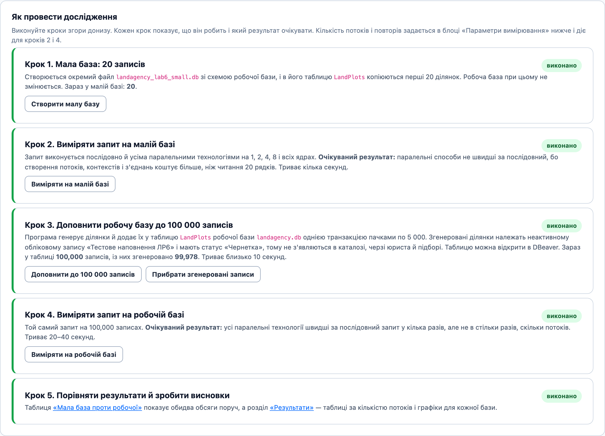
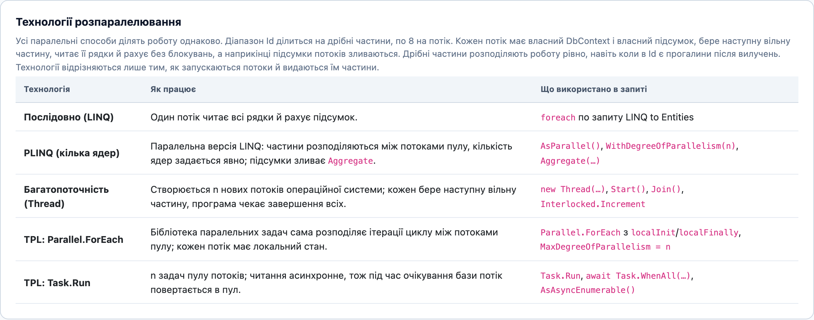
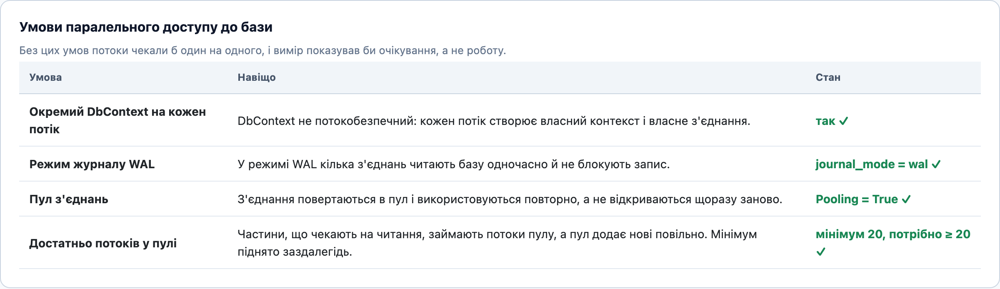
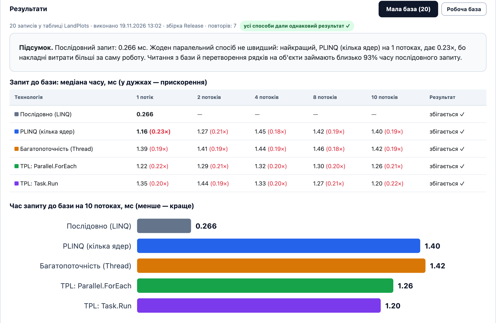
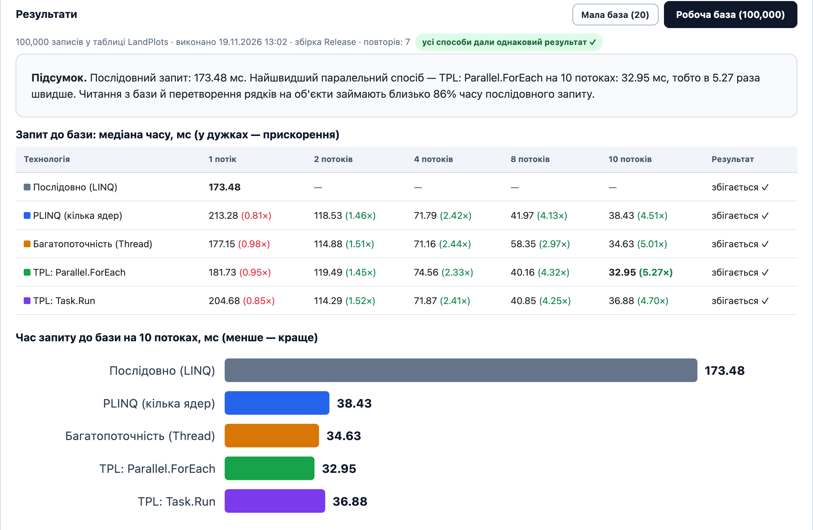
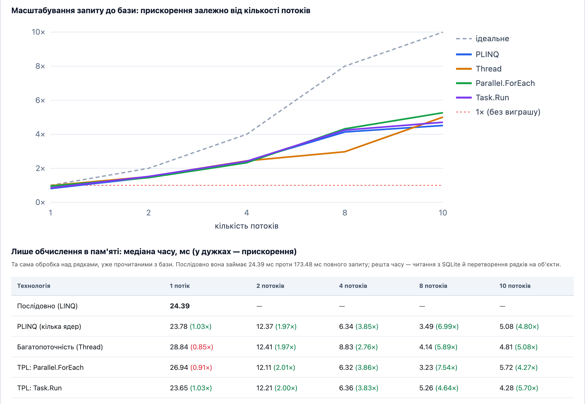
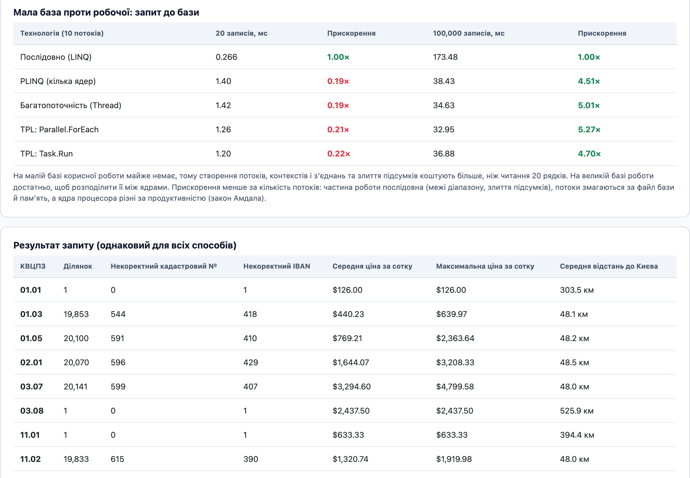
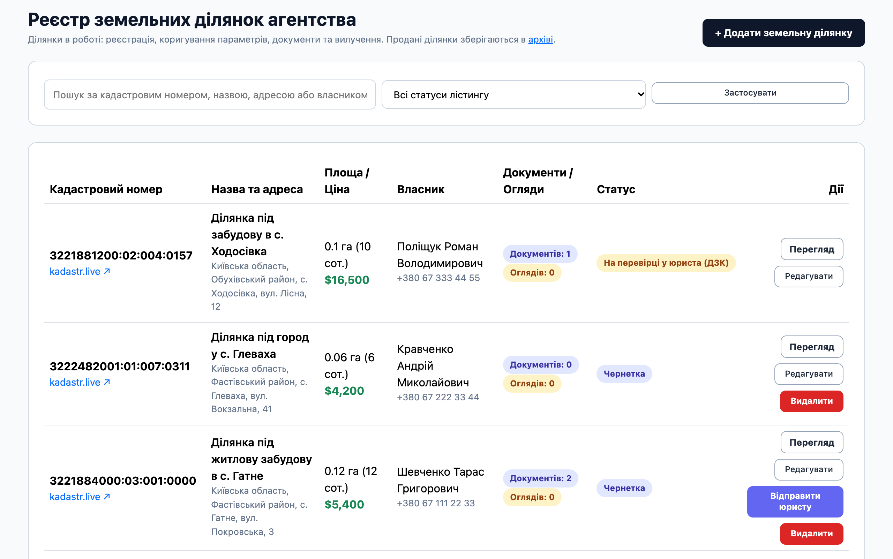
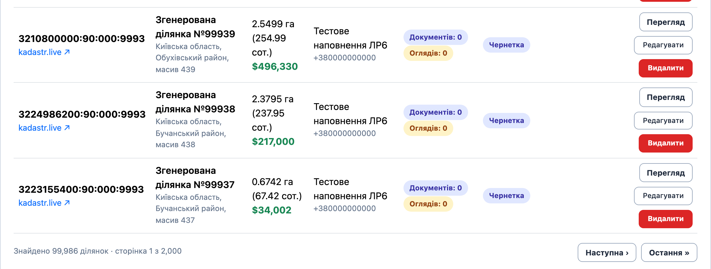

## 1 Тема, мета та завдання роботи

**Тема роботи:** паралельна обробка даних.

**Мета роботи:** опрацювати методи підвищення швидкодії застосунків на прикладі проєкту «Система автоматизації агентства земельних ділянок» (LandAgencyMvc).

**Завдання згідно з методичними вказівками:**

- виконати один довільний запит на вибірку даних спочатку послідовно, потім паралельно;
- порівняти час роботи запиту на незначних обсягах даних (до 20 записів у таблиці) при послідовному й паралельному виконанні;
- програмно доповнити одну з таблиць бази даних, розробленої на ЛР № 1–5, так, щоб кількість записів становила близько 100 000;
- порівняти час роботи послідовного й паралельного запитів на такому обсязі даних;
- розпаралелити той самий запит різними технологіями (на кількох ядрах із самостійно обраною кількістю ядер, багатопоточність, TPL), порівняти час виконання й оформити результати у вигляді таблиці.

**Результат у стислому вигляді.** Роботу виконано на проєкті ЛР № 2–5 (ASP.NET Core MVC, .NET 10, Entity Framework Core 10, SQLite). Обрано запит «аудит земельного банку за цільовим призначенням» до таблиці `LandPlots`. Таблицю `LandPlots` робочої бази `landagency.db` програмно доповнено до 100 000 записів однією транзакцією за 8,4 с. Для малого обсягу використано окрему базу з рівно 20 записами в тій самій таблиці.

Запит виконано послідовно й чотирма технологіями: PLINQ на заданій кількості ядер, ручні потоки `Thread`, `Parallel.ForEach` і `Task.Run` з TPL. Паралельно виконується сам запит до бази: кожен потік власним контекстом EF Core читає свої частини таблиці й рахує підсумок.

На 20 записах кожен паралельний варіант у 4–5 разів повільніший за послідовний. На 100 000 записах прискорення на 10 потоках становить від 4,51 до 5,27 раза; найшвидший `Parallel.ForEach` (32,95 мс проти 173,47 мс). Усі способи дали однаковий результат запиту.

Дослідження проводиться на окремій сторінці рієлтора «Паралельний аналіз» у п'ять кроків. Роботу перевіряють 29 автоматичних тестів.

## 2 Технології паралельної обробки в .NET

Послідовний запит виконує один потік. EF Core перекладає запит LINQ на SQL і читає рядки з SQLite. Потім він перетворює рядки на об'єкти, а обробка в C# рахує підсумок. Паралельний варіант ділить роботу на незалежні частини, які виконуються одночасно на різних ядрах, і наприкінці об'єднує часткові підсумки. У роботі порівнюються чотири технології паралельного виконання (таблиця 1).

**Таблиця 1 — Технології паралельного виконання запиту**

| Технологія | Як працює | Що використано |
|---|---|---|
| PLINQ (розпаралелювання на ядрах) | паралельна версія LINQ: елементи розподіляються між потоками пулу, кількість ядер задається явно | `AsParallel()`, `WithDegreeOfParallelism(n)`, `Aggregate(…)` |
| Багатопоточність (Thread) | явне створення потоків операційної системи й очікування їх завершення | `new Thread(…)`, `Start()`, `Join()`, `Interlocked.Increment` |
| TPL: Parallel.ForEach | бібліотека паралельних задач розподіляє ітерації циклу між потоками пулу, кожен потік має локальний стан | `Parallel.ForEach` з `localInit` і `localFinally`, `MaxDegreeOfParallelism = n` |
| TPL: Task.Run | кожен потік роботи — окрема задача пулу; читання з бази асинхронне, тож під час очікування потік повертається в пул | `Task.Run`, `await Task.WhenAll(…)`, `AsAsyncEnumerable()` |

Паралельність виграє лише тоді, коли корисна робота кожної частини більша за накладні витрати. До накладних витрат належать створення потоків і задач, відкриття контекстів і з'єднань та злиття результатів.

За законом Амдала прискорення обмежене часткою роботи, яку не можна розпаралелити. У цьому запиті це визначення меж діапазону Id і злиття підсумків. Крім того, паралельні частини змагаються за спільні ресурси: файл бази, кеш сторінок і пропускну здатність пам'яті.

Доступ до бази з кількох потоків має свої умови, вони описані в розділі 6.

## 3 Обраний запит

### 3.1 Що рахує запит

Обрано запит, у якому на кожен рядок припадає помітна обчислювальна робота. Без неї розпаралелювання не мало б чого прискорювати.

Запит «аудит земельного банку за цільовим призначенням» природний для агентства. Перед публікацією й угодами треба знати, скільки ділянок мають помилки в реквізитах, яка ціна за сотку і наскільки ділянки віддалені від Києва. З бази читаються лише сім полів кожної ділянки. Для кожної ділянки запит:

- перевіряє формат кадастрового номера (групи з 10, 2, 3 і 4 цифр через двокрапку);
- перевіряє контрольну суму IBAN продавця за модулем 97 (ISO 13616);
- рахує ціну за сотку;
- рахує відстань від центру ділянки до центру Києва за формулою гаверсинуса.

Результат групується за кодом КВЦПЗ. Для кожної групи запит рахує кількість ділянок, кількість некоректних кадастрових номерів і IBAN, середню й максимальну ціну за сотку та середню відстань до Києва (лістинг 1).

Лістинг 1 — Обробка однієї ділянки в запиті (Models/ParallelAnalysisModels.cs)

```csharp
public void Add(PlotAnalysisRow row)
{
    if (!_groups.TryGetValue(row.Purpose, out var stats))
    {
        stats = new PurposeGroupStats { PurposeCode = LandBankAudit.PurposeCode(row.Purpose) };
        _groups[row.Purpose] = stats;
    }

    stats.Count++;
    if (!LandPlot.IsValidCadastralFormat(row.CadastralNumber))
    {
        stats.InvalidCadastralCount++;
    }

    if (!LandBankAudit.IsValidUaIban(row.SellerBankIban))
    {
        stats.InvalidIbanCount++;
    }

    if (row.AreaHectares > 0)
    {
        decimal perSotka = Math.Round(row.PriceUsd / (decimal)(row.AreaHectares * 100.0), 2);
        stats.SumPricePerSotkaUsd += perSotka;
        if (perSotka > stats.MaxPricePerSotkaUsd)
        {
            stats.MaxPricePerSotkaUsd = perSotka;
        }
    }

    if (row.Latitude.HasValue && row.Longitude.HasValue)
    {
        stats.WithCoordinatesCount++;
        stats.SumDistanceMeters += LandBankAudit.DistanceToKyivMeters(row.Latitude.Value, row.Longitude.Value);
    }
}
```

### 3.2 Однаковий результат за будь-якого способу виконання

Кожен потік накопичує власний проміжний підсумок `LandBankAccumulator`, а наприкінці підсумки зливаються методом `Merge`. Спільних змінних під час обробки немає, тому блокування потрібне лише на етапі злиття.

Суми цілочисельні (кількості, відстані в метрах) або типу `decimal` (ціни), тому результат не залежить від порядку, у якому потоки обробили рядки. Це дає змогу перевіряти кожен паралельний спосіб: його результат порівнюється з послідовним групу за групою в кожному повторі вимірювання.

## 4 Дані для дослідження

### 4.1 Мала база: 20 записів

Для другого пункту завдання потрібна таблиця, у якій не більше 20 записів. У робочій базі після ЛР № 5 22 ділянки, тому мала база — окремий файл `landagency_lab6_small.db` з тією самою схемою. Кнопка «Створити малу базу» створює його заново й копіює в таблицю `LandPlots` перші 20 ділянок робочої бази. Робоча база при цьому не змінюється.

### 4.2 Програмне доповнення робочої бази до 100 000 записів

Для третього пункту завдання таблицю `LandPlots` робочої бази `landagency.db` доповнено програмно (лістинг 2).

Генератор використовує фіксоване зерно `Random`, тому дані щоразу однакові. Кадастрові номери унікальні, коди КВЦПЗ і райони реальні, а ціни залежать від призначення й площі. Приблизно 3% кадастрових номерів і 2% IBAN навмисно некоректні, щоб перевіркам запиту було що відсіювати.

Записи додаються пачками по 5 000 в одній транзакції: якщо генерація перерветься, у базі не лишиться частини записів. Після підтвердження журнал WAL переноситься у файл бази, тому в DBeaver таблиця `LandPlots` одразу містить 100 000 рядків. 99 978 записів додаються приблизно за 8 с.

Лістинг 2 — Програмне доповнення таблиці LandPlots робочої бази однією транзакцією (Services/ParallelAnalysisService.cs)

```csharp
await using var transaction = await db.Database.BeginTransactionAsync();

var seller = await db.Users.FirstOrDefaultAsync(u => u.Email == LoadSellerEmail);
if (seller == null)
{
    seller = NewLoadSeller();
    db.Users.Add(seller);
    await db.SaveChangesAsync();
}

int alreadyGenerated = await db.LandPlots.CountAsync(p => p.SellerId == seller.Id);
var random = new Random(2026 + alreadyGenerated);
var createdBase = new DateTime(2020, 1, 1, 9, 0, 0);

for (int start = 0; start < toAdd; start += InsertBatchSize)
{
    int end = Math.Min(start + InsertBatchSize, toAdd);
    var batch = new List<LandPlot>(end - start);
    for (int i = start; i < end; i++)
    {
        batch.Add(GeneratePlot(alreadyGenerated + i, seller.Id, random, createdBase));
    }

    db.LandPlots.AddRange(batch);
    await db.SaveChangesAsync();
    db.ChangeTracker.Clear();
}

await transaction.CommitAsync();
await db.Database.ExecuteSqlRawAsync("PRAGMA wal_checkpoint(TRUNCATE);");
```

### 4.3 Вплив 100 000 записів на решту застосунку

Згенеровані ділянки належать неактивному обліковому запису «Тестове наповнення ЛР6», не мають відомого пароля й мають статус «Чернетка». Тому вони не потрапляють у каталог клієнта, чергу юриста, автоматичний підбір і угоди. Дати їх створення раніші за справжні, тож реєстр рієлтора, відсортований від нових записів до старих, і далі починається зі справжніх ділянок. Кнопка «Прибрати згенеровані записи» повертає робочу базу до демонстраційного стану ЛР № 4–5.

Щоб сторінки лишалися швидкими на 100 000 записів, змінено три запити:

- реєстр рієлтора читає з бази лише потрібну сторінку з 50 ділянок (рис. 8 і 9 у розділі 9);
- список клієнтів рахує кількість ділянок кожного клієнта одним запитом `GROUP BY` замість завантаження всіх ділянок;
- список для швидкого оновлення на сторінці заявок не містить клієнтських чернеток.

Час відкриття сторінок після доповнення бази наведено в таблиці 9 (розділ 9).



## 5 Паралельне виконання запиту

### 5.1 Запит до бази

Послідовний варіант — звичайний запит LINQ to Entities в одному потоці: він читає всі рядки й додає їх до одного підсумку. Паралельні варіанти виконують ту саму роботу за однією схемою:

1. Двома короткими запитами `MIN` і `MAX` за індексом первинного ключа визначаються межі діапазону Id.
2. Діапазон ділиться на дрібні частини, по 8 на кожен потік (лістинг 3).
3. Запускається n потоків. Кожен потік відкриває власний контекст EF Core і власне з'єднання, бере наступну вільну частину, читає її рядки й додає до власного підсумку без блокувань.
4. Наприкінці підсумки потоків зливаються.

Отже, паралельно виконуються і читання з SQLite, і перетворення рядків на об'єкти, і обчислення. Технології відрізняються лише тим, як запускаються потоки й видаються їм частини (лістинг 4). Робоче місце потоку з власним контекстом і підсумком показано в лістингу 5.

Лістинг 3 — Межі діапазону й дрібні частини (Services/LandBankQuery.cs)

```csharp
public static IReadOnlyList<IdRange> ReadChunks(Func<LandAgencyContext> createContext, int threads)
{
    using var db = createContext();
    int? minId = db.LandPlots.Min(p => (int?)p.Id);
    int? maxId = db.LandPlots.Max(p => (int?)p.Id);
    return minId.HasValue && maxId.HasValue
        ? SplitIdRange(minId.Value, maxId.Value, threads * ChunksPerThread)
        : Array.Empty<IdRange>();
}
```

Лістинг 4 — Запуск потоків запиту: PLINQ, Thread, Parallel.ForEach, Task.Run (Services/LandBankQuery.cs)

```csharp
void Work()
{
    using var worker = new ChunkReader(createContext);
    int i;
    while ((i = Interlocked.Increment(ref next)) < chunks.Count)
    {
        worker.Read(chunks[i]);
    }

    MergeIntoTotal(worker.Accumulator);
}

switch (technique)
{
    case AnalysisTechnique.Plinq:
        var plinqResult = OneAtATime(chunks.Count)
            .AsParallel()
            .WithDegreeOfParallelism(threads)
            .WithExecutionMode(ParallelExecutionMode.ForceParallelism)
            .Aggregate(
                () => new ChunkReader(createContext),
                (worker, i) => { worker.Read(chunks[i]); return worker; },
                (left, right) => { left.Accumulator.Merge(right.Accumulator); right.Dispose(); return left; },
                worker => { worker.Dispose(); return worker.Accumulator; });
        MergeIntoTotal(plinqResult);
        break;

    case AnalysisTechnique.Threads:
        var workers = new Thread[threads];
        for (int t = 0; t < threads; t++)
        {
            workers[t] = new Thread(Work);
            workers[t].Start();
        }

        foreach (var worker in workers)
        {
            worker.Join();
        }

        break;

    case AnalysisTechnique.ParallelForEach:
        Parallel.ForEach(
            OneAtATime(chunks.Count),
            new ParallelOptions { MaxDegreeOfParallelism = threads },
            () => new ChunkReader(createContext),
            (i, _, worker) => { worker.Read(chunks[i]); return worker; },
            worker => { worker.Dispose(); MergeIntoTotal(worker.Accumulator); });
        break;

    case AnalysisTechnique.Tasks:
        await Task.WhenAll(Enumerable.Range(0, threads).Select(_ => Task.Run(async () =>
        {
            await using var worker = new ChunkReader(createContext);
            int i;
            while ((i = Interlocked.Increment(ref next)) < chunks.Count)
            {
                await worker.ReadAsync(chunks[i]);
            }

            MergeIntoTotal(worker.Accumulator);
        })));
        break;
```

Лістинг 5 — Робоче місце потоку: власний DbContext і власний підсумок (Services/LandBankQuery.cs)

```csharp
private sealed class ChunkReader : IDisposable, IAsyncDisposable
{
    private readonly LandAgencyContext _db;

    public ChunkReader(Func<LandAgencyContext> createContext)
    {
        _db = createContext();
    }

    public LandBankAccumulator Accumulator { get; } = new();

    public void Read(IdRange range)
    {
        foreach (var row in Rows(_db, range))
        {
            Accumulator.Add(row);
        }
    }

    public async Task ReadAsync(IdRange range)
    {
        await foreach (var row in Rows(_db, range).AsAsyncEnumerable())
        {
            Accumulator.Add(row);
        }
    }
```

### 5.2 Лише обчислення в пам'яті

Щоб окремо побачити обчислювальну частину, той самий підрахунок виконано ще й над рядками, уже прочитаними з бази в масив. Тут PLINQ використано в класичній формі `AsParallel().WithDegreeOfParallelism(n).Aggregate(…)` з окремим підсумком на кожен потік (лістинг 6). Решта технологій ділять масив на частини так само, як у запиті до бази.

Лістинг 6 — Обчислення в пам'яті засобами PLINQ (Services/LandBankQuery.cs)

```csharp
public static List<PurposeGroupStats> RunPlinq(PlotAnalysisRow[] rows, int threads) =>
    rows.AsParallel()
        .WithDegreeOfParallelism(threads)
        .Aggregate(
            () => new LandBankAccumulator(),
            (accumulator, row) => { accumulator.Add(row); return accumulator; },
            (left, right) => { left.Merge(right); return left; },
            accumulator => accumulator.ToResult());
```



## 6 Умови паралельного доступу до бази

Кілька потоків можуть ефективно читати одну базу SQLite лише за чотирьох умов (таблиця 2). Сторінка показує фактичний стан кожної з них (рис. 3).

**Таблиця 2 — Умови паралельного доступу до бази**

| Умова | Навіщо | Як забезпечено |
|---|---|---|
| Окремий DbContext на кожен потік | DbContext не потокобезпечний, його не можна використовувати з кількох потоків одночасно | кожен потік створює власний `ChunkReader` із власним контекстом (лістинг 5) |
| Режим журналу WAL | у режимі WAL кілька з'єднань читають базу одночасно й не блокують запис | `PRAGMA journal_mode = WAL` під час ініціалізації бази; режим зберігається у файлі бази |
| Пул з'єднань | з'єднання повертаються в пул і використовуються повторно, а не відкриваються щоразу заново | `Pooling=True` у рядку підключення |
| Достатньо потоків у пулі | частини, що чекають на читання з бази, займають потоки пулу, а пул додає нові потоки повільно, приблизно по одному за пів секунди | мінімум потоків пулу піднімається заздалегідь (лістинг 7) |

Лістинг 7 — Запас потоків у пулі (Services/ParallelAnalysisService.cs)

```csharp
private void EnsureThreadPoolCapacity()
{
    ThreadPool.GetMinThreads(out int workers, out int io);
    if (workers < RequiredWorkerThreads)
    {
        ThreadPool.SetMinThreads(RequiredWorkerThreads, io);
    }
}
```

Під час налагодження виявлено ще чотири причини, які спотворювали або обмежували прискорення. Усі чотири усунено:

- **Нерівні частини через прогалини в Id.** Після вилучення згенерованих записів і повторного доповнення Id ділянок становлять 1–22 і далі 100 001–199 978. Коли діапазон [min; max] ділився на стільки частин, скільки потоків, на 2 потоках одна частина отримувала 22 рядки, а друга — всі інші, і прискорення не було (1,03×). Тепер частини дрібні, по 8 на потік, і потік, що впорався раніше, бере наступну. Порожня частина коштує одного короткого запиту за первинним ключем.
- **Дорогий підрахунок меж.** Точні межі за кількістю рядків через `ROW_NUMBER()` займали близько 50 мс, а читання й сортування всіх Id — близько 30 мс на кожен прогін. Це послідовна частина роботи, тому прискорення обмежувалось приблизно 2–3 разами. Межі за `MIN` і `MAX` разом із дрібними частинами коштують менше мілісекунди.
- **Пачки в стандартному розподільнику.** PLINQ і `Parallel.ForEach` видають елементи пачками, що зростають, і один потік міг забрати кілька частин наперед. Розподільник із параметром `EnumerablePartitionerOptions.NoBuffering` видає частини по одній.
- **Спільний регулярний вираз.** Об'єкт `Regex` зберігає лише один готовий обробник, тому паралельні потоки змагалися за нього. Перевірку формату кадастрового номера переписано посимвольно, без регулярного виразу.



## 7 Методика вимірювань

Вимірювання виконано на ноутбуці з процесором Apple M1 Pro (10 логічних ядер: 8 продуктивних і 2 енергоефективні), macOS 26.5, .NET 10.0.1, у збірці Release. Збірка Debug вимикає оптимізації компілятора, тому для звіту не підходить. Сторінка показує характеристики машини, щоб результати можна було порівнювати.

- Перед вимірюваннями кожна паралельна технологія один раз виконує запит до бази, а обчислення в пам'яті повторюються протягом 1 с. Так JIT встигає скомпілювати оптимізований код, EF Core — побудувати модель і кешувати запити, пул — відкрити з'єднання, а SQLite — заповнити кеш сторінок.
- Кожен спосіб на кожній кількості потоків (1, 2, 4, 8 і 10) виконується один раз без виміру, потім 7 разів із вимірюванням через `Stopwatch` (лістинг 8). У таблицю потрапляє медіана, яка менше залежить від випадкових пауз системи, ніж середнє.
- Кожен прогін порівнює свій результат із результатом послідовного запиту.

Лістинг 8 — Вимірювання часу одного способу (Services/ParallelAnalysisService.cs)

```csharp
private static async Task<TechniqueTiming> MeasureAsync(
    AnalysisTechnique technique, int threads, int repetitions, List<PurposeGroupStats> expected,
    Func<Task<List<PurposeGroupStats>>> run)
{
    bool matches = LandBankQuery.SameResult(expected, await run());

    var samples = new double[repetitions];
    var stopwatch = new Stopwatch();
    for (int r = 0; r < repetitions; r++)
    {
        stopwatch.Restart();
        var result = await run();
        stopwatch.Stop();
        samples[r] = stopwatch.Elapsed.TotalMilliseconds;
        matches &= LandBankQuery.SameResult(expected, result);
    }
```

## 8 Результати

### 8.1 Мала база: 20 записів

**Таблиця 3 — Запит до бази на 20 записах: медіана часу, мс (у дужках — прискорення відносно послідовного)**

| Технологія | 1 потік | 2 потоки | 4 потоки | 8 потоків | 10 потоків |
|---|---|---|---|---|---|
| Послідовно (LINQ) | 0,266 | — | — | — | — |
| PLINQ | 1,16 (0,23×) | 1,27 (0,21×) | 1,45 (0,18×) | 1,42 (0,19×) | 1,40 (0,19×) |
| Багатопоточність (Thread) | 1,39 (0,19×) | 1,41 (0,19×) | 1,44 (0,18×) | 1,46 (0,18×) | 1,42 (0,19×) |
| TPL: Parallel.ForEach | 1,22 (0,22×) | 1,29 (0,21×) | 1,32 (0,20×) | 1,30 (0,20×) | 1,26 (0,21×) |
| TPL: Task.Run | 1,35 (0,20×) | 1,44 (0,19×) | 1,33 (0,20×) | 1,27 (0,21×) | 1,20 (0,22×) |

Послідовний запит читає 20 рядків за 0,27 мс. Будь-який паралельний варіант у 4–5 разів повільніший: 1,2–1,5 мс. Корисної роботи майже немає, а запит меж діапазону, відкриття контекстів і з'єднань, запуск потоків, запити до порожніх частин і злиття підсумків коштують більше, ніж читання 20 рядків (рис. 4).



### 8.2 Робоча база: 100 000 записів

**Таблиця 4 — Запит до бази на 100 000 записах: медіана часу, мс (у дужках — прискорення відносно послідовного)**

| Технологія | 1 потік | 2 потоки | 4 потоки | 8 потоків | 10 потоків |
|---|---|---|---|---|---|
| Послідовно (LINQ) | 173,47 | — | — | — | — |
| PLINQ | 213,28 (0,81×) | 118,53 (1,46×) | 71,79 (2,42×) | 41,97 (4,13×) | 38,43 (4,51×) |
| Багатопоточність (Thread) | 177,15 (0,98×) | 114,88 (1,51×) | 71,16 (2,44×) | 58,35 (2,97×) | 34,63 (5,01×) |
| TPL: Parallel.ForEach | 181,73 (0,95×) | 119,48 (1,45×) | 74,56 (2,33×) | 40,16 (4,32×) | 32,95 (5,27×) |
| TPL: Task.Run | 204,68 (0,85×) | 114,29 (1,52×) | 71,87 (2,41×) | 40,85 (4,25×) | 36,88 (4,70×) |

Послідовний запит займає 173,47 мс (мінімум 169,64 мс, максимум 203,57 мс). Уже на 2 потоках усі технології швидші в 1,45–1,52 раза, на 4 — у 2,33–2,44 раза, на 10 — у 4,51–5,27 раза. Найкращий результат дав `Parallel.ForEach` на 10 потоках: 32,95 мс, тобто в 5,27 раза швидше (рис. 5).

На одному потоці паралельні варіанти на 2–23% повільніші за послідовний: вони виконують ту саму роботу плюс запит меж і 8 окремих запитів до частин. Значення 8 потоків для `Thread` (2,97×) вибивається з ряду: повтор вимірювання давав до 4,9×. Різниця пояснюється тим, на які ядра операційна система поставила потоки під час конкретного прогону.



### 8.3 Лише обчислення в пам'яті

**Таблиця 5 — Лише обчислення над 100 000 рядками в пам'яті: медіана часу, мс (у дужках — прискорення)**

| Технологія | 1 потік | 2 потоки | 4 потоки | 8 потоків | 10 потоків |
|---|---|---|---|---|---|
| Послідовно (LINQ) | 24,39 | — | — | — | — |
| PLINQ | 23,78 (1,03×) | 12,37 (1,97×) | 6,33 (3,85×) | 3,49 (6,99×) | 5,08 (4,80×) |
| Багатопоточність (Thread) | 28,84 (0,85×) | 12,41 (1,97×) | 8,83 (2,76×) | 4,14 (5,89×) | 4,81 (5,08×) |
| TPL: Parallel.ForEach | 26,94 (0,91×) | 12,11 (2,01×) | 6,32 (3,86×) | 3,23 (7,54×) | 5,72 (4,27×) |
| TPL: Task.Run | 23,65 (1,03×) | 12,21 (2,00×) | 6,36 (3,83×) | 5,26 (4,64×) | 4,28 (5,70×) |

Обчислювальна частина послідовно займає 24,39 мс, тобто лише 14% повного запиту. Решта 86% часу — читання з SQLite й перетворення рядків на об'єкти. Саме цю частину скорочує паралельне читання з бази: без нього, якби паралельно рахувались лише обчислення, повний запит прискорився б не більше ніж на 14%.

Обчислення в пам'яті масштабуються краще: до 4 потоків майже ідеально (3,8×), на 8 потоках до 7,54 раза. На 10 потоках прискорення знову падає, бо два з десяти ядер енергоефективні й повільніші, а потоки змагаються за пропускну здатність пам'яті (рис. 6).



### 8.4 Порівняння малої й робочої бази

**Таблиця 6 — Запит до бази на 10 потоках: 20 записів проти 100 000 записів**

| Технологія | 20 записів, мс | Прискорення | 100 000 записів, мс | Прискорення |
|---|---|---|---|---|
| Послідовно (LINQ) | 0,266 | 1,00× | 173,47 | 1,00× |
| PLINQ | 1,40 | 0,19× | 38,43 | 4,51× |
| Багатопоточність (Thread) | 1,42 | 0,19× | 34,63 | 5,01× |
| TPL: Parallel.ForEach | 1,26 | 0,21× | 32,95 | 5,27× |
| TPL: Task.Run | 1,20 | 0,22× | 36,88 | 4,70× |

Той самий паралельний код на малій базі в 4–5 разів повільніший за послідовний, а на великій у 4,5–5,3 раза швидший (рис. 7). Розпаралелювання виправдане лише тоді, коли обсяг роботи значно перевищує витрати на організацію потоків і з'єднань.

### 8.5 Результат запиту

Результат запиту на 100 000 записах однаковий для всіх способів (таблиця 7, рис. 7).

- Групи 01.03, 01.05, 02.01, 03.07 і 11.02 містять згенеровані ділянки (від 19 833 до 20 141 у групі). Серед них близько 3% некоректних кадастрових номерів і 2% некоректних IBAN, як і задано в генераторі.
- Групи 01.01, 03.08 і 11.01 містять по одній ділянці з демонстраційних даних. IBAN у цих записах не мають правильної контрольної суми, і запит це виявив.

**Таблиця 7 — Результат запиту на 100 000 записах**

| КВЦПЗ | Ділянок | Некоректний кадастровий № | Некоректний IBAN | Середня ціна за сотку, $ | Середня відстань до Києва, км |
|---|---|---|---|---|---|
| 01.01 | 1 | 0 | 1 | 126,00 | 303,5 |
| 01.03 | 19 853 | 544 | 418 | 440,23 | 48,1 |
| 01.05 | 20 100 | 591 | 410 | 769,21 | 48,2 |
| 02.01 | 20 070 | 596 | 429 | 1 644,07 | 48,5 |
| 03.07 | 20 141 | 599 | 407 | 3 294,60 | 48,0 |
| 03.08 | 1 | 0 | 1 | 2 437,50 | 525,9 |
| 11.01 | 1 | 0 | 1 | 633,33 | 394,4 |
| 11.02 | 19 833 | 615 | 390 | 1 320,74 | 48,0 |



## 9 Перевірка роботи

Рішення з двох проєктів (вебзастосунок і тестовий проєкт `LandAgencyMvc.Tests`) збирається з 0 помилок і 0 попереджень. Тестовий проєкт на xUnit містить 29 автоматичних перевірок, і всі вони пройдені (таблиця 8).

Перевірки сервісу працюють зі справжніми файлами SQLite у тимчасовій теці. Наскрізні перевірки запускають увесь застосунок через `WebApplicationFactory` з окремою базою з початкових даних і ходять сторінками так само, як браузер: з cookie входу й токенами захисту форм.

**Таблиця 8 — Автоматичні перевірки ЛР6**

| Перевірка | Що перевіряє |
|---|---|
| Ділення діапазону Id | частини покривають діапазон без пропусків і перекриттів і майже однакові, навіть якщо частин більше, ніж ключів |
| Реквізити | формат кадастрового номера й контрольна сума IBAN розпізнають правильні й зіпсовані значення |
| Однаковий результат у пам'яті | кожна технологія на 1, 2, 3, 7 і 18 потоках повертає той самий результат, що й послідовний запит |
| Однаковий результат у базі | те саме для запиту до SQLite, а також для таблиці з прогалинами в Id після вилучення й повторного доповнення |
| Доповнення | таблиця доповнюється рівно до заданої кількості; повторний запуск нічого не додає; кадастрові номери унікальні; згенеровані записи — чернетки неактивного облікового запису й не потрапляють у каталог |
| Мала база | у малій базі рівно 20 записів, робоча база не змінюється |
| Прибирання | вилучення згенерованих записів повертає базу до демонстраційного стану |
| Умови доступу до бази | база в режимі WAL, пул з'єднань увімкнено, мінімум потоків пулу достатній |
| Сторінка «Паралельний аналіз» | без входу відкривається вхід; юрист і клієнт отримують відмову й не можуть доповнити таблицю; рієлтор проходить кроки 1 і 2 й бачить результати |
| Реєстр рієлтора | реєстр показує ділянки сторінками |

Інтерфейс додатково перевірено в браузері на робочій базі зі 100 000 записів: усі п'ять кроків дослідження, а також сторінки рієлтора, юриста й клієнта (таблиця 9).

**Таблиця 9 — Час відкриття сторінок після доповнення робочої бази до 100 000 записів**

| Сторінка | Роль | Час, мс |
|---|---|---|
| Реєстр ділянок, перша сторінка | рієлтор | 191 |
| Реєстр ділянок, сторінка 2 000 з 2 000 | рієлтор | 612 |
| Клієнти | рієлтор | 68 |
| Запити на підбір | рієлтор | 36 |
| Угоди та нотаріат | рієлтор | 116 |
| Черга перевірки | юрист | 39 |
| Реєстр земельного банку | юрист | 63 |
| Каталог ділянок | клієнт | 86 |
| Кабінет | клієнт | 22 |

Реєстр рієлтора після доповнення бази й далі починається зі справжніх ділянок (рис. 8), а згенеровані ділянки йдуть на наступних сторінках (рис. 9).





## 10 Висновки

1. Запит «аудит земельного банку за цільовим призначенням» виконано послідовно й паралельно чотирма технологіями .NET: PLINQ на обраній кількості ядер, ручними потоками `Thread`, `Parallel.ForEach` і `Task.Run` з TPL. Паралельно виконується сам запит до бази: кожен потік власним контекстом EF Core читає свої частини таблиці й рахує власний підсумок. Усі способи дають однаковий результат, що перевіряється в кожному повторі вимірювання.
2. На малій базі (20 записів) паралельність не дає виграшу: послідовний запит (0,27 мс) у 4–5 разів швидший за паралельні. Накладні витрати на потоки, контексти, з'єднання й злиття перевищують корисну роботу.
3. Таблицю `LandPlots` робочої бази програмно доповнено до 100 000 записів однією транзакцією приблизно за 8 с. Згенеровані записи не заважають роботі застосунку: вони не потрапляють у каталог, чергу юриста й підбір, а реєстр рієлтора показує ділянки сторінками.
4. На 100 000 записах паралельне виконання скорочує час запиту з 173,47 мс до 32,95 мс, тобто в 5,27 раза (`Parallel.ForEach`, 10 потоків). Інші технології дають від 4,51 до 5,01 раза. Прискорення не лінійне: частина роботи лишається послідовною, потоки змагаються за файл бази й пам'ять, а два з десяти ядер енергоефективні (закон Амдала).
5. Основний час запиту — читання з бази й перетворення рядків на об'єкти (86%), обчислення займають лише 14%. Тому розпаралелювати треба саме читання з бази.
6. Для ефективного доступу до бази з кількох потоків потрібні окремий DbContext на потік, режим WAL, пул з'єднань і запас потоків у пулі. Не менш важливий рівномірний розподіл роботи. Дрібні частини, що видаються потокам по одній, усунули перекіс через прогалини в Id, а дешеві межі `MIN` і `MAX` прибрали дорогу послідовну частину.
7. На великих даних технології дають близький результат, бо ділять роботу за однаковою схемою. Відрізняються накладні витрати й обсяг коду: PLINQ і TPL беруть потоки з пулу й потребують менше коду, ніж ручні потоки.
8. Дослідження повністю відтворюється на сторінці рієлтора «Паралельний аналіз». Сторінка проводить через п'ять кроків, показує очікуваний результат кожного кроку, умови доступу до бази, таблиці за кількістю потоків і графіки. Роботу перевіряють 29 автоматичних тестів.

## 11 Перелік використаних джерел

1. Методичні вказівки до лабораторної роботи № 6 «Паралельна обробка даних» з дисципліни «Об'єктно-орієнтоване програмування».
2. Barbara Chapman, Gabriele Jost and Ruud van der Pas. Using OpenMP. Portable Shared Memory Parallel Programming. MIT Press, 2007.
3. Mark J. Price. C# 11 and .NET 7 – Modern Cross-Platform Development Fundamentals. 7th Edition. Packt Publishing, 2022. ISBN 978-1-80323-780-0.
4. Настенко Д. В., Нестерко А. Б. Об'єктно-орієнтоване програмування. Частина 1. Основи об'єктно-орієнтованого програмування на мові C#: навчальний посібник. К.: НТУУ «КПІ», 2016. 76 с.
5. ДСТУ 3008:2015. Інформація та документація. Звіти у сфері науки і техніки. Структура та правила оформлювання.
6. Amdahl G. M. Validity of the single processor approach to achieving large scale computing capabilities // AFIPS Conference Proceedings. 1967. Vol. 30. P. 483–485.
7. Документація C#: https://docs.microsoft.com/en-us/dotnet/csharp/
8. Microsoft Learn. Parallel programming in .NET: Task Parallel Library (TPL), Parallel LINQ (PLINQ), custom partitioners: https://learn.microsoft.com/en-us/dotnet/standard/parallel-programming/
9. Microsoft Learn. Managed threading; The managed thread pool: https://learn.microsoft.com/en-us/dotnet/standard/threading/
10. Microsoft Learn. EF Core: DbContext lifetime, configuration and thread safety: https://learn.microsoft.com/en-us/ef/core/dbcontext-configuration/
11. Microsoft Learn. Microsoft.Data.Sqlite: connection strings and connection pooling: https://learn.microsoft.com/en-us/dotnet/standard/data/sqlite/connection-strings
12. SQLite Documentation. Write-Ahead Logging: https://www.sqlite.org/wal.html
